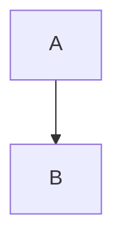

# Heading one

Some **bold**, *italic*, a [link](https://example.com) and `inline code`.

> A quote

- item

```ts
// comment
const answer: number = 42;
function greet(name: string) { return `hi ${name}`; }
```


