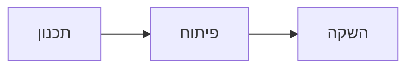

# תוכנית רבעונית



## מטרות

- להגדיל את מספר המשתמשים הפעילים
- לשפר את זמני הטעינה
- להשיק אפליקציה למובייל

## צוותים

### מוצר

- מחקר משתמשים
- אפיון פיצ׳רים

### הנדסה

- תשתית ענן
- ביצועים

## לוח זמנים

- חודש ראשון: תכנון
- חודש שני: פיתוח
- חודש שלישי: השקה

## מפת יעדים

```mindmap
- יעדים
  - משתמשים פעילים
  - זמני טעינה
  - אפליקציה למובייל
```
