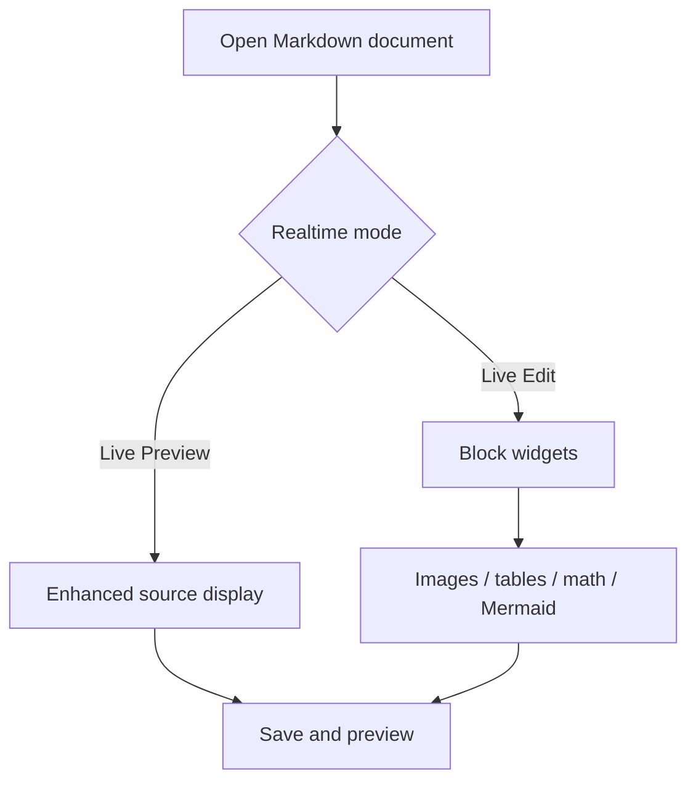
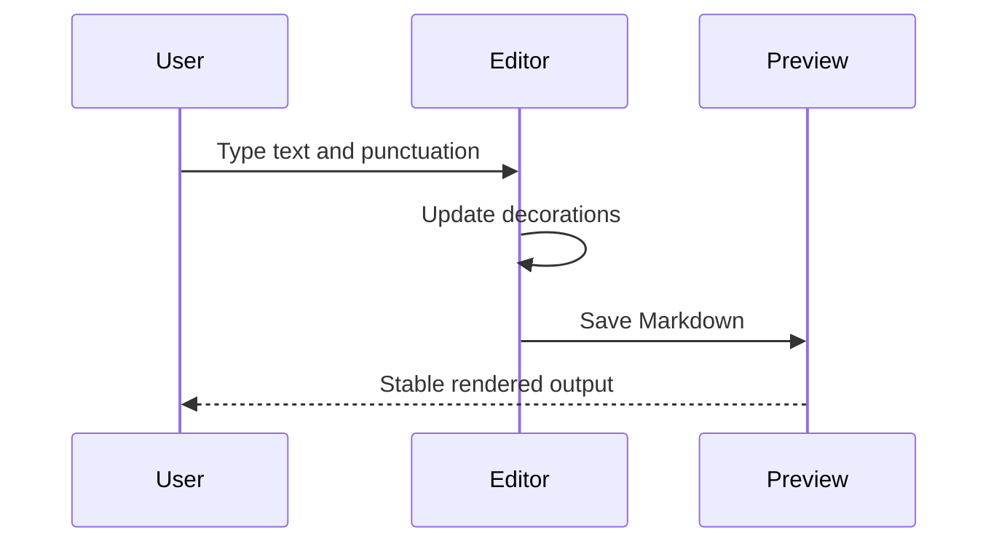

# SoloMD Realtime Markdown Support Test Document

This document tests the editor's realtime modes, not just the final preview. Watch three things while testing:

1. **Input reliability:** typing, selection, punctuation, and undo/redo behave normally.
2. **Realtime rendering reliability:** elements show their rendered state when the cursor moves away, and return to their source or editable state when the cursor moves back in.
3. **Preview consistency:** the right-hand preview pane, exported HTML/PDF files, and the realtime editing view look the same.

On Windows builds that use a native text area, the CodeMirror Live Edit widgets do not appear in the editor; use Split or Preview mode to check the rendered output there. On macOS, Linux, or any build with CodeMirror realtime editing enabled, run every Live Edit test case.

## 0. Test Procedure

1. Open `docs/fixtures/markdown-support-test.md` in SoloMD.
2. Cycle through the modes: Edit, Live Preview, Live Edit, Split, and Preview.
3. For each test block, place the cursor inside the source, then move it to the next line or an empty space.
4. Save the document and reopen it. Check that images, math, Mermaid diagrams, tables, and tldraw blocks are all still there.

## 1. Realtime Mode Acceptance Matrix

| Feature | Live Preview Expectation | Live Edit Expectation | Preview/Export Expectation |
| --- | --- | --- | --- |
| Heading | `#` fades or hides when the cursor moves away | Heading style appears when the cursor moves away; source visible when the cursor enters | Rendered as a heading |
| Bold/Italic/Strikethrough | Markup fades when the cursor leaves the line | Markup hides and the style applies when the cursor moves away | Rendered as styled text |
| Link | Label is readable; source remains editable | Label appears when the cursor moves away; full Markdown shown when the cursor enters | Rendered as a link |
| Standalone Image | Source remains editable | Image widget appears when the cursor moves away | Image displays stably |
| Table | Source remains editable | Table widget appears when the cursor leaves the table | Rendered as a table |
| Inline Math | Source remains editable | Inline formula appears when the cursor leaves the line | Rendered as a formula |
| Block Math | Source remains editable | Math widget appears when the cursor leaves the formula block | Rendered as a formula |
| Mermaid | Source remains editable | Diagram appears when the cursor leaves the code block | Rendered as a diagram |
| tldraw | Source remains editable or the canvas displays | Whiteboard widget displays | Whiteboard placeholder or canvas |
| Frontmatter | Source remains editable | Does not disrupt editing | Not shown as part of the body |
| Footnote | Source remains editable | No widget required in the editor | Navigable in Preview |

## 2. Cursor Visibility and Styling: Headings and Inline Styles

# Live H1: Should display as an H1 heading when the cursor moves away

## Live H2: Should display as an H2 heading when the cursor moves away

### Live H3: Should display as an H3 heading when the cursor moves away

A standard paragraph containing **bold text**, *italic text*, ***bold-italic text***, ~~strikethrough text~~, `inline code`, and ==highlighted text==.

Link test: [SoloMD GitHub](https://github.com/zhitongblog/solomd "SoloMD"). When the cursor moves away from the link it should show a readable label; when the cursor enters the link the full Markdown source should be visible.

Automatic link test: https://example.com/path?a=1&b=2

Email automatic link: test@example.com

HTML entity test: AT&amp;T, &lt;tag&gt;, &copy;

## 3. Lists, Blockquotes, and Task Items

- Unordered list item 1
- Unordered list item 2, containing **bold text** and a [link](https://example.com)
  - Nested list item
  - `code` within a nested list item

1. Ordered list item 1
2. Ordered list item 2
3. Ordered list item 3

- [ ] Incomplete task
- [x] Completed task

> Blockquote line 1: the blockquote marker should fade or hide when the cursor moves away.
>
> Blockquote line 2, containing **bold text**, `code`, and a [link](https://example.com).

## 4. Code Blocks

Markdown inside inline code should not be rendered: `**not bold**`, `$not_math$`, `[not link](https://example.com)`.

```ts
type MarkdownCase = {
  name: string;
  realtime: boolean;
  expected: "source" | "rendered" | "preview-only";
};

const sample: MarkdownCase = {
  name: "Typing and realtime rendering",
  realtime: true,
  expected: "rendered",
};
```

```bash
pnpm install
pnpm build
pnpm test
```

## 5. Live Edit Block Widgets: Standalone Image Lines

The next line must stay a standalone image line: add no text before or after it. In Live Edit the image widget should appear when the cursor leaves the line, and the source should reappear when the cursor returns.


The line below holds an inline image; Live Edit should not collapse the whole line into an image widget:

Text before and after an inline image:  — this line should stay easy to edit.

Image stability regression checks:

- The image is visible when the file first opens.
- The image is still visible after switching to another document and back.
- The image is visible after saving and reopening the file.
- Relative paths under `imageRoot: ./assets` resolve correctly.

## 6. Live Edit Block Widgets: Tables

With the cursor inside a table the source should be editable; with the cursor outside the table it should display as a table widget.

| Type | Markdown Source | Expected in Live Mode | Expected in Preview |
| --- | --- | --- | --- |
| Bold | `**bold**` | Bold, or readable source | Bold |
| Link | `[label](url)` | Readable label; source still reachable | Clickable link |
| Alignment | `:---:` | Column width stays intact | Rendered as a table |

Aligned table:

| Left-aligned | Centered | Right-aligned |
| :--- | :---: | ---: |
| alpha | beta | 100 |
| gamma | Mixed content | 200 |

## 7. Live Edit: Math

Inline formulas: Einstein's equation $E = mc^2$, Pythagorean theorem $a^2 + b^2 = c^2$.

None of these should be read as inline formulas:

- A price like $5.
- An escaped dollar sign: \$x$.
- An empty formula: `$ $`.
- `$x + y$` inside inline code.

Block formula; a math widget should appear once the cursor leaves the whole block:

$$
\int_{-\infty}^{\infty} e^{-x^2} dx = \sqrt{\pi}
$$

Single-line block formula:

$$a^2 + b^2 = c^2$$

## 8. Live Edit: Mermaid

The source shows while the cursor is inside the code block; the diagram renders once the cursor leaves it. No unexpected blank space should appear when switching documents or scrolling back.





## 9. Live Edit: tldraw

In Live Edit a tldraw code block should appear as a whiteboard widget. In Preview or export, where the full whiteboard runtime is unavailable, the page layout must stay intact.

```tldraw height="520" width=""
{
  "document": {
    "store": {
      "document:document": {
        "gridSize": 10,
        "name": "",
        "meta": {},
        "id": "document:document",
        "typeName": "document"
      },
      "page:page": {
        "meta": {},
        "id": "page:page",
        "name": "Page 1",
        "index": "a1",
        "typeName": "page"
      }
    },
    "schema": {
      "schemaVersion": 2,
      "sequences": {
        "com.tldraw.store": 5,
        "com.tldraw.asset": 1,
        "com.tldraw.camera": 1,
        "com.tldraw.document": 2,
        "com.tldraw.instance": 26,
        "com.tldraw.instance_page_state": 5,
        "com.tldraw.page": 1,
        "com.tldraw.instance_presence": 6,
        "com.tldraw.pointer": 1,
        "com.tldraw.shape": 4,
        "com.tldraw.asset.bookmark": 2,
        "com.tldraw.asset.image": 6,
        "com.tldraw.asset.video": 5,
        "com.tldraw.shape.arrow": 8,
        "com.tldraw.shape.bookmark": 2,
        "com.tldraw.shape.draw": 4,
        "com.tldraw.shape.embed": 4,
        "com.tldraw.shape.frame": 1,
        "com.tldraw.shape.geo": 11,
        "com.tldraw.shape.group": 0,
        "com.tldraw.shape.highlight": 3,
        "com.tldraw.shape.image": 5,
        "com.tldraw.shape.line": 5,
        "com.tldraw.shape.note": 10,
        "com.tldraw.shape.text": 4,
        "com.tldraw.shape.video": 4,
        "com.tldraw.binding.arrow": 1
      }
    }
  },
  "session": {
    "version": 0,
    "currentPageId": "page:page",
    "exportBackground": true,
    "isFocusMode": false,
    "isDebugMode": false,
    "isToolLocked": false,
    "isGridMode": false,
    "pageStates": [
      {
        "pageId": "page:page",
        "camera": {
          "x": 0,
          "y": 0,
          "z": 1
        },
        "selectedShapeIds": [],
        "focusedGroupId": null
      }
    ]
  }
}
```

## 10. Preview-only Syntax

This syntax is mainly checked in Preview and export. Live Edit needs no interactive widget for it, but it must not interfere with realtime input.

Footnote reference: here is a footnote.[^note]

Another footnote reference: realtime mode should stay smooth with footnotes present.[^input]

[^note]: Footnote content; it should be numbered correctly and navigable in Preview.
[^input]: Footnotes can also contain **bold** text, `code`, and [links](https://example.com).

Wiki links:

- [[README]]
- [[README|Custom Title]]
- [[README#Installation]]
- [[Another Page|Alias]]

Tags: #markdown #RealtimeMode

Raw HTML:

<details>
<summary>Expand HTML details</summary>

Content inside an HTML `<details>` element. It should expand in Preview and stay editable in the editor.

</details>

<table>
  <thead>
    <tr><th>HTML table</th><th>Expected</th></tr>
  </thead>
  <tbody>
    <tr><td>Preview</td><td>Rendered as an HTML table</td></tr>
    <tr><td>Live Edit</td><td>No table widget required</td></tr>
  </tbody>
</table>

## 11. Horizontal Rules and Edge-case Input

---

Three asterisks should render as a horizontal rule:

***

Backslash escapes: \*not italic\*, \[not a link\]\(url\), \# not a heading.

Angle-bracket autolinks: <https://example.com> and <test@example.com>.

## 12. Slide Separators

The `---` below can be used to check presentation or paged export. A plain horizontal rule in normal Markdown preview is also acceptable.

---

# Second Page Heading

This page checks that the cursor position stays correct after scrolling, paging, and switching realtime modes.

## 13. Regression Checklist

| Check | Pass criterion | Result |
| --- | --- | --- |
| Cursor enters a heading | `#` visible and editable |  |
| Cursor leaves a heading | Heading style shown |  |
| Cursor enters a link | Full `[label](url)` visible |  |
| Cursor leaves a link | Readable link label shown |  |
| Standalone image | Image widget or Preview image shown |  |
| Table | Table shown when cursor is outside; source editable inside |  |
| Inline math | Formula shown when cursor is outside; prices not mistaken for math |  |
| Block math | Formula block shown when cursor is outside |  |
| Mermaid | Diagram shown when cursor is outside; no blank space after scrolling |  |
| tldraw | Editing and preview not broken |  |
| Save and reopen | Images and diagrams do not disappear |  |
| Export | HTML/PDF content matches Preview |  |

## 14. Manual Notes

Test environment:

- Operating system:
- SoloMD version:
- Live Edit enabled:
- Split/Preview enabled:

Issues found:

1.
2.
3.
