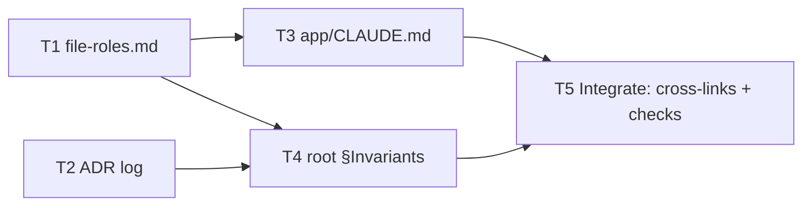

# Wave 0 PR-1: Conventions, ADR Log, CLAUDE.md Layering — Implementation Plan

> **For agentic workers:** REQUIRED SUB-SKILL: Use superpowers:subagent-driven-development (recommended) or superpowers:executing-plans to implement this plan task-by-task. Steps use checkbox (`- [ ]`) syntax for tracking.

**Goal:** Add the written rules that every later wave depends on: the file-role naming convention, an ADR log with the first two decisions, root `CLAUDE.md` invariants, and an `app/CLAUDE.md` router.

**Architecture:** Docs only. Built bottom-up in three layers. Layer 1 holds leaf docs that cite nothing new. Layer 2 holds the two `CLAUDE.md` files that cite Layer 1. Layer 3 adds the cross-links and runs the checks. Tasks in the same layer touch separate files and run in parallel.

**Tech Stack:** Markdown. Verification uses `bash`, `grep`, `wc`.

**Spec:** `docs/design/wave-refactor/2026-10-30-wave0-guardrails-lld.md` (§PR-1), parent HLD `docs/design/wave-refactor/2026-10-30-wave-refactor-hld.md` v3.0

## Global Constraints

- Docs only. No file under `app/src/`, `app/src-tauri/`, `mcp-mindmap/` changes.
- Each new file reads in ≤ 5 min: ≤ 1000 words (`wc -w`).
- Markdown links (`[x](path)`) only to files that exist when the task commits. Files from later PRs or waves are named in backticks, never linked.
- Prose style: short sentences, tables and bullets over paragraphs.
- Commit on `main` (branch creation is blocked in this environment). Do not push.
- Every commit message ends with `Co-Authored-By: Claude Opus 5.5 <noreply@anthropic.com>`.

## Deviation from the LLD

The LLD's root `CLAUDE.md` row says "§Greenness ladder (filled by PR-3)". This plan does **not** add an empty heading, because an empty section is a placeholder. PR-3 adds the whole section.

---

## Dependency graph



| Layer | Tasks (parallel within layer) | Depends on | Files touched |
|---|---|---|---|
| 1 — Define leaves | T1, T2 | — | `docs/conventions/` · `docs/adr/` |
| 2 — Layer docs | T3, T4 | T1 (T3); T1 + T2 (T4) | `app/CLAUDE.md` · `CLAUDE.md` §Invariants |
| 3 — Integrate | T5 | T3, T4 | `CLAUDE.md` §Layout, `docs/design/adr/README.md` index |

T3 can start as soon as T1 commits; it does not wait for T2.

## Parallel execution protocol

1. Dispatch all tasks of one layer at once. Each worker writes **only** its listed files.
2. Workers do **not** run `git commit`. Parallel commits in one checkout race on `.git/index.lock`.
3. The orchestrator commits each finished task on its own, staging that task's paths only (the commit step in each task).
4. Start the next layer once all of its dependencies are committed.

## Shared check: link checker

T3, T4 and T5 use this script. Save it to the scratchpad, not the repo.

```bash
#!/usr/bin/env bash
# usage: check-links.sh FILE...   → prints BROKEN lines, exits 1 if any
status=0
for f in "$@"; do
  dir=$(dirname "$f")
  grep -oE '\]\([^)#[:space:]]+' "$f" | sed 's/^](//' | grep -vE '^https?:' | while read -r p; do
    [ -e "$dir/$p" ] || { echo "BROKEN $f -> $p"; exit 1; }
  done || status=1
done
exit $status
```

---

### Task 1: File-role convention (Layer 1)

**Files:**
- Create: `docs/conventions/file-roles.md`

**Interfaces:**
- Consumes: nothing.
- Produces: the role names `port`, `adapter`, `schema`, `service`, `feature`, `store`, `prompt`, `test`, `arch.test`, and the feature folder shape `features/<f>/{contracts,internal,ui,CLAUDE.md}`. T3 and T4 cite this file by path.

- [ ] **Step 1: Write the file**

````markdown
# File roles

A file's suffix says what it is allowed to do. An agent reads the name and knows the rules before opening the file.

**Applies to new and moved files only.** Do not rename a file just to add a role. Wave work renames files as it moves them.

## Roles

| Suffix | Contains | Must not contain |
|---|---|---|
| `.port.ts` | One interface + its Zod schemas for inputs and outputs | Implementations, `@tauri-apps/*`, Vue |
| `.adapter.ts` | One implementation of one port (`tauri`, `web`, `canned`) | Business rules; exports beyond the port's shape |
| `.schema.ts` | Zod schemas and inferred types only | Side effects, I/O |
| `.service.ts` | Stateful logic behind a plain TS API | `vue`, `pinia` imports |
| `.feature.ts` | Registers one feature into a host (commands, CM extensions, settings slice, i18n keys) | Logic that belongs in a service |
| `.store.ts` | One Pinia store | Direct IPC (call a port) |
| `.prompt.ts` | One AI prompt template + its input schema | Provider calls |
| `.test.ts` | Unit tests, co-located with the file under test | — |
| `.arch.test.ts` | Architecture specs under `app/arch/` | — |

## Naming

- Base name: kebab-case, then the role: `file-system.port.ts`, `file-system.tauri.adapter.ts`, `git-pane.store.ts`.
- Adapter names put the target before the role: `<port>.<target>.adapter.ts`.
- Tests mirror the file: `file-system.port.ts` → `file-system.port.test.ts`.
- Vue components keep PascalCase `.vue`. They take no role suffix.
- A file with no clear single role is a sign to split it.

## Feature folder

```
app/src/features/<feature>/
├── contracts/   public surface: ports, schemas, the .feature.ts entry
├── internal/    private: services, stores, adapters
├── ui/          Vue components
└── CLAUDE.md    what the feature does, its contracts, its tests
```

- Other code imports a feature only through `contracts/`.
- `internal/` is private. An arch spec enforces this from Wave 0 PR-2.
````

- [ ] **Step 2: Check size**

Run: `wc -w docs/conventions/file-roles.md`
Expected: a number ≤ 1000.

- [ ] **Step 3: Commit (orchestrator)**

```bash
git add docs/conventions/file-roles.md
git commit -m "docs(conventions): add file-role suffix convention

Co-Authored-By: Claude Opus 5.5 <noreply@anthropic.com>"
```

---

### Task 2: ADR log with ADR 0001 and 0002 (Layer 1)

**Files:**
- Create: `docs/design/adr/README.md`
- Create: `docs/design/adr/0001-wave-refactor.md`
- Create: `docs/design/adr/0002-arch-specs-not-eslint.md`

**Interfaces:**
- Consumes: nothing new. Links only to the HLD and LLD, which exist.
- Produces: ADR format and the path `docs/adr/`. T4 cites it. T5 adds the index rows to `docs/design/adr/README.md`.

- [ ] **Step 1: Write `docs/design/adr/README.md`**

````markdown
# Architecture Decision Records

One file per decision that is expensive to reverse.

**Accepted ADRs are settled. Do not re-derive or re-argue them.** To change one, write a new ADR that supersedes it.

## Format

File: `NNNN-kebab-title.md`, numbered in order, never reused.

```markdown
# NNNN. Title

**Status**: accepted | superseded by NNNN · **Date**: YYYY-MM-DD

## Context
What forces the decision. Facts, numbers, links.

## Decision
What we do. One short paragraph or a list.

## Consequences
What gets easier, what gets harder, what we now must do.
```

## Rules

- Only `Status` changes after acceptance. Everything else is frozen.
- Link the spec the decision comes from.
- Keep it under one page.

## Index
````

- [ ] **Step 2: Write `docs/design/adr/0001-wave-refactor.md`**

````markdown
# 0001. Restructure solomd-rtl in waves

**Status**: accepted · **Date**: 2026-10-30

## Context

- The app grew feature-first. God files: `Editor.vue` 5026 lines, `FileTree.vue` 2943, `ai_proxy.rs` 2933, `SettingsPanel.vue` 2614, `App.vue` 2511, `stores/settings.ts` 1793.
- About 100 raw `invoke()` calls sit in 58 files.
- Large files and untyped IPC make every agent edit riskier.
- Full design: [HLD v3.0](../wave-refactor/2026-10-30-wave-refactor-hld.md).

## Decision

1. Restructure in five waves, each shipped as a release:
   0 Guardrails → 1 Platform → 2 Editor → 3 Settings & shell → 4 AI.
2. Each wave runs two tracks: **Define** (contracts) and **Decompose** (split god files). They meet at an **Integrate** gate.
3. Target layout: `app/src/{platform,ai,features/<f>,shell,lib}`.
4. Platform access goes through TS ports with Zod schemas and two adapters: `tauri` (desktop) and `web`. No mobile adapters.
5. Wiring uses a feature registry plus Vue `provide/inject`. No DI container.
6. The fork is independent of upstream SoloMD. Files move into `features/` freely.
7. File size uses a ratchet: today's oversize files are recorded and may only shrink. Budgets: `.ts` ≤ 400 lines, `.vue` ≤ 500, `.rs` ≤ 600 by the end of Wave 4.
8. AI is last, because AI features are not in use yet. `ai-rewrite` stays behind a thin shim from Wave 2 to Wave 4.

## Consequences

- Easier: small files an agent can hold whole; typed IPC; one place to swap providers.
- Harder: two waves of shim code for AI; many file moves in review diffs.
- Must: keep the test count from dropping; keep each PR diff ≤ ~500 lines excluding moves.
````

- [ ] **Step 3: Write `docs/design/adr/0002-arch-specs-not-eslint.md`**

````markdown
# 0002. Architecture rules as `node --test` specs, not ESLint

**Status**: accepted · **Date**: 2026-10-30

## Context

- The repo has no ESLint. `app/package.json` runs unit tests with `node --test`.
- Wave rules need checks: file size, raw IPC imports, `lib/` purity, feature privacy.
- Some files already break these rules. Wave 0 must not touch runtime code.
- Full design: [Wave 0 LLD](../wave-refactor/2026-10-30-wave0-guardrails-lld.md).

## Decision

1. Write each rule as a spec in `app/arch/*.arch.test.ts`, run by `node --test`.
2. Record existing violations in `app/arch/baseline.json`. Entries may be removed or lowered, never added or raised.
3. Each failure message starts with `[arch:<rule>]` and says how to fix it.

## Consequences

- Easier: no new dependencies; same runner and speed as the existing unit tests; rules are plain TS.
- Harder: no editor squiggles; import parsing is ours to maintain.
- Must: keep `app/arch/` specs under ~1s total so `guard` stays ≤ 15s.
````

- [ ] **Step 4: Check size and links**

Run: `wc -w docs/adr/*.md && bash <scratchpad>/check-links.sh docs/adr/*.md`
Expected: every count ≤ 1000; no `BROKEN` lines; exit 0.

- [ ] **Step 5: Commit (orchestrator)**

```bash
git add docs/design/adr/README.md docs/design/adr/0001-wave-refactor.md docs/design/adr/0002-arch-specs-not-eslint.md
git commit -m "docs(adr): add ADR log with wave refactor and arch-spec decisions

Co-Authored-By: Claude Opus 5.5 <noreply@anthropic.com>"
```

---

### Task 3: `app/CLAUDE.md` router (Layer 2)

**Files:**
- Create: `app/CLAUDE.md`

**Interfaces:**
- Consumes: `docs/conventions/file-roles.md` (T1).
- Produces: `app/CLAUDE.md`. T5 links it from the root Layout table.

- [ ] **Step 1: Write the file**

````markdown
# app/

Vue 3 + CodeMirror 6 + Pinia front end. `src-tauri/` is the Rust desktop shell. Project rules live in the root `CLAUDE.md` §Invariants. File naming: [file roles](../docs/conventions/file-roles.md).

## Map

| Path | Today | Wave target |
|---|---|---|
| `src/App.vue` | Root host, ~2500 lines | Split into `shell/` + services (Wave 1) |
| `src/components/` | ~118 flat Vue components; `git/`, `properties/` subfolders | Empties into `features/<f>/ui/` by Wave 4 |
| `src/composables/` | `use*` hooks | Move with their feature |
| `src/stores/` | Pinia stores; `settings.ts` holds all settings | Per-feature settings slices (Wave 3) |
| `src/lib/` | Pure TS: CM extensions (`cm-*.ts`), parsers, `theme/`, `git-pane/` | Stays. Pure: no `vue`, `pinia`, `@tauri-apps/*` |
| `src/ui/` | `Ds*` design-system primitives | Stays |
| `src/i18n/` | Locale tables. New strings go in `en.ts` | Keys move into features (Wave 2+) |
| `src/styles/` | Global CSS and tokens | Stays |
| `src/dev/` | Dev-only render harnesses | Stays |
| `src-tauri/src/` | Rust commands (`commands.rs`, `ai_proxy.rs`, `git_pane/`) | Grouped by domain, mirroring `platform/` |
| `e2e/` | Playwright theme e2e (macOS baselines) | Stays |

Planned folders, not created yet: `src/platform/` (Wave 1), `src/features/` (Wave 1+), `src/shell/` (Wave 1), `src/ai/` (Wave 4), `arch/` (Wave 0 PR-2).

## Tests

| Kind | Where | Run |
|---|---|---|
| Unit | Co-located `src/**/*.test.ts` | `pnpm --dir app test` |
| Types | All of `src/` | `pnpm --dir app exec vue-tsc --noEmit` |
| e2e | `e2e/` | `pnpm --dir app exec playwright test --config e2e/playwright.config.ts` (macOS) |
| Arch | `arch/*.arch.test.ts` (from Wave 0 PR-2) | `pnpm --dir app arch` (from PR-3) |

Unit tests run on Node type-stripping: import local files with the `.ts` extension.

## Which CLAUDE.md to read

| Working in | Read first |
|---|---|
| Anywhere | Root `CLAUDE.md` |
| `src/features/<f>/` | That feature's `CLAUDE.md` (each feature gets one from Wave 1) |
| `arch/` | `arch/CLAUDE.md` (from Wave 0 PR-2) |
| `src/lib/theme/` | `docs/design/2026-10-29-theme-layer-design.md` |
| `../demos/` | [demos/CLAUDE.md](../demos/CLAUDE.md) |

Changed code in an area? Update that area's `CLAUDE.md` in the same commit.
````

- [ ] **Step 2: Check size and links**

Run: `wc -w app/CLAUDE.md && bash <scratchpad>/check-links.sh app/CLAUDE.md`
Expected: ≤ 1000 words; no `BROKEN` lines; exit 0.

- [ ] **Step 3: Check the map against the tree**

Run: `ls app/src`
Expected: every entry except `assets`, `main.ts`, `types.ts`, `vite-env.d.ts` appears in the Map table. If a folder is missing from the table, add a row.

- [ ] **Step 4: Commit (orchestrator)**

```bash
git add app/CLAUDE.md
git commit -m "docs(app): add app/CLAUDE.md router

Co-Authored-By: Claude Opus 5.5 <noreply@anthropic.com>"
```

---

### Task 4: Root `CLAUDE.md` §Invariants (Layer 2)

**Files:**
- Modify: `CLAUDE.md` — insert a new `## Invariants` section between the intro line (line 3) and `## Layout`. Touch nothing else in this task.

**Interfaces:**
- Consumes: `docs/conventions/file-roles.md` (T1), `docs/adr/` (T2).
- Produces: the invariant list. PR-2 and later waves enforce items 2–5.

- [ ] **Step 1: Insert the section after line 3**

```markdown
## Invariants

These hold in every wave. Break one only through a new ADR.

1. **Spec wins.** If code disagrees with an accepted spec or ADR, fix the code or write a superseding ADR. Accepted ADRs in [docs/adr/](docs/design/adr/README.md) are settled.
2. **Ratchets only shrink.** Arch baselines (`app/arch/baseline.json`, from Wave 0 PR-2) may lose entries or lower values, never gain or raise.
3. **IPC through ports.** Once `app/src/platform/` exists (Wave 1), only it imports `@tauri-apps/*`.
4. **`lib/` stays pure.** `app/src/lib/` imports no `vue`, `pinia` or `@tauri-apps/*`.
5. **Features are private.** Import another feature only through its `contracts/`.
6. **Doc sync.** Code change ⇒ update the nearest `CLAUDE.md` in the same commit.
7. **File roles.** New and moved files follow [file roles](docs/conventions/file-roles.md).
```

- [ ] **Step 2: Check links and that the rest is untouched**

Run: `bash <scratchpad>/check-links.sh CLAUDE.md && git diff --stat CLAUDE.md`
Expected: no `BROKEN` lines; diff shows only insertions (`+`), no deletions.

- [ ] **Step 3: Commit (orchestrator)**

```bash
git add CLAUDE.md
git commit -m "docs(claude-md): add root invariants

Co-Authored-By: Claude Opus 5.5 <noreply@anthropic.com>"
```

---

### Task 5: Integrate — cross-links and final checks (Layer 3)

**Files:**
- Modify: `CLAUDE.md` §Layout table — change the `app/` row; add two rows.
- Modify: `docs/design/adr/README.md` — fill the `## Index` section.

**Interfaces:**
- Consumes: every file from T1–T4.
- Produces: nothing new. Closes PR-1.

- [ ] **Step 1: Update the root Layout table**

Replace the row

```markdown
| `app/` | The editor (Vue/Vite web build + `src-tauri/` desktop shell) |
```

with

```markdown
| `app/` | The editor (Vue/Vite web build + `src-tauri/` desktop shell) — see [app/CLAUDE.md](app/CLAUDE.md) |
| `docs/adr/` | Architecture decisions. Accepted = settled — see [README](docs/design/adr/README.md) |
| `docs/conventions/` | Naming rules — see [file roles](docs/conventions/file-roles.md) |
```

- [ ] **Step 2: Fill the ADR index**

Append under `## Index` in `docs/design/adr/README.md`:

```markdown
| # | Title | Status |
|---|---|---|
| [0001](0001-wave-refactor.md) | Restructure solomd-rtl in waves | accepted |
| [0002](0002-arch-specs-not-eslint.md) | Architecture rules as `node --test` specs, not ESLint | accepted |
```

- [ ] **Step 3: Run all checks**

```bash
bash <scratchpad>/check-links.sh CLAUDE.md app/CLAUDE.md docs/conventions/file-roles.md docs/adr/*.md
```

Expected: no output, exit 0.

```bash
wc -w CLAUDE.md app/CLAUDE.md docs/conventions/file-roles.md docs/adr/*.md
```

Expected: every file ≤ 1000 words.

```bash
git diff --name-only 9dc0efb3 -- app/src app/src-tauri mcp-mindmap
```

Expected: no output (no runtime files touched).

```bash
pnpm --dir app test
```

Expected: exit 0, 1153 tests pass (unchanged baseline).

- [ ] **Step 4: Commit (orchestrator)**

```bash
git add CLAUDE.md docs/design/adr/README.md
git commit -m "docs: link app router, ADR log and conventions from root CLAUDE.md

Co-Authored-By: Claude Opus 5.5 <noreply@anthropic.com>"
```

- [ ] **Step 5: Confirm clean tree**

Run: `git status --porcelain`
Expected: no output. PR-1 is done: 5 commits on `main`, not pushed.

---

## Spec coverage

| LLD §PR-1 row | Task |
|---|---|
| `docs/conventions/file-roles.md` (9 roles, new/moved only, feature folder shape) | T1 |
| `docs/design/adr/README.md` (format, "settled — don't re-derive") | T2, index in T5 |
| `docs/design/adr/0001-wave-refactor.md` (wave order, TS ports, registry DI, ratchet) | T2 |
| `docs/design/adr/0002-arch-specs-not-eslint.md` | T2 |
| Root `CLAUDE.md` §Invariants (spec wins, ratchet, no raw invoke, doc sync); keep Layout | T4, Layout links in T5 |
| Root `CLAUDE.md` §Greenness ladder | Deferred to PR-3 (see Deviation) |
| `app/CLAUDE.md` router (folder map, tests, which `CLAUDE.md`) | T3 |
| Reading time ≤ 5 min per file | Word check in T1–T5 |
