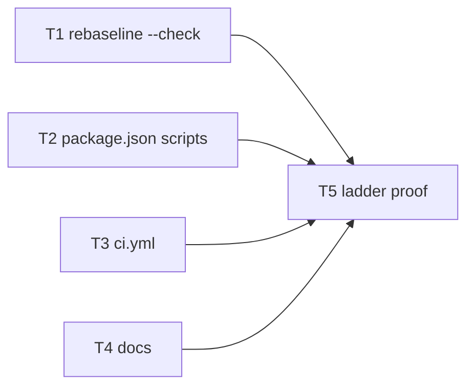

# Wave 0 PR-3: Greenness Ladder + PR CI — Implementation Plan

> **For agentic workers:** REQUIRED SUB-SKILL: Use superpowers:subagent-driven-development (recommended) or superpowers:executing-plans to implement this plan task-by-task. Steps use checkbox (`- [ ]`) syntax for tracking.

**Goal:** Give agents and CI one command per rung — `guard` after every edit, `verify` before each commit, `full` before a wave's Integrate gate — plus a "baseline is tight" check, and run the cheap rungs on every PR.

**Architecture:** Four independent lanes written in parallel against one fixed contract (the script names and the `--check` flag below), then one integration task that proves the ladder end to end. `rebaseline.ts --check` reports slack without writing, so the tight check works before a commit (no `git diff` against the index).

**Tech Stack:** pnpm 10 scripts (`app/package.json`), Node 22 `node --test`, GitHub Actions (`ubuntu-latest`).

**Spec:** `docs/design/wave-refactor/2026-10-30-wave0-guardrails-lld.md` §PR-3, including "Carried from the PR-2 final review"; HLD `docs/design/wave-refactor/2026-10-30-wave-refactor-hld.md` v3.1

## Global Constraints

- Zero new dependencies.
- No runtime code changes: nothing under `app/src/`, `app/src-tauri/`, `mcp-mindmap/` is edited.
- `guard` ≤ 15s (measured today: arch 1s + unit 4s + vue-tsc 7s ≈ 12s).
- Exit code is the only signal. Every script exits non-zero on any failure.
- CI: `pull_request` + push to `main`, `ubuntu-latest`, Node pinned `22.19`, pnpm 10. No cargo, no e2e in CI.
- Root `CLAUDE.md` §Invariants was hand-edited by the user (commit `3059aa6f`). Do not touch it.
- Commit on `main`. Do not push. Commit messages end with `Co-Authored-By: Claude Opus 5.5 <noreply@anthropic.com>`.

## Contract (every lane codes against this)

| Name | Defined in | Behavior |
|---|---|---|
| `node arch/rebaseline.ts --check` | T1 | Never writes. Exit 1 on any increase (same messages as today). Exit 1 with `[arch:tight] …` lines if the baseline has slack. Exit 0 and print `baseline is tight: fileSize N, rawIpc N, libPurity N` otherwise |
| `arch` | T2 | `node --test "arch/**/*.test.ts"` |
| `arch:rebaseline` | T2 | `node arch/rebaseline.ts` |
| `arch:tight` | T2 | `node arch/rebaseline.ts --check` |
| `guard` | T2 | `arch` → `test` → `vue-tsc --noEmit` |
| `verify` | T2 | `guard` → `arch:tight` → `vite build` → `cargo check` → mcp-mindmap tests |
| `full` | T2 | `verify` → `cargo test` → Playwright e2e |
| CI job `guard` | T3 | install → `guard` → `arch:tight` → `vite build` |

## Rulings carried into this plan

| # | Decision | Why |
|---|---|---|
| R1 | Tight check is `rebaseline.ts --check`, not `rebaseline && git diff --exit-code` (the LLD note) | `git diff` fails a correctly rebaselined but not-yet-committed file, which breaks "verify before each commit" |
| R2 | `arch:tight` runs in `verify` and CI, not in `guard` | Mid-refactor shrinks should not fail the after-every-edit rung |
| R3 | CI runs `vite build` via `pnpm --dir app exec vite build`, not `build` | `build` repeats `vue-tsc`, which `guard` already ran |

## Dependency graph



| Layer | Tasks (parallel) | Starts when |
|---|---|---|
| 1 — Lanes | T1 ∥ T2 ∥ T3 ∥ T4 | now (all code against the Contract) |
| 2 — Integrate | T5 | T1–T4 committed |

## Parallel execution protocol

1. Dispatch T1–T4 at once. Each worker writes **only** its listed files.
2. Workers do **not** run `git commit`; the orchestrator commits each task separately.
3. T2's own checks call `arch:tight`; if T1 is not committed yet, T2 skips that one check and T5 covers it.

---

### Task 1: `rebaseline.ts --check` (Layer 1)

**Files:**
- Modify: `app/arch/rebaseline.ts`
- Test: `app/arch/rebaseline.test.ts` (append; keep existing tests unchanged)

**Interfaces:**
- Consumes: existing `rebaseline(previous, measured)`, `measure`, `loadBaseline`, `type Baseline`.
- Produces: `slack(previous: Baseline, next: Baseline): string[]` and CLI flag `--check`.

- [ ] **Step 1: Append failing tests to `app/arch/rebaseline.test.ts`**

Add `slack` to the existing import from `./rebaseline.ts`, then append:

```typescript
test('slack is empty when nothing would change', () => {
  assert.deepEqual(slack(PREVIOUS, PREVIOUS), []);
});

test('slack lists every entry a rebaseline would lower or drop', () => {
  const next: Baseline = {
    version: 1,
    fileSize: { 'app/src/big.vue': 650 },
    rawIpc: ['app/src/ipc.ts'],
    libPurity: [],
  };
  assert.deepEqual(slack(PREVIOUS, next), [
    '[arch:tight] fileSize app/src/big.vue: 700 → 650',
    '[arch:tight] fileSize app/src/fixed.ts: 450 → removed',
    '[arch:tight] rawIpc app/src/old-ipc.ts: removed',
    '[arch:tight] libPurity app/src/lib/impure.ts: removed',
  ]);
});
```

- [ ] **Step 2: Run to verify it fails**

Run: `node --test app/arch/rebaseline.test.ts`
Expected: FAIL — `slack` is not exported (`SyntaxError: The requested module './rebaseline.ts' does not provide an export named 'slack'`).

- [ ] **Step 3: Implement in `app/arch/rebaseline.ts`**

Add next to `INIT_FLAG`:

```typescript
const CHECK_FLAG = '--check';
const TIGHT_HINT = 'baseline.json has slack. Run `pnpm --dir app arch:rebaseline` and commit baseline.json with the shrink. See app/arch/CLAUDE.md.';
```

Add after `rebaseline`:

```typescript
export function slack(previous: Baseline, next: Baseline): string[] {
  return [
    ...Object.entries(previous.fileSize).flatMap(([path, lines]) => {
      const now = next.fileSize[path];
      if (now === undefined) return [`[arch:tight] fileSize ${path}: ${lines} → removed`];
      return now < lines ? [`[arch:tight] fileSize ${path}: ${lines} → ${now}`] : [];
    }),
    ...droppedPaths('rawIpc', previous.rawIpc, next.rawIpc),
    ...droppedPaths('libPurity', previous.libPurity, next.libPurity),
  ];
}

function droppedPaths(key: string, previous: readonly string[], next: readonly string[]): string[] {
  const kept = new Set(next);
  return previous.filter((path) => !kept.has(path)).map((path) => `[arch:tight] ${key} ${path}: removed`);
}

function checkTight(previous: Baseline, next: Baseline): number {
  const lines = slack(previous, next);
  if (lines.length === 0) {
    console.log(`baseline is tight: ${summary(previous)}`);
    return EXIT_OK;
  }
  console.error([...lines, TIGHT_HINT].join('\n'));
  return EXIT_REFUSED;
}
```

Replace `main` with:

```typescript
function main(args: readonly string[]): number {
  const measured = measure(REPO_ROOT);
  if (args.includes(INIT_FLAG)) return init(measured);
  const previous = loadBaseline();
  const { baseline, increases } = rebaseline(previous, measured);
  if (increases.length > 0) {
    console.error([...increases, 'rebaseline refused: baseline values may only go down.'].join('\n'));
    return EXIT_REFUSED;
  }
  if (args.includes(CHECK_FLAG)) return checkTight(previous, baseline);
  writeFileSync(BASELINE_PATH, serializeBaseline(baseline));
  console.log(`baseline updated: ${summary(baseline)}`);
  return EXIT_OK;
}
```

- [ ] **Step 4: Run to verify it passes**

Run: `node --test app/arch/rebaseline.test.ts`
Expected: PASS, 5 tests.

- [ ] **Step 5: Check the CLI on the real repo**

```bash
shasum app/arch/baseline.json
node app/arch/rebaseline.ts --check; echo "exit $?"
shasum app/arch/baseline.json
```

Expected: `baseline is tight: fileSize 71, rawIpc 59, libPurity 21`, `exit 0`, both shasums equal.

- [ ] **Step 6: Commit (orchestrator)**

```bash
git add app/arch/rebaseline.ts app/arch/rebaseline.test.ts
git commit -m "feat(arch): add rebaseline --check for baseline slack

Co-Authored-By: Claude Opus 5.5 <noreply@anthropic.com>"
```

---

### Task 2: Ladder scripts in `app/package.json` (Layer 1)

**Files:**
- Modify: `app/package.json` (`scripts` block only)

**Interfaces:**
- Consumes: Contract (`--check` from T1).
- Produces: scripts `arch`, `arch:rebaseline`, `arch:tight`, `guard`, `verify`, `full`.

- [ ] **Step 1: Insert after the `"test"` line**

```json
    "arch": "node --test \"arch/**/*.test.ts\"",
    "arch:rebaseline": "node arch/rebaseline.ts",
    "arch:tight": "node arch/rebaseline.ts --check",
    "guard": "pnpm run arch && pnpm run test && vue-tsc --noEmit",
    "verify": "pnpm run guard && pnpm run arch:tight && vite build && cargo check --manifest-path src-tauri/Cargo.toml && pnpm --dir ../mcp-mindmap test",
    "full": "pnpm run verify && cargo test --manifest-path src-tauri/Cargo.toml && playwright test --config e2e/playwright.config.ts",
```

Keep every existing script unchanged.

- [ ] **Step 2: Check JSON and the fast rungs**

```bash
node -e "JSON.parse(require('fs').readFileSync('app/package.json','utf8'))" && echo json-ok
pnpm --dir app arch; echo "arch exit $?"
time pnpm --dir app guard; echo "guard exit $?"
```

Expected: `json-ok`; `arch exit 0`; `guard exit 0` with wall time ≤ 15s.

- [ ] **Step 3: Check the failure path of `guard`**

```bash
printf '\n' >> app/src/components/Editor.vue
pnpm --dir app guard; echo "guard exit $?"
git restore app/src/components/Editor.vue
git diff --exit-code -- app/src/components/Editor.vue && echo restored
```

Expected: output contains `[arch:file-size] app/src/components/Editor.vue has 5027 lines; baseline 5026.`, `guard exit` non-zero, then `restored`. The unit tests and vue-tsc do not run (the `&&` chain stops).

- [ ] **Step 4: Commit (orchestrator)**

```bash
git add app/package.json
git commit -m "chore(app): add greenness ladder scripts

Co-Authored-By: Claude Opus 5.5 <noreply@anthropic.com>"
```

---

### Task 3: PR CI workflow (Layer 1)

**Files:**
- Create: `.github/workflows/ci.yml`

**Interfaces:**
- Consumes: Contract (`guard`, `arch:tight` script names).
- Produces: CI job `guard`.

- [ ] **Step 1: Write `.github/workflows/ci.yml`**

```yaml
name: CI

on:
  pull_request:
  push:
    branches: [main]

concurrency:
  group: ci-${{ github.ref }}
  cancel-in-progress: true

permissions:
  contents: read

jobs:
  guard:
    name: guard + web build
    runs-on: ubuntu-latest
    timeout-minutes: 15
    steps:
      - uses: actions/checkout@v4

      - uses: pnpm/action-setup@v4
        with:
          version: 10

      - uses: actions/setup-node@v4
        with:
          node-version: '22.19'
          cache: pnpm
          cache-dependency-path: app/pnpm-lock.yaml

      - name: Install app dependencies
        run: pnpm --dir app install --frozen-lockfile

      - name: Guard (arch specs, unit tests, vue-tsc)
        run: pnpm --dir app guard

      - name: Baseline is tight
        run: pnpm --dir app arch:tight

      - name: Web build
        run: pnpm --dir app exec vite build
```

- [ ] **Step 2: Check it parses and has the required shape**

```bash
node --input-type=module -e "
import { readFileSync } from 'node:fs';
import { createRequire } from 'node:module';
const yaml = createRequire(process.cwd() + '/app/package.json')('js-yaml');
const wf = yaml.load(readFileSync('.github/workflows/ci.yml', 'utf8'));
const steps = wf.jobs.guard.steps.map((s) => s.run ?? s.uses);
console.log(JSON.stringify({ on: Object.keys(wf.on), node: wf.jobs.guard.steps[2].with['node-version'], steps }, null, 1));
"
```

Expected: `on` = `["pull_request","push"]`, `node` = `"22.19"` (a string), steps in order: checkout, pnpm setup, setup-node, install, `pnpm --dir app guard`, `pnpm --dir app arch:tight`, `pnpm --dir app exec vite build`.

CI itself is not exercised until the branch is pushed (not part of this plan).

- [ ] **Step 3: Commit (orchestrator)**

```bash
git add .github/workflows/ci.yml
git commit -m "ci: run guard, baseline tight check and web build on PRs

Co-Authored-By: Claude Opus 5.5 <noreply@anthropic.com>"
```

---

### Task 4: Docs — ladder section and command updates (Layer 1)

**Files:**
- Modify: `CLAUDE.md` (root) — new `## Greenness ladder` section between `## Invariants` and `## Layout`; two lines in `## Commands`. Do not touch §Invariants.
- Modify: `app/CLAUDE.md` — the `Arch` row of the Tests table
- Modify: `app/arch/CLAUDE.md` — `## Shrinking the baseline` and `## Run`

**Interfaces:**
- Consumes: Contract names.
- Produces: the docs agents read for the ladder.

- [ ] **Step 1: Root `CLAUDE.md` — insert before `## Layout`**

```markdown
## Greenness ladder

The exit code is the only signal. Never commit on red.

| Run | Covers | When |
|---|---|---|
| `pnpm --dir app guard` | arch specs → unit tests → `vue-tsc` (~12s) | After every edit |
| `pnpm --dir app verify` | guard → baseline tight → `vite build` → `cargo check` → mcp-mindmap tests (~1 min) | Before each commit |
| `pnpm --dir app full` | verify → `cargo test` → Playwright e2e (macOS only) | Before a wave's Integrate gate |

CI (`.github/workflows/ci.yml`) runs guard, the tight check and `vite build` on every PR and push to `main`.
```

- [ ] **Step 2: Root `CLAUDE.md` — `## Commands` block**

After the line `pnpm --dir app test     # node --test`, insert:

```bash
pnpm --dir app guard    # after every edit (see Greenness ladder)
pnpm --dir app verify   # before each commit
```

- [ ] **Step 3: `app/CLAUDE.md` — replace the Arch row**

Replace
`| Arch | \`arch/*.test.ts\` | \`node --test "arch/**/*.test.ts"\` (from \`app/\`); \`pnpm --dir app arch\` from PR-3 |`
with
`| Arch | \`arch/*.test.ts\` | \`pnpm --dir app arch\` |`

- [ ] **Step 4: `app/arch/CLAUDE.md` — `## Shrinking the baseline`**

- Replace the code block line `node app/arch/rebaseline.ts` with `pnpm --dir app arch:rebaseline`.
- Replace the sentence `CI checks this from Wave 0 PR-3.` with: `` `pnpm --dir app arch:tight` (`rebaseline.ts --check`) fails on any slack without writing; it runs in `verify` and in CI. ``

- [ ] **Step 5: `app/arch/CLAUDE.md` — `## Run`**

Replace the line `Commands run from the repo root.` and the code block below it with:

````markdown
```bash
pnpm --dir app arch         # all arch tests
pnpm --dir app arch:tight   # fail if baseline.json has slack
```
````

- [ ] **Step 6: Check links and size**

Run: `bash <scratchpad>/check-links.sh CLAUDE.md app/CLAUDE.md app/arch/CLAUDE.md && wc -w CLAUDE.md app/arch/CLAUDE.md`

The checker (save to the scratchpad, not the repo):

```bash
#!/usr/bin/env bash
status=0
for f in "$@"; do
  dir=$(dirname "$f")
  grep -oE '\]\([^)#[:space:]]+' "$f" | sed 's/^](//' | grep -vE '^https?:' | while read -r p; do
    [ -e "$dir/$p" ] || { echo "BROKEN $f -> $p"; exit 1; }
  done || status=1
done
exit $status
```

Expected: no `BROKEN` lines; each file ≤ 1000 words; `git diff CLAUDE.md` shows no change inside §Invariants.

- [ ] **Step 7: Commit (orchestrator)**

```bash
git add CLAUDE.md app/CLAUDE.md app/arch/CLAUDE.md
git commit -m "docs: document the greenness ladder and arch scripts

Co-Authored-By: Claude Opus 5.5 <noreply@anthropic.com>"
```

---

### Task 5: Ladder proof (Layer 2)

**Files:** none changed (temporary mutations are restored).

**Interfaces:**
- Consumes: everything from T1–T4.

- [ ] **Step 1: Fast rungs pass**

```bash
time pnpm --dir app guard; echo "guard exit $?"
pnpm --dir app arch:tight; echo "tight exit $?"
```

Expected: `guard exit 0` in ≤ 15s; `baseline is tight: fileSize 71, rawIpc 59, libPurity 21`, `tight exit 0`.

- [ ] **Step 2: `verify` passes**

Run: `pnpm --dir app verify; echo "verify exit $?"`
Expected: `verify exit 0` (about 1 minute; cargo check ~25s, vite build ~16s).

- [ ] **Step 3: Tight check catches slack (restore afterwards)**

Pick the smallest `.vue` entry in `fileSize` with a value above 501:

```bash
F=$(node -e "const b=require('./app/arch/baseline.json');const e=Object.entries(b.fileSize).filter(([p,n])=>p.endsWith('.vue')&&n>501).sort((a,b)=>a[1]-b[1])[0];console.log(e[0])")
echo "$F"
sed -i '' '$d' "$F"
pnpm --dir app arch:tight; echo "tight exit $?"
git restore "$F"
git diff --exit-code -- "$F" app/arch/baseline.json && echo restored
```

Expected: one `[arch:tight] fileSize <F>: N → N-1` line plus the hint, `tight exit 1`, then `restored` (baseline.json never written).

- [ ] **Step 4: Nothing else changed**

```bash
git status --porcelain
git diff --name-only <PR-3 base> -- app/src app/src-tauri mcp-mindmap
```

Expected: both empty.

No commit. Report the three exit codes and the guard wall time.

---

## Spec coverage

| LLD §PR-3 item | Task |
|---|---|
| `arch`, `guard`, `verify`, `full`, `arch:rebaseline` scripts with listed rungs | T2 |
| `guard` ≤ 15s | T2 Step 2, T5 Step 1 |
| CI on `pull_request` + push to `main`, ubuntu, guard then vite build; no cargo, no e2e | T3 |
| Root `CLAUDE.md` §Greenness ladder in ~5 lines | T4 Step 1 |
| Carried: tight-baseline CI step | T1 (`--check`, R1) + T2 `arch:tight` + T3 step |
| Carried: CI pins Node 22.19 | T3 |
| Test surface: guard/verify exit 0; growing a baselined file makes guard fail with the arch message | T2 Step 3, T5 Steps 1–2 |
