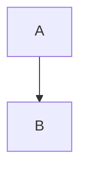

# Theme Layer — Engine Implementation Plan (plan 1 of 2)

Executed 2026-10-29 on branch feat/theme-layer; deviations recorded in the commit history.

> **For agentic workers:** REQUIRED SUB-SKILL: Use superpowers:subagent-driven-development (recommended) or superpowers:executing-plans to implement this plan task-by-task. Steps use checkbox (`- [x]`) syntax for tracking.

**Goal:** Replace SoloMD's five theming mechanisms with one theme layer: a typed theme format, one manager that paints shell + editor + preview + diagrams from it, converters for every existing source, a CodeMirror catalog, and a one-time migration.

**Architecture:** Pure modules in `app/src/lib/theme/` (schema, tokens, resolve, css, converters, migration), tested with `node --test`. A Pinia store (`stores/theme.ts`) loads Built-in + Catalog (bundled JSON) and My themes (`<config>/themes/*.json` via new Rust commands), resolves the active slot, and `apply.ts` writes one `<style id="solomd-theme">` of CSS variables. CodeMirror reads those variables through one var-based chrome theme per mode.

**Tech Stack:** Vue 3.5, Pinia 3, CodeMirror 6, Mermaid 11, Tauri 2 (Rust), Zod 4, `node --test` (Node 22 type stripping), Playwright 1.60 (from `demos/`), esbuild (from Vite).

**Spec:** `docs/superpowers/specs/2026-10-29-theme-layer-design.md`

**Plan 2 (not here):** the Theme page gallery, hover preview, Customize-as-sections editor, "+ Add variant". Plan 1 ships a minimal picker (Appearance + Light slot + Dark slot selects) and keeps today's Theme Studio working through an adapter.

## Global Constraints

- No arbitrary CSS in themes. Colours: hex, `rgb()`, `hsl()`, `color-mix()` only. Unknown keys are rejected.
- Only `variant.app.colors.{bg,text,accent}` are required; everything else resolves through fallbacks.
- Built-in and Catalog themes are read-only. My themes live in `<config>/themes/<id>.json`.
- `source: 'builtin' | 'catalog' | 'mine'`; `origin?: 'studio' | 'json' | 'marketplace' | 'fork'`. Nothing branches on `origin`.
- Settings: `appearance: 'light' | 'dark' | 'system'`, `lightSlot` / `darkSlot: { themeId, variant }`.
- `<html data-theme>` is set to the mode (`light` / `dark`), and `<html data-mode>` to the same value. Component CSS keyed on `data-theme="dark"` keeps working.
- Mind map follows the mode only.
- Old settings keys (`theme`, `customCssPath`, `activeUserThemeId`, `userThemes`) stay in the stored blob, untouched, for one release.
- Code style: functions 10–20 lines, no `any`, no magic numbers (named constants), early returns, no comments except a non-obvious why.
- Tests: `node --test` files next to the module, `*.test.ts`, importing with the `.ts` extension (see `src/lib/auto-save.test.ts`).

**Spec deviation (decided here, report to user):** `surfaces.style.backdrop` is a list of layers, not a single `{from,to,angle}`, because Aurora's backdrop is 6 stacked gradients:

```ts
type BackdropLayer =
  | { kind: 'linear'; angle: number; stops: { color: string; at: number }[] }
  | { kind: 'radial'; x: number; y: number; color: string; fade: number };
backdrop: BackdropLayer[]   // [] = none
```

## File Structure

| File | Responsibility |
|---|---|
| `app/src/lib/theme/schema.ts` | Zod schema, `Theme` / `Variant` types, `parseTheme()` |
| `app/src/lib/theme/tokens.ts` | Section key → CSS variable map, style defaults |
| `app/src/lib/theme/color.ts` | `mixColor`, `isLight`, re-exports of hex helpers |
| `app/src/lib/theme/resolve.ts` | `resolveVariant()` — fallbacks → `ResolvedVariant` |
| `app/src/lib/theme/css.ts` | `themeCss(resolved, mode)` — the `<style>` text |
| `app/src/lib/theme/css-vars.ts` | `parseVarBlocks()`, `parseBackdrop()` — shared CSS readers |
| `app/src/lib/theme/from-css.ts` | Marketplace CSS → Theme + dropped-rule report |
| `app/src/lib/theme/from-studio.ts` | Theme Studio `UserTheme` ↔ Theme |
| `app/src/lib/theme/from-cm.ts` | Extracted CodeMirror theme → Variant (derived app colours) |
| `app/src/lib/theme/migrate.ts` | `planMigration()` — legacy settings → slots + themes |
| `app/src/lib/theme/mermaid.ts` | `mermaidConfigFor(resolved, mode)`, `graphvizThemeFor(mode)` |
| `app/src/lib/theme/builtin/*.json` | 6 built-in themes (generated, committed) |
| `app/src/lib/theme/catalog/*.json` | CodeMirror catalog (generated, committed) |
| `app/src/lib/theme/sources.ts` | Loads bundled JSON (`import.meta.glob`) + My themes (Tauri) |
| `app/src/lib/theme/apply.ts` | Writes style element + `data-mode` / `data-theme` |
| `app/src/stores/theme.ts` | Pinia store: list, slots, mode, resolved, preview, revision |
| `app/scripts/theme/build-builtins.ts` | main.css + chrome table → `builtin/*.json` |
| `app/scripts/theme/build-catalog.ts` | esbuild + Playwright extraction → `catalog/*.json` |
| `app/scripts/theme/catalog-page.ts` | Browser entry that mounts each CM theme and reads computed styles |
| `app/src-tauri/src/themes.rs` | + `theme_json_save` / `theme_json_list` / `theme_json_remove` |
| `app/e2e/theme.spec.ts`, `app/e2e/playwright.config.ts` | Baseline screenshots + behaviour checks |
| Modified | `lib/themes.ts`, `stores/settings.ts`, `App.vue`, `Editor.vue`, `Preview.vue`, `Mindmap*.vue`, `Toolbar.vue`, `QuickCapture.vue`, `WhiteboardOverlay.vue`, `useExport.ts`, `useThemeStudio.ts`, `ThemeStudio.vue`, `SettingsPanel.vue`, `ThemeMarketplace.vue`, `styles/main.css`, `lib/cm-live-preview.ts` |
| Deleted (Task 16) | `lib/custom-theme.ts` |

---

### Task 0: Baseline screenshots (before any change)

**Files:**
- Create: `app/e2e/playwright.config.ts`, `app/e2e/theme-baseline.spec.ts`, `app/e2e/fixtures/sample.md`
- Output (committed): `app/e2e/theme-baseline.spec.ts-snapshots/*.png`

**Interfaces:** Produces the reference PNGs that Task 17 compares against.

- [x] **Step 1: Write the config**

```ts
// app/e2e/playwright.config.ts
import { defineConfig } from '@playwright/test';

const PORT = 1420;

export default defineConfig({
  testDir: '.',
  use: { baseURL: `http://localhost:${PORT}`, viewport: { width: 1280, height: 800 } },
  webServer: { command: 'pnpm dev', cwd: '..', port: PORT, reuseExistingServer: true },
  expect: { toHaveScreenshot: { maxDiffPixelRatio: 0.01 } },
});
```

- [x] **Step 2: Write the sample document**

`app/e2e/fixtures/sample.md`:

````md
# Heading one

Some **bold**, *italic*, a [link](https://example.com) and `inline code`.

> A quote

- item

```ts
// comment
const answer: number = 42;
function greet(name: string) { return `hi ${name}`; }
```


````

- [x] **Step 3: Write the baseline spec**

```ts
// app/e2e/theme-baseline.spec.ts
import { test, expect, type Page } from '@playwright/test';
import { readFileSync } from 'node:fs';

const LEGACY_THEMES = ['light', 'dark', 'nord', 'solarized-light', 'solarized-dark', 'monokai', 'github-light', 'dracula'];
const SAMPLE = readFileSync(new URL('./fixtures/sample.md', import.meta.url), 'utf8');
const SETTLE_MS = 800;

async function openWithTheme(page: Page, theme: string): Promise<void> {
  await page.addInitScript(([t]) => {
    const raw = localStorage.getItem('solomd.settings.v1');
    const s = raw ? JSON.parse(raw) : {};
    localStorage.setItem('solomd.settings.v1', JSON.stringify({ ...s, theme: t, viewMode: 'split' }));
  }, [theme]);
  await page.goto('/');
  await page.locator('.cm-content').first().click();
  await page.keyboard.press('ControlOrMeta+a');
  await page.keyboard.insertText(SAMPLE);
  await page.waitForTimeout(SETTLE_MS);
}

for (const theme of LEGACY_THEMES) {
  test(`theme ${theme} looks the same`, async ({ page }) => {
    await openWithTheme(page, theme);
    await expect(page).toHaveScreenshot(`${theme}.png`, { fullPage: true });
  });
}
```

- [x] **Step 4: Record the baseline**

Run: `pnpm --dir demos exec playwright test --config ../app/e2e/playwright.config.ts theme-baseline --update-snapshots`
Expected: 8 passed, 8 PNGs written under `app/e2e/theme-baseline.spec.ts-snapshots/`. Open two of them and check that the editor shows the sample in split view. If `.cm-content` is not on the start screen, add `await page.keyboard.press('ControlOrMeta+n')` before the click and re-run.

- [x] **Step 5: Commit**

```bash
git add app/e2e
git commit -m "test(theme): baseline screenshots of the 8 built-in themes"
```

---

### Task 1: Schema

**Files:**
- Modify: `app/package.json` (add `"zod": "^4.2.0"` to dependencies)
- Create: `app/src/lib/theme/tokens.ts`, `app/src/lib/theme/schema.ts`
- Test: `app/src/lib/theme/schema.test.ts`

**Interfaces:**
- Produces: `SECTION_COLOR_VARS`, `SectionId`, `ColorKey<S>`, `themeSchema`, `variantSchema`, `type Theme`, `type Variant`, `type BackdropLayer`, `type TextStyle`, `parseTheme(raw: unknown): ParseResult`, `type ParseResult = { ok: true; theme: Theme } | { ok: false; error: string }`.

- [x] **Step 1: Install zod**

Run: `pnpm --dir app add zod@^4.2.0`

- [x] **Step 2: Write `tokens.ts`**

```ts
// app/src/lib/theme/tokens.ts
export const SECTION_COLOR_VARS = {
  app: {
    bg: '--bg', text: '--text', textMuted: '--text-muted', textFaint: '--text-faint',
    accent: '--accent', accentFg: '--accent-fg', danger: '--danger',
  },
  surfaces: { panel: '--bg-elev', hover: '--bg-hover', active: '--bg-active', soft: '--bg-soft', border: '--border' },
  markdown: {
    h1: '--md-h1', h2: '--md-h2', h3: '--md-h3', h4: '--md-h4', h5: '--md-h5', h6: '--md-h6',
    strong: '--md-strong', em: '--md-em', link: '--md-link', url: '--md-url', code: '--md-code',
    codeBg: '--md-code-bg', quote: '--md-quote', list: '--md-list', hr: '--md-hr',
  },
  code: {
    keyword: '--syn-keyword', string: '--syn-string', number: '--syn-number', comment: '--syn-comment',
    function: '--syn-function', variable: '--syn-variable', type: '--syn-type', property: '--syn-property',
    operator: '--syn-operator', punctuation: '--syn-punctuation', tag: '--syn-tag', attribute: '--syn-attribute',
    regexp: '--syn-regexp', constant: '--syn-constant', invalid: '--syn-invalid',
  },
  editor: {
    background: '--cm-bg', gutterBg: '--cm-gutter-bg', gutterFg: '--cm-gutter-fg', activeLine: '--cm-active-line',
    selection: '--cm-selection', cursor: '--cm-cursor', bracket: '--cm-bracket', search: '--cm-search',
    searchActive: '--cm-search-active',
  },
  diagrams: { nodeBg: '--dg-node-bg', nodeBorder: '--dg-node-border', line: '--dg-line', text: '--dg-text' },
} as const;

export type SectionId = keyof typeof SECTION_COLOR_VARS;
export type ColorKey<S extends SectionId> = keyof (typeof SECTION_COLOR_VARS)[S];
export const SECTION_IDS = Object.keys(SECTION_COLOR_VARS) as SectionId[];

export const MIN_ROUNDNESS = 0;
export const MAX_ROUNDNESS = 2;
export const DEFAULT_ROUNDNESS = 1;
export const MAX_BACKDROP_LAYERS = 8;
export const MAX_PANEL_BLUR_PX = 40;
export const MAX_NAME_LENGTH = 80;
export const MAX_ID_LENGTH = 64;
export const ID_RE = /^[a-z0-9_-]+$/i;
```

- [x] **Step 3: Write the failing test**

```ts
// app/src/lib/theme/schema.test.ts
import assert from 'node:assert/strict';
import { test } from 'node:test';
import { parseTheme } from './schema.ts';

const minimal = {
  id: 'mini', name: 'Mini', version: 1, source: 'mine',
  variants: { dark: { mode: 'dark', app: { colors: { bg: '#000000', text: '#ffffff', accent: '#ff9f40' } } } },
};

test('accepts a theme with only the required app colours', () => {
  assert.equal(parseTheme(minimal).ok, true);
});

test('accepts rgb, hsl and color-mix colours', () => {
  const t = structuredClone(minimal);
  t.variants.dark.app.colors.bg = 'rgb(1, 2, 3)';
  t.variants.dark.app.colors.text = 'hsl(10 20% 30%)';
  t.variants.dark.app.colors.accent = 'color-mix(in srgb, #fff 20%, transparent)';
  assert.equal(parseTheme(t).ok, true);
});

test('rejects a CSS injection in a colour and names the field', () => {
  const t = structuredClone(minimal);
  t.variants.dark.app.colors.bg = 'red; } body { display: none';
  const r = parseTheme(t);
  assert.equal(r.ok, false);
  assert.match(r.ok ? '' : r.error, /variants\.dark\.app\.colors\.bg/);
});

test('rejects radius out of range', () => {
  const t = structuredClone(minimal) as Record<string, any>;
  t.variants.dark.app.style = { radius: 3 };
  assert.equal(parseTheme(t).ok, false);
});

test('rejects unknown keys', () => {
  const t = structuredClone(minimal) as Record<string, any>;
  t.variants.dark.app.extraCss = 'body{}';
  const r = parseTheme(t);
  assert.equal(r.ok, false);
  assert.match(r.ok ? '' : r.error, /extraCss/);
});

test('rejects a missing required colour', () => {
  const t = structuredClone(minimal) as Record<string, any>;
  delete t.variants.dark.app.colors.accent;
  assert.equal(parseTheme(t).ok, false);
});

test('rejects a theme with no variants', () => {
  assert.equal(parseTheme({ ...minimal, variants: {} }).ok, false);
});
```

- [x] **Step 4: Run test to verify it fails**

Run: `cd app && node --test src/lib/theme/schema.test.ts`
Expected: FAIL, `Cannot find module './schema.ts'`.

- [x] **Step 5: Write `schema.ts`**

```ts
// app/src/lib/theme/schema.ts
import { z } from 'zod';
import {
  MAX_BACKDROP_LAYERS, MAX_ID_LENGTH, MAX_NAME_LENGTH, MAX_PANEL_BLUR_PX, MAX_ROUNDNESS, MIN_ROUNDNESS,
  ID_RE, SECTION_COLOR_VARS, type ColorKey, type SectionId,
} from './tokens.ts';

const COLOR_RE = /^(#[0-9a-f]{3,8}|rgba?\([\d\s.,%/]+\)|hsla?\([\d\s.,%/deg]+\)|color-mix\([a-z0-9\s.,%#()-]+\)|transparent)$/i;
const PERCENT_MAX = 100;
const DEGREES_MAX = 360;

const color = z.string().trim().regex(COLOR_RE, 'not an allowed colour');
const percent = z.number().min(0).max(PERCENT_MAX);
const roundness = z.number().min(MIN_ROUNDNESS).max(MAX_ROUNDNESS);
const textStyle = z.strictObject({ italic: z.boolean().optional(), bold: z.boolean().optional(), underline: z.boolean().optional() });

const backdropLayer = z.discriminatedUnion('kind', [
  z.strictObject({
    kind: z.literal('linear'),
    angle: z.number().min(0).max(DEGREES_MAX),
    stops: z.array(z.strictObject({ color, at: percent })).min(2),
  }),
  z.strictObject({ kind: z.literal('radial'), x: percent, y: percent, color, fade: percent }),
]);

function colorsOf<S extends SectionId>(section: S) {
  const keys = Object.keys(SECTION_COLOR_VARS[section]) as ColorKey<S>[];
  const shape = Object.fromEntries(keys.map((k) => [k, color.optional()])) as Record<ColorKey<S>, z.ZodOptional<typeof color>>;
  return z.strictObject(shape);
}

const appColors = colorsOf('app').extend({ bg: color, text: color, accent: color });

const styles = {
  app: z.strictObject({ radius: roundness.optional() }),
  surfaces: z.strictObject({
    backdrop: z.array(backdropLayer).max(MAX_BACKDROP_LAYERS).optional(),
    panelOpacity: z.number().min(0).max(1).optional(),
    panelBlur: z.number().min(0).max(MAX_PANEL_BLUR_PX).optional(),
  }),
  markdown: z.strictObject({ heading: textStyle.optional(), link: textStyle.optional(), quote: textStyle.optional() }),
  code: z.strictObject({
    comment: textStyle.optional(), keyword: textStyle.optional(), function: textStyle.optional(), string: textStyle.optional(),
  }),
  editor: z.strictObject({ activeLine: z.boolean().optional() }),
  diagrams: z.strictObject({ nodeRadius: roundness.optional() }),
};

function section<S extends SectionId>(id: S) {
  return z.strictObject({ colors: colorsOf(id).optional(), style: styles[id].optional() }).optional();
}

export const variantSchema = z.strictObject({
  label: z.string().max(MAX_NAME_LENGTH).optional(),
  mode: z.enum(['light', 'dark']),
  app: z.strictObject({ colors: appColors, style: styles.app.optional() }),
  surfaces: section('surfaces'),
  markdown: section('markdown'),
  code: section('code'),
  editor: section('editor'),
  diagrams: section('diagrams'),
});

export const themeSchema = z.strictObject({
  id: z.string().min(1).max(MAX_ID_LENGTH).regex(ID_RE),
  name: z.string().min(1).max(MAX_NAME_LENGTH),
  author: z.string().max(MAX_NAME_LENGTH).optional(),
  version: z.literal(1),
  source: z.enum(['builtin', 'catalog', 'mine']),
  origin: z.enum(['studio', 'json', 'marketplace', 'fork']).optional(),
  basedOn: z.string().max(MAX_ID_LENGTH).optional(),
  variants: z.record(z.string().regex(ID_RE), variantSchema).refine((v) => Object.keys(v).length > 0, 'needs at least one variant'),
});

export type Theme = z.infer<typeof themeSchema>;
export type Variant = z.infer<typeof variantSchema>;
export type BackdropLayer = z.infer<typeof backdropLayer>;
export type TextStyle = z.infer<typeof textStyle>;
export type ThemeMode = Variant['mode'];
export type ParseResult = { ok: true; theme: Theme } | { ok: false; error: string };

export function parseTheme(raw: unknown): ParseResult {
  const r = themeSchema.safeParse(raw);
  if (r.success) return { ok: true, theme: r.data };
  const issue = r.error.issues[0];
  const keys = issue.code === 'unrecognized_keys' ? `.${issue.keys.join(',')}` : '';
  return { ok: false, error: `${issue.path.join('.')}${keys}: ${issue.message}` };
}
```

- [x] **Step 6: Run test to verify it passes**

Run: `cd app && node --test src/lib/theme/schema.test.ts`
Expected: 7 passed.

- [x] **Step 7: Commit**

```bash
git add app/package.json app/pnpm-lock.yaml app/src/lib/theme/tokens.ts app/src/lib/theme/schema.ts app/src/lib/theme/schema.test.ts
git commit -m "feat(theme): theme file schema with per-section colours and styles"
```

---

### Task 2: Resolve (fallbacks)

**Files:**
- Create: `app/src/lib/theme/color.ts`, `app/src/lib/theme/defaults.ts`, `app/src/lib/theme/resolve.ts`
- Test: `app/src/lib/theme/resolve.test.ts`

**Interfaces:**
- Consumes: `Variant`, `ThemeMode`, `TextStyle`, `BackdropLayer` (Task 1); `mix`, `luminance`, `isHexColor` from `lib/user-theme.ts`.
- Produces:
  - `mixColor(a: string, b: string, amount: number): string`, `isLight(color: string): boolean`
  - `type ResolvedVariant = { mode: ThemeMode; colors: { [S in SectionId]: Record<ColorKey<S>, string> }; style: ResolvedStyle }`
  - `type ResolvedStyle = { radius: number; backdrop: BackdropLayer[]; panelOpacity: number; panelBlur: number; heading: TextStyle; link: TextStyle; quote: TextStyle; comment: TextStyle; keyword: TextStyle; function: TextStyle; string: TextStyle; activeLine: boolean; nodeRadius: number }`
  - `resolveVariant(v: Variant): ResolvedVariant`
  - `SOLOMD_CODE: Record<ThemeMode, Record<'keyword'|'string'|'number'|'comment'|'function'|'variable'|'type'|'property'|'operator', string>>`

- [x] **Step 1: Write `color.ts`**

```ts
// app/src/lib/theme/color.ts
import { isHexColor, luminance, mix } from '../user-theme.ts';

const PERCENT = 100;
const LIGHT_SPLIT = 0.5;

/** `amount` (0–1) of `b` mixed into `a`; non-hex inputs stay a CSS `color-mix()`. */
export function mixColor(a: string, b: string, amount: number): string {
  if (isHexColor(a) && isHexColor(b)) return mix(a, b, amount);
  const share = Math.round(amount * PERCENT);
  return `color-mix(in srgb, ${a} ${PERCENT - share}%, ${b})`;
}

export function isLight(color: string): boolean {
  return isHexColor(color) ? luminance(color) > LIGHT_SPLIT : false;
}
```

- [x] **Step 2: Write `defaults.ts`** (values copied from `styles/main.css` `:root` and `:root[data-theme="dark"]`)

```ts
// app/src/lib/theme/defaults.ts
import type { ThemeMode } from './schema.ts';

export const SOLOMD_CODE = {
  light: {
    keyword: '#a626a4', string: '#50a14f', number: '#986801', comment: '#a0a1a7', function: '#4078f2',
    variable: '#383a42', type: '#c18401', property: '#e45649', operator: '#0184bc',
  },
  dark: {
    keyword: '#c678dd', string: '#98c379', number: '#d19a66', comment: '#5c6370', function: '#61afef',
    variable: '#e06c75', type: '#e5c07b', property: '#e06c75', operator: '#56b6c2',
  },
} as const satisfies Record<ThemeMode, Record<string, string>>;

export const DANGER = { light: '#d64545', dark: '#e86d6d' } as const;
export const TEXT_ON_ACCENT = { onLight: '#1a1a1a', onDark: '#ffffff' } as const;

export const MIX = {
  muted: 0.35, faint: 0.6, panel: 0.04, hover: 0.06, active: 0.12, border: 0.14,
  activeLine: 0.04, bracket: 0.25, search: 0.3, searchActive: 0.5,
  h3: 0.3, h4: 0.6, h6: 0.2, url: 0.3, selection: 0.78,
} as const;

export const DEFAULT_STYLE = {
  radius: 1, panelOpacity: 1, panelBlur: 0, activeLine: true, nodeRadius: 1,
  heading: { bold: true }, link: {}, quote: {}, comment: { italic: true }, keyword: {}, function: {}, string: {},
} as const;
```

- [x] **Step 3: Write the failing test**

```ts
// app/src/lib/theme/resolve.test.ts
import assert from 'node:assert/strict';
import { test } from 'node:test';
import { resolveVariant } from './resolve.ts';
import { SOLOMD_CODE } from './defaults.ts';
import type { Variant } from './schema.ts';

const dark: Variant = { mode: 'dark', app: { colors: { bg: '#000000', text: '#ffffff', accent: '#ff9f40' } } };

test('editor background falls back to app bg', () => {
  assert.equal(resolveVariant(dark).colors.editor.background, '#000000');
});

test('gutter background follows the editor background', () => {
  const v: Variant = { ...dark, editor: { colors: { background: '#111111' } } };
  assert.equal(resolveVariant(v).colors.editor.gutterBg, '#111111');
});

test('diagram line falls back to the surface border', () => {
  const v: Variant = { ...dark, surfaces: { colors: { border: '#333333' } } };
  assert.equal(resolveVariant(v).colors.diagrams.line, '#333333');
});

test('code constant falls back to code number', () => {
  const v: Variant = { ...dark, code: { colors: { number: '#123456' } } };
  assert.equal(resolveVariant(v).colors.code.constant, '#123456');
});

test('missing code colours come from the SoloMD palette of the same mode', () => {
  assert.equal(resolveVariant(dark).colors.code.keyword, SOLOMD_CODE.dark.keyword);
});

test('surfaces mix bg toward text', () => {
  const r = resolveVariant(dark);
  assert.equal(r.colors.surfaces.hover, '#0f0f0f');
});

test('non-hex inputs mix with color-mix()', () => {
  const v: Variant = { mode: 'dark', app: { colors: { bg: 'rgb(0, 0, 0)', text: '#ffffff', accent: '#ff9f40' } } };
  assert.match(resolveVariant(v).colors.surfaces.hover, /^color-mix\(in srgb, rgb\(0, 0, 0\) 94%, #ffffff\)$/);
});

test('style defaults apply and explicit values win', () => {
  const v: Variant = { ...dark, app: { ...dark.app, style: { radius: 0 } } };
  const r = resolveVariant(v);
  assert.equal(r.style.radius, 0);
  assert.deepEqual(r.style.comment, { italic: true });
  assert.equal(r.style.activeLine, true);
});
```

- [x] **Step 4: Run test to verify it fails**

Run: `cd app && node --test src/lib/theme/resolve.test.ts`
Expected: FAIL, `Cannot find module './resolve.ts'`.

- [x] **Step 5: Write `resolve.ts`**

```ts
// app/src/lib/theme/resolve.ts
import type { BackdropLayer, TextStyle, ThemeMode, Variant } from './schema.ts';
import type { ColorKey, SectionId } from './tokens.ts';
import { isLight, mixColor } from './color.ts';
import { DANGER, DEFAULT_STYLE, MIX, SOLOMD_CODE, TEXT_ON_ACCENT } from './defaults.ts';

type Colors<S extends SectionId> = Record<ColorKey<S>, string>;
export type ResolvedColors = { [S in SectionId]: Colors<S> };
export type ResolvedStyle = {
  radius: number; backdrop: BackdropLayer[]; panelOpacity: number; panelBlur: number;
  heading: TextStyle; link: TextStyle; quote: TextStyle;
  comment: TextStyle; keyword: TextStyle; function: TextStyle; string: TextStyle;
  activeLine: boolean; nodeRadius: number;
};
export type ResolvedVariant = { mode: ThemeMode; colors: ResolvedColors; style: ResolvedStyle };

function appColors(v: Variant): Colors<'app'> {
  const { bg, text, accent, ...rest } = v.app.colors;
  return {
    bg, text, accent,
    textMuted: rest.textMuted ?? mixColor(text, bg, MIX.muted),
    textFaint: rest.textFaint ?? mixColor(text, bg, MIX.faint),
    accentFg: rest.accentFg ?? (isLight(accent) ? TEXT_ON_ACCENT.onLight : TEXT_ON_ACCENT.onDark),
    danger: rest.danger ?? DANGER[v.mode],
  };
}

function surfaceColors(v: Variant, app: Colors<'app'>): Colors<'surfaces'> {
  const c = v.surfaces?.colors ?? {};
  const panel = c.panel ?? mixColor(app.bg, app.text, MIX.panel);
  return {
    panel,
    hover: c.hover ?? mixColor(app.bg, app.text, MIX.hover),
    active: c.active ?? mixColor(app.bg, app.text, MIX.active),
    soft: c.soft ?? panel,
    border: c.border ?? mixColor(app.bg, app.text, MIX.border),
  };
}

function markdownColors(v: Variant, app: Colors<'app'>, s: Colors<'surfaces'>): Colors<'markdown'> {
  const c = v.markdown?.colors ?? {};
  const { text, textMuted: muted, accent, bg } = app;
  return {
    h1: c.h1 ?? text, h2: c.h2 ?? text, h3: c.h3 ?? mixColor(text, muted, MIX.h3),
    h4: c.h4 ?? mixColor(text, muted, MIX.h4), h5: c.h5 ?? muted, h6: c.h6 ?? mixColor(muted, bg, MIX.h6),
    strong: c.strong ?? text, em: c.em ?? text, link: c.link ?? accent, url: c.url ?? mixColor(accent, text, MIX.url),
    code: c.code ?? accent, codeBg: c.codeBg ?? s.panel, quote: c.quote ?? muted, list: c.list ?? accent, hr: c.hr ?? s.border,
  };
}

function codeColors(v: Variant, app: Colors<'app'>): Colors<'code'> {
  const base = { ...SOLOMD_CODE[v.mode], ...v.code?.colors };
  const c = v.code?.colors ?? {};
  return {
    ...base,
    punctuation: c.punctuation ?? app.text,
    tag: c.tag ?? base.keyword,
    attribute: c.attribute ?? base.property,
    regexp: c.regexp ?? base.string,
    constant: c.constant ?? base.number,
    invalid: c.invalid ?? app.danger,
  };
}

function editorColors(v: Variant, app: Colors<'app'>): Colors<'editor'> {
  const c = v.editor?.colors ?? {};
  const background = c.background ?? app.bg;
  return {
    background,
    gutterBg: c.gutterBg ?? background,
    gutterFg: c.gutterFg ?? app.textFaint,
    activeLine: c.activeLine ?? mixColor(background, app.text, MIX.activeLine),
    selection: c.selection ?? mixColor(app.accent, 'transparent', MIX.selection),
    cursor: c.cursor ?? app.accent,
    bracket: c.bracket ?? mixColor(background, app.accent, MIX.bracket),
    search: c.search ?? mixColor(background, app.accent, MIX.search),
    searchActive: c.searchActive ?? mixColor(background, app.accent, MIX.searchActive),
  };
}

function diagramColors(v: Variant, app: Colors<'app'>, s: Colors<'surfaces'>): Colors<'diagrams'> {
  const c = v.diagrams?.colors ?? {};
  return { nodeBg: c.nodeBg ?? s.panel, nodeBorder: c.nodeBorder ?? app.accent, line: c.line ?? s.border, text: c.text ?? app.text };
}

function resolveStyle(v: Variant): ResolvedStyle {
  return {
    ...DEFAULT_STYLE,
    radius: v.app.style?.radius ?? DEFAULT_STYLE.radius,
    backdrop: v.surfaces?.style?.backdrop ?? [],
    panelOpacity: v.surfaces?.style?.panelOpacity ?? DEFAULT_STYLE.panelOpacity,
    panelBlur: v.surfaces?.style?.panelBlur ?? DEFAULT_STYLE.panelBlur,
    ...pickDefined(v.markdown?.style), ...pickDefined(v.code?.style),
    activeLine: v.editor?.style?.activeLine ?? DEFAULT_STYLE.activeLine,
    nodeRadius: v.diagrams?.style?.nodeRadius ?? DEFAULT_STYLE.nodeRadius,
  };
}

function pickDefined<T extends object>(o: T | undefined): Partial<T> {
  return Object.fromEntries(Object.entries(o ?? {}).filter(([, val]) => val !== undefined)) as Partial<T>;
}

export function resolveVariant(v: Variant): ResolvedVariant {
  const app = appColors(v);
  const surfaces = surfaceColors(v, app);
  return {
    mode: v.mode,
    colors: {
      app, surfaces,
      markdown: markdownColors(v, app, surfaces),
      code: codeColors(v, app),
      editor: editorColors(v, app),
      diagrams: diagramColors(v, app, surfaces),
    },
    style: resolveStyle(v),
  };
}
```

- [x] **Step 6: Run test to verify it passes**

Run: `cd app && node --test src/lib/theme/resolve.test.ts`
Expected: 8 passed. If `surfaces mix bg toward text` fails on rounding, print `resolveVariant(dark).colors.surfaces.hover` and use that value (`mix` rounds per channel: 255 × 0.06 = 15.3 → `0f`).

- [x] **Step 7: Commit**

```bash
git add app/src/lib/theme/color.ts app/src/lib/theme/defaults.ts app/src/lib/theme/resolve.ts app/src/lib/theme/resolve.test.ts
git commit -m "feat(theme): resolve variants with per-section fallbacks"
```

---

### Task 3: Tokens → CSS

**Files:**
- Create: `app/src/lib/theme/css.ts`
- Test: `app/src/lib/theme/css.test.ts`

**Interfaces:**
- Consumes: `ResolvedVariant` (Task 2), `SECTION_COLOR_VARS` (Task 1), `TextStyle`, `BackdropLayer`.
- Produces: `themeVars(r: ResolvedVariant): Record<string, string>`, `themeCss(r: ResolvedVariant): string`, `backdropCss(layers: BackdropLayer[]): string`, `SHOW_THROUGH: readonly string[]`, `THEME_SELECTOR = 'html:root'`.

- [x] **Step 1: Write the failing test**

```ts
// app/src/lib/theme/css.test.ts
import assert from 'node:assert/strict';
import { test } from 'node:test';
import { backdropCss, themeCss, themeVars } from './css.ts';
import { resolveVariant } from './resolve.ts';
import type { Variant } from './schema.ts';

const dark: Variant = { mode: 'dark', app: { colors: { bg: '#000000', text: '#ffffff', accent: '#ff9f40' } } };

test('maps colours to the existing variable names', () => {
  const vars = themeVars(resolveVariant(dark));
  assert.equal(vars['--bg'], '#000000');
  assert.equal(vars['--cm-bg'], '#000000');
  assert.equal(vars['--syn-constant'], vars['--syn-number']);
});

test('writes text styles as font variables', () => {
  const vars = themeVars(resolveVariant(dark));
  assert.equal(vars['--syn-comment-style'], 'italic');
  assert.equal(vars['--syn-keyword-weight'], 'normal');
  assert.equal(vars['--md-heading-weight'], 'bold');
});

test('radius scales the three radius variables', () => {
  const vars = themeVars(resolveVariant({ ...dark, app: { ...dark.app, style: { radius: 2 } } }));
  assert.equal(vars['--r-md'], '16px');
});

test('hidden active line is transparent', () => {
  const vars = themeVars(resolveVariant({ ...dark, editor: { style: { activeLine: false } } }));
  assert.equal(vars['--cm-active-line'], 'transparent');
});

test('backdrop layers become a CSS background list', () => {
  const css = backdropCss([
    { kind: 'radial', x: 15, y: 20, color: '#67e8b9', fade: 52 },
    { kind: 'linear', angle: 165, stops: [{ color: '#070b18', at: 0 }, { color: '#130f22', at: 100 }] },
  ]);
  assert.equal(css, 'radial-gradient(circle at 15% 20%, #67e8b9, transparent 52%), linear-gradient(165deg, #070b18 0%, #130f22 100%)');
});

test('panels show the backdrop through only when there is one', () => {
  assert.doesNotMatch(themeCss(resolveVariant(dark)), /backdrop-filter/);
  const withBackdrop: Variant = {
    ...dark,
    surfaces: { style: { backdrop: [{ kind: 'radial', x: 1, y: 1, color: '#ffffff', fade: 10 }], panelOpacity: 0, panelBlur: 6 } },
  };
  const css = themeCss(resolveVariant(withBackdrop));
  assert.match(css, /html:root body \{\n  background-image: var\(--bg-grad\);/);
  assert.match(css, /backdrop-filter: blur\(var\(--panel-blur\)\)/);
  assert.equal(themeVars(resolveVariant(withBackdrop))['--panel-blur'], '6px');
});

test('declares color-scheme for the mode', () => {
  assert.match(themeCss(resolveVariant(dark)), /color-scheme: dark;/);
});
```

- [x] **Step 2: Run test to verify it fails**

Run: `cd app && node --test src/lib/theme/css.test.ts`
Expected: FAIL, `Cannot find module './css.ts'`.

- [x] **Step 3: Write `css.ts`**

```ts
// app/src/lib/theme/css.ts
import type { BackdropLayer, TextStyle } from './schema.ts';
import type { ResolvedVariant } from './resolve.ts';
import { SECTION_COLOR_VARS, SECTION_IDS } from './tokens.ts';

export const THEME_SELECTOR = 'html:root';
export const SHOW_THROUGH = [
  '.app', '.pane-host', '.preview-host', '.cm-host', '.plain-editor', '.pane--editor', '.pane--preview',
  '.toolbar', '.statusbar', '.ftree', '.outline', '.side-sidebar', '.pane-tabbar',
] as const;

const RADIUS_PX = { '--r-sm': 4, '--r-md': 8, '--r-lg': 12 } as const;
const NODE_RADIUS_PX = 5;
const PERCENT = 100;
const STYLED_TOKENS = {
  '--md-heading': 'heading', '--md-link': 'link', '--md-quote': 'quote',
  '--syn-comment': 'comment', '--syn-keyword': 'keyword', '--syn-function': 'function', '--syn-string': 'string',
} as const;

function colorVars(r: ResolvedVariant): Record<string, string> {
  const out: Record<string, string> = {};
  for (const section of SECTION_IDS) {
    const map = SECTION_COLOR_VARS[section] as Record<string, string>;
    const colors = r.colors[section] as Record<string, string>;
    for (const [key, cssVar] of Object.entries(map)) out[cssVar] = colors[key];
  }
  return out;
}

function textStyleVars(prefix: string, s: TextStyle): Record<string, string> {
  return {
    [`${prefix}-style`]: s.italic ? 'italic' : 'normal',
    [`${prefix}-weight`]: s.bold ? 'bold' : 'normal',
    [`${prefix}-decoration`]: s.underline ? 'underline' : 'none',
  };
}

function styleVars(r: ResolvedVariant): Record<string, string> {
  const s = r.style;
  const out: Record<string, string> = {
    '--bg-grad': s.backdrop.length ? backdropCss(s.backdrop) : 'none',
    '--panel-opacity': `${Math.round(s.panelOpacity * PERCENT)}%`,
    '--panel-blur': `${s.panelBlur}px`,
    '--dg-node-radius': `${s.nodeRadius * NODE_RADIUS_PX}px`,
  };
  for (const [cssVar, px] of Object.entries(RADIUS_PX)) out[cssVar] = `${px * s.radius}px`;
  for (const [prefix, key] of Object.entries(STYLED_TOKENS)) Object.assign(out, textStyleVars(prefix, s[key]));
  return out;
}

export function themeVars(r: ResolvedVariant): Record<string, string> {
  const vars = { ...colorVars(r), ...styleVars(r) };
  if (!r.style.activeLine) vars['--cm-active-line'] = 'transparent';
  return vars;
}

function layerCss(layer: BackdropLayer): string {
  if (layer.kind === 'radial') return `radial-gradient(circle at ${layer.x}% ${layer.y}%, ${layer.color}, transparent ${layer.fade}%)`;
  return `linear-gradient(${layer.angle}deg, ${layer.stops.map((st) => `${st.color} ${st.at}%`).join(', ')})`;
}

export function backdropCss(layers: BackdropLayer[]): string {
  return layers.map(layerCss).join(', ');
}

function showThroughCss(): string {
  return [
    `${THEME_SELECTOR} body {\n  background-image: var(--bg-grad);\n}`,
    `${THEME_SELECTOR} :is(${SHOW_THROUGH.join(', ')}) {\n` +
      '  background: color-mix(in srgb, var(--bg-elev) var(--panel-opacity), transparent) !important;\n' +
      '  backdrop-filter: blur(var(--panel-blur));\n}',
  ].join('\n\n');
}

export function themeCss(r: ResolvedVariant): string {
  const decls = Object.entries(themeVars(r)).map(([k, v]) => `  ${k}: ${v};`);
  const root = `${THEME_SELECTOR} {\n  color-scheme: ${r.mode};\n${decls.join('\n')}\n}`;
  return r.style.backdrop.length ? `${root}\n\n${showThroughCss()}` : root;
}
```

- [x] **Step 4: Run the tests**

Run: `cd app && node --test src/lib/theme/css.test.ts`
Expected: 7 passed.

- [x] **Step 5: Commit**

```bash
git add app/src/lib/theme/css.ts app/src/lib/theme/css.test.ts
git commit -m "feat(theme): render resolved variants as CSS variables"
```

---

### Task 4: Shared CSS readers + Marketplace CSS converter

**Files:**
- Create: `app/src/lib/theme/css-vars.ts`, `app/src/lib/theme/from-css.ts`
- Test: `app/src/lib/theme/from-css.test.ts`, fixture `app/src/lib/theme/__fixtures__/aurora.css` (copy of `web/public/themes/aurora.css`)

**Interfaces:**
- Consumes: `SECTION_COLOR_VARS`, `Variant`, `Theme`, `BackdropLayer`, `parseTheme`, `isLight`, `SHOW_THROUGH`.
- Produces:
  - `type CssRule = { selectors: string[]; decls: Record<string, string> }`
  - `parseRules(css: string): CssRule[]` (comments stripped, top-level rules only)
  - `modeSelectorsOf(rule: CssRule): ('base' | 'light' | 'dark' | string)[]` — maps `:root`→`base`, `:root[data-theme="x"]`→`x`
  - `varsToVariant(vars: Record<string,string>, mode?: ThemeMode): { variant: Variant; dropped: string[] }`
  - `parseBackdrop(value: string): BackdropLayer[] | null`
  - `convertMarketplaceCss(css: string, meta: { id: string; name: string; author?: string }): { theme: Theme; dropped: string[] }`

- [x] **Step 1: Copy the fixture**

Run: `mkdir -p app/src/lib/theme/__fixtures__ && cp web/public/themes/aurora.css app/src/lib/theme/__fixtures__/aurora.css`

- [x] **Step 2: Write the failing test**

```ts
// app/src/lib/theme/from-css.test.ts
import assert from 'node:assert/strict';
import { readFileSync } from 'node:fs';
import { test } from 'node:test';
import { convertMarketplaceCss } from './from-css.ts';
import { parseBackdrop, parseRules } from './css-vars.ts';

const aurora = readFileSync(new URL('./__fixtures__/aurora.css', import.meta.url), 'utf8');

test('parses top-level rules and strips comments', () => {
  const rules = parseRules('/* x */ :root { --bg: #000; } .a, .b { color: red; }');
  assert.deepEqual(rules[0], { selectors: [':root'], decls: { '--bg': '#000' } });
  assert.deepEqual(rules[1].selectors, ['.a', '.b']);
});

test('parses radial and linear gradients into layers', () => {
  const layers = parseBackdrop('radial-gradient(circle at 15% 20%, rgba(103, 232, 185, 0.22), transparent 52%), linear-gradient(165deg, #070b18 0%, #0d1424 60%, #130f22 100%)');
  assert.deepEqual(layers, [
    { kind: 'radial', x: 15, y: 20, color: 'rgba(103, 232, 185, 0.22)', fade: 52 },
    { kind: 'linear', angle: 165, stops: [{ color: '#070b18', at: 0 }, { color: '#0d1424', at: 60 }, { color: '#130f22', at: 100 }] },
  ]);
});

test('Aurora becomes one valid dark variant with its palette', () => {
  const { theme } = convertMarketplaceCss(aurora, { id: 'mk-aurora', name: 'Aurora' });
  assert.deepEqual(Object.keys(theme.variants), ['dark']);
  const v = theme.variants.dark;
  assert.equal(v.app.colors.bg, '#0d1424');
  assert.equal(v.app.colors.accent, '#67e8b9');
  assert.equal(v.code?.colors?.keyword, '#c084fc');
  assert.equal(theme.source, 'mine');
  assert.equal(theme.origin, 'marketplace');
});

test('Aurora keeps its 6-layer backdrop and see-through panels', () => {
  const v = convertMarketplaceCss(aurora, { id: 'mk-aurora', name: 'Aurora' }).theme.variants.dark;
  assert.equal(v.surfaces?.style?.backdrop?.length, 6);
  assert.equal(v.surfaces?.style?.panelOpacity, 0);
});

test('reports dropped rules and unknown variables', () => {
  const { dropped } = convertMarketplaceCss(aurora, { id: 'mk-aurora', name: 'Aurora' });
  assert.ok(dropped.includes('.cm-editor .cm-gutters'));
  assert.ok(dropped.includes('--md-code-border'));
  assert.ok(!dropped.includes('body'));
});

test('separate light and dark blocks become two variants', () => {
  const css = ':root[data-theme="light"] { --bg: #ffffff; --text: #111111; --accent: #0066ff; }\n' +
    ':root[data-theme="dark"] { --bg: #111111; --text: #eeeeee; --accent: #66aaff; }';
  const { theme } = convertMarketplaceCss(css, { id: 'mk-x', name: 'X' });
  assert.deepEqual(Object.keys(theme.variants).sort(), ['dark', 'light']);
});
```

- [x] **Step 3: Run test to verify it fails**

Run: `cd app && node --test src/lib/theme/from-css.test.ts`
Expected: FAIL, `Cannot find module './from-css.ts'`.

- [x] **Step 4: Write `css-vars.ts`**

```ts
// app/src/lib/theme/css-vars.ts
import type { BackdropLayer, ThemeMode, Variant } from './schema.ts';
import { SECTION_COLOR_VARS, SECTION_IDS, type SectionId } from './tokens.ts';
import { isLight } from './color.ts';

export type CssRule = { selectors: string[]; decls: Record<string, string> };

const COMMENT_RE = /\/\*[\s\S]*?\*\//g;
const RULE_RE = /([^{}]+)\{([^{}]*)\}/g;
const DECL_SPLIT_RE = /;(?![^(]*\))/;
const ROOT_THEME_RE = /^:root\[data-theme=["']?([a-z0-9-]+)["']?\]$/i;
const RADIAL_RE = /^radial-gradient\(\s*circle at ([\d.]+)% ([\d.]+)%,\s*(.+?),\s*transparent ([\d.]+)%\s*\)$/i;
const LINEAR_RE = /^linear-gradient\(\s*([\d.]+)deg,\s*(.+)\)$/i;
const STOP_RE = /^(.+?)\s+([\d.]+)%$/;

function parseDecls(body: string): Record<string, string> {
  const out: Record<string, string> = {};
  for (const part of body.split(DECL_SPLIT_RE)) {
    const i = part.indexOf(':');
    if (i > 0) out[part.slice(0, i).trim()] = part.slice(i + 1).trim().replace(/\s+/g, ' ');
  }
  return out;
}

export function parseRules(css: string): CssRule[] {
  const rules: CssRule[] = [];
  for (const m of css.replace(COMMENT_RE, '').matchAll(RULE_RE)) {
    rules.push({ selectors: m[1].split(',').map((s) => s.trim()).filter(Boolean), decls: parseDecls(m[2]) });
  }
  return rules;
}

export function modeSelectorsOf(rule: CssRule): string[] {
  return rule.selectors.map((s) => (s === ':root' ? 'base' : ROOT_THEME_RE.exec(s)?.[1] ?? s));
}

function splitTopLevel(value: string): string[] {
  const parts: string[] = [];
  let depth = 0, start = 0;
  for (let i = 0; i < value.length; i++) {
    if (value[i] === '(') depth++;
    if (value[i] === ')') depth--;
    if (value[i] === ',' && depth === 0) { parts.push(value.slice(start, i).trim()); start = i + 1; }
  }
  return [...parts, value.slice(start).trim()].filter(Boolean);
}

function parseLayer(part: string): BackdropLayer | null {
  const r = RADIAL_RE.exec(part);
  if (r) return { kind: 'radial', x: Number(r[1]), y: Number(r[2]), color: r[3].trim(), fade: Number(r[4]) };
  const l = LINEAR_RE.exec(part);
  if (!l) return null;
  const stops = splitTopLevel(l[2]).map((s) => STOP_RE.exec(s)).filter((m): m is RegExpExecArray => !!m);
  return { kind: 'linear', angle: Number(l[1]), stops: stops.map((m) => ({ color: m[1].trim(), at: Number(m[2]) })) };
}

export function parseBackdrop(value: string): BackdropLayer[] | null {
  const layers = splitTopLevel(value).map(parseLayer);
  return layers.every((x): x is BackdropLayer => !!x) ? layers : null;
}

const VAR_TO_KEY: Record<string, [SectionId, string]> = Object.fromEntries(
  SECTION_IDS.flatMap((section) =>
    Object.entries(SECTION_COLOR_VARS[section]).map(([key, cssVar]) => [cssVar, [section, key]])),
);

export function varsToVariant(vars: Record<string, string>, mode?: ThemeMode): { variant: Variant; dropped: string[] } {
  const sections: Record<string, { colors: Record<string, string> }> = {};
  const dropped: string[] = [];
  for (const [name, value] of Object.entries(vars)) {
    const target = VAR_TO_KEY[name];
    if (!target) { if (name.startsWith('--') && name !== '--bg-grad') dropped.push(name); continue; }
    const [section, key] = target;
    (sections[section] ??= { colors: {} }).colors[key] = value;
  }
  const appColors = sections.app?.colors ?? {};
  const resolvedMode: ThemeMode = mode ?? (isLight(appColors.bg ?? '') ? 'light' : 'dark');
  const variant = { mode: resolvedMode, ...sections } as Variant;
  return { variant, dropped };
}
```

- [x] **Step 5: Write `from-css.ts`**

```ts
// app/src/lib/theme/from-css.ts
import type { Theme, ThemeMode, Variant } from './schema.ts';
import { parseTheme } from './schema.ts';
import { modeSelectorsOf, parseBackdrop, parseRules, varsToVariant, type CssRule } from './css-vars.ts';
import { SHOW_THROUGH } from './css.ts';

type Meta = { id: string; name: string; author?: string };
const SHOW_THROUGH_MIN_MATCHES = 3;
const BLUR_RE = /blur\(([\d.]+)px\)/;
const RADIUS_BASE_PX = 8;
const HANDLED_SELECTORS = new Set(['body']);

function isVarBlock(rule: CssRule): boolean {
  return modeSelectorsOf(rule).every((m) => m === 'base' || m === 'light' || m === 'dark');
}

function isShowThrough(rule: CssRule): boolean {
  const hits = rule.selectors.filter((s) => (SHOW_THROUGH as readonly string[]).includes(s)).length;
  return hits >= SHOW_THROUGH_MIN_MATCHES && /transparent/.test(rule.decls.background ?? rule.decls['background-color'] ?? '');
}

function collectVars(rules: CssRule[]): Record<string, Record<string, string>> {
  const byMode: Record<string, Record<string, string>> = {};
  for (const rule of rules.filter(isVarBlock)) {
    for (const m of modeSelectorsOf(rule)) Object.assign((byMode[m] ??= {}), rule.decls);
  }
  return byMode;
}

function variantsFrom(byMode: Record<string, Record<string, string>>): { variants: Record<string, Variant>; dropped: string[] } {
  const base = byMode.base ?? {};
  const explicit = (['light', 'dark'] as ThemeMode[]).filter((m) => byMode[m]);
  const sets = explicit.length ? explicit.map((m) => ({ ...base, ...byMode[m] })) : [base];
  const converted = sets.map((vars, i) => varsToVariant(vars, explicit[i]));
  const variants: Record<string, Variant> = {};
  for (const c of converted) variants[c.variant.mode] ??= c.variant;
  return { variants, dropped: [...new Set(converted.flatMap((c) => c.dropped))] };
}

function applyStyles(variants: Record<string, Variant>, rules: CssRule[], vars: Record<string, string>): void {
  const backdrop = vars['--bg-grad'] ? parseBackdrop(vars['--bg-grad']) : null;
  const panel = rules.find(isShowThrough);
  const blur = Object.values(rules).map((r) => BLUR_RE.exec(r.decls['backdrop-filter'] ?? '')).find(Boolean);
  const radiusPx = vars['--r-md'] ? Number.parseFloat(vars['--r-md']) : undefined;
  for (const v of Object.values(variants)) {
    const style = { ...(backdrop ? { backdrop } : {}), ...(panel ? { panelOpacity: 0 } : {}), ...(blur ? { panelBlur: Number(blur[1]) } : {}) };
    if (Object.keys(style).length) v.surfaces = { ...v.surfaces, style };
    if (radiusPx !== undefined) v.app = { ...v.app, style: { radius: radiusPx / RADIUS_BASE_PX } };
  }
}

function droppedRules(rules: CssRule[]): string[] {
  return rules
    .filter((r) => !isVarBlock(r) && !isShowThrough(r) && !r.selectors.every((s) => HANDLED_SELECTORS.has(s)))
    .map((r) => r.selectors.join(', '));
}

export function convertMarketplaceCss(css: string, meta: Meta): { theme: Theme; dropped: string[] } {
  const rules = parseRules(css);
  const byMode = collectVars(rules);
  const { variants, dropped } = variantsFrom(byMode);
  applyStyles(variants, rules, { ...byMode.base, ...byMode.dark, ...byMode.light });
  const raw = { ...meta, version: 1, source: 'mine', origin: 'marketplace', variants };
  const parsed = parseTheme(raw);
  if (!parsed.ok) throw new Error(`${meta.name}: ${parsed.error}`);
  return { theme: parsed.theme, dropped: [...droppedRules(rules), ...dropped] };
}
```

- [x] **Step 6: Run the tests**

Run: `cd app && node --test src/lib/theme/from-css.test.ts`
Expected: 6 passed. If `parseTheme` rejects an Aurora colour (e.g. an `rgba()` with spaces), widen `COLOR_RE` in `schema.ts` only for the failing shape and add that colour to `schema.test.ts` "accepts" case.

- [x] **Step 7: Run every marketplace theme through the converter**

Add to `from-css.test.ts`:

```ts
import { readdirSync } from 'node:fs';

const MARKET_DIR = new URL('../../../../web/public/themes/', import.meta.url);

test('every marketplace theme converts to a valid theme', () => {
  for (const file of readdirSync(MARKET_DIR).filter((f) => f.endsWith('.css'))) {
    const css = readFileSync(new URL(file, MARKET_DIR), 'utf8');
    assert.doesNotThrow(() => convertMarketplaceCss(css, { id: `mk-${file.replace('.css', '')}`, name: file }), file);
  }
});
```

Run: `cd app && node --test src/lib/theme/from-css.test.ts`
Expected: 7 passed. Fix any failing file by widening the parser, never by special-casing a file name.

- [x] **Step 8: Commit**

```bash
git add app/src/lib/theme/css-vars.ts app/src/lib/theme/from-css.ts app/src/lib/theme/from-css.test.ts app/src/lib/theme/__fixtures__
git commit -m "feat(theme): convert marketplace CSS themes to the theme format"
```

---

### Task 5: Built-in themes as JSON

**Files:**
- Create: `app/scripts/theme/build-builtins.ts`, generated `app/src/lib/theme/builtin/{solomd,nord,solarized,monokai,github,dracula}.json`
- Modify: `app/package.json` (script `"theme:builtins": "node scripts/theme/build-builtins.ts"`)
- Test: `app/src/lib/theme/builtin.test.ts`

**Interfaces:**
- Consumes: `parseRules`, `modeSelectorsOf`, `varsToVariant` (Task 4), `parseTheme` (Task 1).
- Produces: `BUILTIN_IDS = ['solomd','nord','solarized','monokai','github','dracula']`, and the legacy map used by Task 9: `LEGACY_TO_SLOT: Record<LegacyTheme, { themeId: string; variant: 'light' | 'dark' }>` exported from `app/src/lib/theme/legacy.ts`.

- [x] **Step 1: Write `legacy.ts`**

```ts
// app/src/lib/theme/legacy.ts
export type LegacyTheme = 'light' | 'dark' | 'nord' | 'solarized-light' | 'solarized-dark' | 'monokai' | 'github-light' | 'dracula';
export type SlotRef = { themeId: string; variant: string };

export const LEGACY_TO_SLOT: Record<LegacyTheme, SlotRef & { variant: 'light' | 'dark' }> = {
  light: { themeId: 'solomd', variant: 'light' },
  dark: { themeId: 'solomd', variant: 'dark' },
  nord: { themeId: 'nord', variant: 'dark' },
  'solarized-light': { themeId: 'solarized', variant: 'light' },
  'solarized-dark': { themeId: 'solarized', variant: 'dark' },
  monokai: { themeId: 'monokai', variant: 'dark' },
  'github-light': { themeId: 'github', variant: 'light' },
  dracula: { themeId: 'dracula', variant: 'dark' },
};

export const BUILTIN_NAMES: Record<string, string> = {
  solomd: 'SoloMD', nord: 'Nord', solarized: 'Solarized', monokai: 'Monokai', github: 'GitHub', dracula: 'Dracula',
};

export const DEFAULT_SLOTS = { light: LEGACY_TO_SLOT.light, dark: LEGACY_TO_SLOT.dark } as const;
```

- [x] **Step 2: Write the generator**

Editor chrome comes from today's `lib/themes.ts` (`mkTheme` arguments and `oneDark`); `light` had no chrome theme, so it gets none.

```ts
// app/scripts/theme/build-builtins.ts
import { readFileSync, writeFileSync, mkdirSync } from 'node:fs';
import { parseRules, modeSelectorsOf, varsToVariant } from '../../src/lib/theme/css-vars.ts';
import { parseTheme, type Variant } from '../../src/lib/theme/schema.ts';
import { LEGACY_TO_SLOT, BUILTIN_NAMES, type LegacyTheme } from '../../src/lib/theme/legacy.ts';

const MAIN_CSS = new URL('../../src/styles/main.css', import.meta.url);
const OUT_DIR = new URL('../../src/lib/theme/builtin/', import.meta.url);

type Chrome = { background: string; gutterFg: string; selection: string; cursor: string; activeLine?: string };
const CHROME: Partial<Record<LegacyTheme, Chrome>> = {
  dark: { background: '#282c34', gutterFg: '#7d8799', selection: '#3E4451', cursor: '#528bff', activeLine: '#2c313a' },
  nord: { background: '#2e3440', gutterFg: '#4c566a', selection: 'rgba(136,192,208,0.2)', cursor: '#88c0d0' },
  'solarized-light': { background: '#fdf6e3', gutterFg: '#93a1a1', selection: 'rgba(38,139,210,0.15)', cursor: '#268bd2' },
  'solarized-dark': { background: '#002b36', gutterFg: '#586e75', selection: 'rgba(38,139,210,0.2)', cursor: '#268bd2' },
  monokai: { background: '#272822', gutterFg: '#75715e', selection: 'rgba(249,38,114,0.18)', cursor: '#f92672' },
  'github-light': { background: '#ffffff', gutterFg: '#babbbc', selection: 'rgba(3,102,214,0.12)', cursor: '#0366d6' },
  dracula: { background: '#282a36', gutterFg: '#6272a4', selection: 'rgba(189,147,249,0.18)', cursor: '#bd93f9' },
};

function varsByLegacyName(): Record<string, Record<string, string>> {
  const out: Record<string, Record<string, string>> = {};
  for (const rule of parseRules(readFileSync(MAIN_CSS, 'utf8'))) {
    for (const m of modeSelectorsOf(rule)) {
      if (m === 'base') Object.assign((out.light ??= {}), rule.decls);
      else if (m in LEGACY_TO_SLOT) Object.assign((out[m] ??= {}), rule.decls);
    }
  }
  return out;
}

function variantFor(name: LegacyTheme, vars: Record<string, string>): Variant {
  const { variant } = varsToVariant(vars, LEGACY_TO_SLOT[name].variant);
  const chrome = CHROME[name];
  if (!chrome) return variant;
  const { background, gutterFg, selection, cursor, activeLine } = chrome;
  return { ...variant, editor: { colors: { background, gutterBg: background, gutterFg, selection, cursor, ...(activeLine ? { activeLine } : {}) } } };
}

function build(): void {
  const vars = varsByLegacyName();
  const themes: Record<string, { variants: Record<string, Variant> }> = {};
  for (const name of Object.keys(LEGACY_TO_SLOT) as LegacyTheme[]) {
    const { themeId, variant } = LEGACY_TO_SLOT[name];
    (themes[themeId] ??= { variants: {} }).variants[variant] = variantFor(name, { ...vars.light, ...vars[name] });
  }
  mkdirSync(OUT_DIR, { recursive: true });
  for (const [id, { variants }] of Object.entries(themes)) {
    const parsed = parseTheme({ id, name: BUILTIN_NAMES[id], version: 1, source: 'builtin', variants });
    if (!parsed.ok) throw new Error(`${id}: ${parsed.error}`);
    writeFileSync(new URL(`${id}.json`, OUT_DIR), `${JSON.stringify(parsed.theme, null, 2)}\n`);
  }
}

build();
```

`{ ...vars.light, ...vars[name] }` reproduces today's cascade: a named theme inherits every `:root` value it does not override. Note that it also inherits `:root`'s light `color-scheme`-independent values such as `--danger`, which is what the app paints today.

- [x] **Step 3: Generate**

Run: `cd app && node scripts/theme/build-builtins.ts && ls src/lib/theme/builtin`
Expected: `dracula.json github.json monokai.json nord.json solarized.json solomd.json`.

- [x] **Step 4: Write the golden test**

```ts
// app/src/lib/theme/builtin.test.ts
import assert from 'node:assert/strict';
import { readFileSync } from 'node:fs';
import { test } from 'node:test';
import { parseTheme } from './schema.ts';
import { resolveVariant } from './resolve.ts';
import { themeVars } from './css.ts';
import { parseRules, modeSelectorsOf } from './css-vars.ts';

const load = (id: string) => JSON.parse(readFileSync(new URL(`./builtin/${id}.json`, import.meta.url), 'utf8'));
const MAIN = parseRules(readFileSync(new URL('../../styles/main.css', import.meta.url), 'utf8'));

function mainVars(name: string): Record<string, string> {
  const base = MAIN.filter((r) => modeSelectorsOf(r).includes('base')).reduce((a, r) => ({ ...a, ...r.decls }), {});
  const own = MAIN.filter((r) => modeSelectorsOf(r).includes(name)).reduce((a, r) => ({ ...a, ...r.decls }), {});
  return { ...base, ...own };
}

for (const id of ['solomd', 'nord', 'solarized', 'monokai', 'github', 'dracula']) {
  test(`${id} is a valid theme`, () => assert.equal(parseTheme(load(id)).ok, true));
}

test('Nord resolves to the same palette main.css paints today', () => {
  const vars = themeVars(resolveVariant(load('nord').variants.dark));
  const expected = mainVars('nord');
  for (const key of ['--bg', '--bg-elev', '--text', '--accent', '--md-h1', '--syn-keyword', '--syn-operator']) {
    assert.equal(vars[key], expected[key], key);
  }
});

test('SoloMD dark keeps One Dark editor chrome', () => {
  assert.equal(load('solomd').variants.dark.editor.colors.background, '#282c34');
});
```

- [x] **Step 5: Run it**

Run: `cd app && node --test src/lib/theme/builtin.test.ts`
Expected: 8 passed.

- [x] **Step 6: Commit**

```bash
git add app/scripts/theme/build-builtins.ts app/src/lib/theme/legacy.ts app/src/lib/theme/builtin app/src/lib/theme/builtin.test.ts app/package.json
git commit -m "feat(theme): built-in themes as theme JSON, generated from main.css"
```

---

### Task 6: Theme Studio adapter

**Files:**
- Create: `app/src/lib/theme/from-studio.ts`
- Test: `app/src/lib/theme/from-studio.test.ts`

**Interfaces:**
- Consumes: `UserTheme`, `Palette`, `BgGradient`, `isGradient`, `THEME_TOKEN_KEYS` from `lib/user-theme.ts`; `varsToVariant`; `themeVars`; `resolveVariant`.
- Produces:
  - `fromUserTheme(ut: UserTheme): Theme` (id `ut.id`, `source:'mine'`, `origin:'studio'`, variants `light` + `dark`)
  - `paletteOf(variant: Variant): Palette` (resolved → the 36 Studio token keys, hex), used by Studio instead of `readThemePalette`.

- [x] **Step 1: Write the failing test**

```ts
// app/src/lib/theme/from-studio.test.ts
import assert from 'node:assert/strict';
import { test } from 'node:test';
import { fromUserTheme, paletteOf } from './from-studio.ts';
import { parseTheme } from './schema.ts';
import type { UserTheme } from '../user-theme.ts';

const ut: UserTheme = {
  id: 'ut-abc', name: 'Mine',
  light: { '--bg': '#ffffff', '--text': '#111111', '--accent': '#0066ff', '--syn-keyword': '#aa00aa' },
  dark: { '--bg': '#101010', '--text': '#eeeeee', '--accent': '#66aaff' },
  edited: { light: [], dark: [] }, radius: 2,
  gradient: { light: null, dark: { from: '#101010', to: '#202040', angle: 165 } },
};

test('converts both palettes into a valid two-variant theme', () => {
  const theme = fromUserTheme(ut);
  assert.equal(parseTheme(theme).ok, true);
  assert.equal(theme.variants.light.code?.colors?.keyword, '#aa00aa');
  assert.equal(theme.origin, 'studio');
});

test('radius and gradient become style props', () => {
  const theme = fromUserTheme(ut);
  assert.equal(theme.variants.dark.app.style?.radius, 2);
  assert.deepEqual(theme.variants.dark.surfaces?.style?.backdrop, [
    { kind: 'linear', angle: 165, stops: [{ color: '#101010', at: 0 }, { color: '#202040', at: 100 }] },
  ]);
  assert.equal(theme.variants.light.surfaces?.style?.backdrop, undefined);
});

test('paletteOf returns every Studio token as hex', () => {
  const p = paletteOf(fromUserTheme(ut).variants.dark);
  assert.equal(p['--bg'], '#101010');
  assert.match(p['--bg-hover'], /^#[0-9a-f]{6}$/);
});
```

- [x] **Step 2: Run test to verify it fails**

Run: `cd app && node --test src/lib/theme/from-studio.test.ts`
Expected: FAIL, `Cannot find module './from-studio.ts'`.

- [x] **Step 3: Write `from-studio.ts`**

```ts
// app/src/lib/theme/from-studio.ts
import { THEME_TOKEN_KEYS, isGradient, toHex6, type Palette, type UserTheme, type Backdrop } from '../user-theme.ts';
import type { BackdropLayer, Theme, ThemeMode, Variant } from './schema.ts';
import { varsToVariant } from './css-vars.ts';
import { resolveVariant } from './resolve.ts';
import { themeVars } from './css.ts';

const GRADIENT_END = 100;

function backdropOf(b: Backdrop): BackdropLayer[] | undefined {
  if (!isGradient(b)) return undefined;
  return [{ kind: 'linear', angle: b.angle, stops: [{ color: b.from, at: 0 }, { color: b.to, at: GRADIENT_END }] }];
}

function variantOf(ut: UserTheme, mode: ThemeMode): Variant {
  const { variant } = varsToVariant(ut[mode], mode);
  const backdrop = backdropOf(ut.gradient[mode]);
  return {
    ...variant,
    app: { ...variant.app, style: { radius: ut.radius } },
    ...(backdrop ? { surfaces: { ...variant.surfaces, style: { backdrop, panelOpacity: 0 } } } : {}),
  };
}

export function fromUserTheme(ut: UserTheme): Theme {
  return {
    id: ut.id, name: ut.name, version: 1, source: 'mine', origin: 'studio',
    variants: { light: variantOf(ut, 'light'), dark: variantOf(ut, 'dark') },
  };
}

export function paletteOf(variant: Variant): Palette {
  const vars = themeVars(resolveVariant(variant));
  return Object.fromEntries(THEME_TOKEN_KEYS.map((k) => [k, toHex6(vars[k] ?? '')]));
}
```

`panelOpacity: 0` with a gradient reproduces today's Studio behaviour (panels go fully transparent over the gradient).

- [x] **Step 4: Run the tests**

Run: `cd app && node --test src/lib/theme/from-studio.test.ts`
Expected: 3 passed.

- [x] **Step 5: Commit**

```bash
git add app/src/lib/theme/from-studio.ts app/src/lib/theme/from-studio.test.ts
git commit -m "feat(theme): convert Theme Studio themes to the theme format"
```

---

### Task 7: CodeMirror catalog

**Files:**
- Create: `app/src/lib/theme/from-cm.ts`, `app/scripts/theme/catalog-page.ts`, `app/scripts/theme/build-catalog.ts`, generated `app/src/lib/theme/catalog/*.json`
- Modify: `app/package.json` (devDependency `@uiw/codemirror-themes-all`, script `"theme:catalog": "node scripts/theme/build-catalog.ts"`)
- Test: `app/src/lib/theme/from-cm.test.ts`

**Interfaces:**
- Consumes: `Variant`, `Theme`, `parseTheme`, `isLight`, `mixColor`.
- Produces:
  - `type ExtractedCmTheme = { id: string; name: string; chrome: { background: string; foreground: string; gutterBg: string; gutterFg: string; activeLine: string; selection: string; cursor: string; bracket: string; search: string; searchActive: string }; tags: Record<CodeTagKey, { color: string; italic: boolean; bold: boolean }> }`
  - `type CodeTagKey = 'keyword'|'string'|'number'|'comment'|'function'|'variable'|'type'|'property'|'operator'|'punctuation'|'tag'|'attribute'|'regexp'|'constant'|'invalid'|'heading'|'link'|'emphasis'|'strong'|'quote'`
  - `cmToTheme(x: ExtractedCmTheme): Theme` (`source:'catalog'`, one variant keyed by its mode)

- [x] **Step 1: Write the failing test**

```ts
// app/src/lib/theme/from-cm.test.ts
import assert from 'node:assert/strict';
import { test } from 'node:test';
import { cmToTheme, type ExtractedCmTheme } from './from-cm.ts';
import { parseTheme } from './schema.ts';

const tag = (color: string, italic = false) => ({ color, italic, bold: false });
const dracula: ExtractedCmTheme = {
  id: 'cm-dracula', name: 'Dracula',
  chrome: {
    background: '#282a36', foreground: '#f8f8f2', gutterBg: '#282a36', gutterFg: '#6d8a88', activeLine: '#44475a',
    selection: '#44475a', cursor: '#f8f8f0', bracket: '#44475a', search: '#ffb86c', searchActive: '#ff79c6',
  },
  tags: {
    keyword: tag('#ff79c6'), string: tag('#f1fa8c'), number: tag('#bd93f9'), comment: tag('#6272a4', true),
    function: tag('#50fa7b'), variable: tag('#f8f8f2'), type: tag('#8be9fd'), property: tag('#66d9ef'),
    operator: tag('#ff79c6'), punctuation: tag('#f8f8f2'), tag: tag('#ff79c6'), attribute: tag('#50fa7b'),
    regexp: tag('#f1fa8c'), constant: tag('#bd93f9'), invalid: tag('#ff5555'), heading: tag('#bd93f9'),
    link: tag('#8be9fd'), emphasis: tag('#f1fa8c', true), strong: tag('#ffb86c'), quote: tag('#6272a4'),
  },
};

test('produces one valid dark catalog variant', () => {
  const theme = cmToTheme(dracula);
  assert.equal(parseTheme(theme).ok, true);
  assert.deepEqual(Object.keys(theme.variants), ['dark']);
  assert.equal(theme.source, 'catalog');
});

test('derives app colours from the editor', () => {
  const v = cmToTheme(dracula).variants.dark;
  assert.equal(v.app.colors.bg, '#282a36');
  assert.equal(v.app.colors.text, '#f8f8f2');
});

test('a near-grey cursor falls back to the function colour for accent', () => {
  assert.equal(cmToTheme(dracula).variants.dark.app.colors.accent, '#50fa7b');
});

test('a coloured cursor becomes the accent', () => {
  const x = structuredClone(dracula);
  x.chrome.cursor = '#ff0066';
  assert.equal(cmToTheme(x).variants.dark.app.colors.accent, '#ff0066');
});

test('italic comments carry over as a style prop', () => {
  assert.deepEqual(cmToTheme(dracula).variants.dark.code?.style?.comment, { italic: true });
});

test('markdown headings and links come from heading and link tags', () => {
  const md = cmToTheme(dracula).variants.dark.markdown?.colors;
  assert.equal(md?.h1, '#bd93f9');
  assert.equal(md?.link, '#8be9fd');
});
```

- [x] **Step 2: Run test to verify it fails**

Run: `cd app && node --test src/lib/theme/from-cm.test.ts`
Expected: FAIL, `Cannot find module './from-cm.ts'`.

- [x] **Step 3: Write `from-cm.ts`**

```ts
// app/src/lib/theme/from-cm.ts
import { toHex6 } from '../user-theme.ts';
import type { TextStyle, Theme, Variant } from './schema.ts';
import { isLight, mixColor } from './color.ts';
import { MIX } from './defaults.ts';

const CODE_KEYS = [
  'keyword', 'string', 'number', 'comment', 'function', 'variable', 'type', 'property', 'operator',
  'punctuation', 'tag', 'attribute', 'regexp', 'constant', 'invalid',
] as const;
const STYLED_KEYS = ['comment', 'keyword', 'function', 'string'] as const;
export type CodeTagKey = (typeof CODE_KEYS)[number] | 'heading' | 'link' | 'emphasis' | 'strong' | 'quote';
type TagStyle = { color: string; italic: boolean; bold: boolean };
type Chrome = {
  background: string; foreground: string; gutterBg: string; gutterFg: string; activeLine: string;
  selection: string; cursor: string; bracket: string; search: string; searchActive: string;
};
export type ExtractedCmTheme = { id: string; name: string; chrome: Chrome; tags: Record<CodeTagKey, TagStyle> };

const GREY_SPREAD = 24;

function isGrey(color: string): boolean {
  const h = toHex6(color).slice(1);
  const ch = [0, 2, 4].map((i) => parseInt(h.slice(i, i + 2), 16));
  return Math.max(...ch) - Math.min(...ch) < GREY_SPREAD;
}

function textStyleOf(t: TagStyle): TextStyle | undefined {
  if (!t.italic && !t.bold) return undefined;
  return { ...(t.italic ? { italic: true } : {}), ...(t.bold ? { bold: true } : {}) };
}

function codeSection(tags: ExtractedCmTheme['tags']): NonNullable<Variant['code']> {
  const colors = Object.fromEntries(CODE_KEYS.map((k) => [k, tags[k].color]));
  const style = Object.fromEntries(STYLED_KEYS.map((k) => [k, textStyleOf(tags[k])]).filter(([, s]) => s));
  return { colors, ...(Object.keys(style).length ? { style } : {}) };
}

function markdownSection(tags: ExtractedCmTheme['tags'], text: string): NonNullable<Variant['markdown']> {
  const heading = tags.heading.color;
  return {
    colors: {
      h1: heading, h2: heading, h3: mixColor(heading, text, MIX.h3), h4: mixColor(heading, text, MIX.h4),
      strong: tags.strong.color, em: tags.emphasis.color, link: tags.link.color, url: tags.string.color,
      code: tags.string.color, quote: tags.quote.color,
    },
  };
}

export function cmToTheme(x: ExtractedCmTheme): Theme {
  const { chrome, tags } = x;
  const mode = isLight(chrome.background) ? 'light' : 'dark';
  const accent = isGrey(chrome.cursor) ? tags.function.color : chrome.cursor;
  const { foreground: text, background: bg, ...editorRest } = chrome;
  const variant: Variant = {
    mode,
    app: { colors: { bg, text, accent } },
    markdown: markdownSection(tags, text),
    code: codeSection(tags),
    editor: { colors: { background: bg, ...editorRest } },
  };
  return { id: x.id, name: x.name, version: 1, source: 'catalog', variants: { [mode]: variant } };
}
```

- [x] **Step 4: Run the tests**

Run: `cd app && node --test src/lib/theme/from-cm.test.ts`
Expected: 6 passed.

- [x] **Step 5: Install the catalog source (build-time only)**

Run: `pnpm --dir app add -D @uiw/codemirror-themes-all`
Then check: `grep -rn "codemirror-themes-all" app/src` must print nothing. Only `scripts/` may import it.

- [x] **Step 6: Write the browser extraction page**

```ts
// app/scripts/theme/catalog-page.ts
import { EditorState, type Extension } from '@codemirror/state';
import { EditorView, drawSelection, highlightActiveLine, lineNumbers } from '@codemirror/view';
import { highlightingFor } from '@codemirror/language';
import { tags as t, type Tag } from '@lezer/highlight';
import { oneDark } from '@codemirror/theme-one-dark';
import * as uiw from '@uiw/codemirror-themes-all';

const TAGS: Record<string, Tag> = {
  keyword: t.keyword, string: t.string, number: t.number, comment: t.comment, function: t.function(t.variableName),
  variable: t.variableName, type: t.typeName, property: t.propertyName, operator: t.operator, punctuation: t.punctuation,
  tag: t.tagName, attribute: t.attributeName, regexp: t.regexp, constant: t.constant(t.name), invalid: t.invalid,
  heading: t.heading, link: t.link, emphasis: t.emphasis, strong: t.strong, quote: t.quote,
};
const NOT_A_THEME_RE = /(Init|Style|Settings|settings|Theme)$|^default/;

function themeExports(): [string, Extension][] {
  const entries = Object.entries(uiw).filter(([name, v]) => !NOT_A_THEME_RE.test(name) && typeof v === 'object' && v !== null);
  return [['oneDark', oneDark], ...(entries as [string, Extension][])];
}

function probe(view: EditorView, cls: string, parent: Element): CSSStyleDeclaration {
  const el = document.createElement('span');
  el.className = cls;
  el.textContent = 'x';
  parent.appendChild(el);
  return getComputedStyle(el);
}

function readTags(view: EditorView) {
  const line = view.contentDOM.querySelector('.cm-line') as Element;
  return Object.fromEntries(Object.entries(TAGS).map(([key, tag]) => {
    const s = probe(view, highlightingFor(view.state, [tag]) ?? '', line);
    return [key, { color: s.color, italic: s.fontStyle === 'italic', bold: Number(s.fontWeight) >= 600 || s.fontWeight === 'bold' }];
  }));
}

function bg(el: Element | null): string {
  return el ? getComputedStyle(el).backgroundColor : '';
}

function readChrome(view: EditorView) {
  const root = view.dom;
  const line = view.contentDOM.querySelector('.cm-line') as Element;
  return {
    background: bg(root), foreground: getComputedStyle(root).color,
    gutterBg: bg(root.querySelector('.cm-gutters')), gutterFg: getComputedStyle(root.querySelector('.cm-gutters') as Element).color,
    activeLine: bg(root.querySelector('.cm-activeLine')),
    selection: bg(root.querySelector('.cm-selectionBackground')),
    cursor: getComputedStyle(root.querySelector('.cm-cursor') as Element).borderLeftColor,
    bracket: probe(view, 'cm-matchingBracket', line).backgroundColor,
    search: probe(view, 'cm-searchMatch', line).backgroundColor,
    searchActive: probe(view, 'cm-searchMatch cm-searchMatch-selected', line).backgroundColor,
  };
}

function extract(name: string, theme: Extension) {
  const host = document.createElement('div');
  document.body.appendChild(host);
  const state = EditorState.create({ doc: 'const x = 1;\nlet y = 2;', selection: { anchor: 0, head: 5 },
    extensions: [theme, lineNumbers(), drawSelection(), highlightActiveLine()] });
  const view = new EditorView({ state, parent: host });
  view.focus();
  const out = { id: `cm-${name.replace(/[A-Z]/g, (c) => `-${c.toLowerCase()}`)}`, name, chrome: readChrome(view), tags: readTags(view) };
  view.destroy();
  host.remove();
  return out;
}

(window as unknown as { extractAll: () => unknown[] }).extractAll = () => themeExports().map(([n, th]) => extract(n, th));
```

Computed colours come back as `rgb(...)` / `rgba(...)`; the schema accepts both. Selection/active line measured through the DOM so `&.cm-focused` rules apply (the view is focused).

- [x] **Step 7: Write the build script**

```ts
// app/scripts/theme/build-catalog.ts
import { build } from 'esbuild';
import { chromium } from '@playwright/test';
import { mkdirSync, writeFileSync, rmSync } from 'node:fs';
import { cmToTheme, type ExtractedCmTheme } from '../../src/lib/theme/from-cm.ts';
import { parseTheme } from '../../src/lib/theme/schema.ts';

const ENTRY = new URL('./catalog-page.ts', import.meta.url).pathname;
const OUT_DIR = new URL('../../src/lib/theme/catalog/', import.meta.url);
const TITLE_GAP_RE = /([a-z])([A-Z])/g;

async function bundle(): Promise<string> {
  const r = await build({ entryPoints: [ENTRY], bundle: true, write: false, format: 'iife', platform: 'browser' });
  return r.outputFiles[0].text;
}

async function extractAll(js: string): Promise<ExtractedCmTheme[]> {
  const browser = await chromium.launch();
  const page = await browser.newPage();
  await page.setContent('<!doctype html><body></body>');
  await page.addScriptTag({ content: js });
  const out = await page.evaluate(() => (window as unknown as { extractAll: () => ExtractedCmTheme[] }).extractAll());
  await browser.close();
  return out;
}

function prettyName(name: string): string {
  const spaced = name.replace(TITLE_GAP_RE, '$1 $2');
  return spaced[0].toUpperCase() + spaced.slice(1);
}

async function main(): Promise<void> {
  const extracted = await extractAll(await bundle());
  rmSync(OUT_DIR, { recursive: true, force: true });
  mkdirSync(OUT_DIR, { recursive: true });
  for (const x of extracted) {
    const parsed = parseTheme(cmToTheme({ ...x, name: prettyName(x.name) }));
    if (!parsed.ok) { console.warn(`skip ${x.name}: ${parsed.error}`); continue; }
    writeFileSync(new URL(`${parsed.theme.id}.json`, OUT_DIR), `${JSON.stringify(parsed.theme, null, 2)}\n`);
  }
  console.log(`wrote ${extracted.length} catalog themes`);
}

await main();
```

`@playwright/test` resolves from `demos/node_modules`; run the script with `NODE_PATH`, as in Step 8.

- [x] **Step 8: Generate the catalog**

Run: `cd app && NODE_PATH=../demos/node_modules node scripts/theme/build-catalog.ts && ls src/lib/theme/catalog | wc -l`
Expected: `wrote N catalog themes` with N ≥ 30, and the same count of JSON files (minus any `skip` lines). Open `cm-dracula.json` and `cm-github-light.json`: background, text and keyword colours must match the theme's site. If a theme is skipped for a colour format (e.g. `color(srgb …)`), convert in `readTags`/`readChrome` via `toHex6`-compatible `rgb()` before returning.

- [x] **Step 9: Commit**

```bash
git add app/src/lib/theme/from-cm.ts app/src/lib/theme/from-cm.test.ts app/scripts/theme/catalog-page.ts app/scripts/theme/build-catalog.ts app/src/lib/theme/catalog app/package.json app/pnpm-lock.yaml
git commit -m "feat(theme): CodeMirror theme catalog with derived app colours"
```

---

### Task 8: Rust commands for My themes

**Files:**
- Modify: `app/src-tauri/src/themes.rs`, `app/src-tauri/src/lib.rs` (handler list near line 296)

**Interfaces:**
- Produces Tauri commands:
  - `theme_json_save(id: String, json: String) -> Result<(), String>` → `<config>/themes/<id>.json`
  - `theme_json_list() -> Result<Vec<ThemeJsonFile>, String>`, `ThemeJsonFile { id: String, json: String }`
  - `theme_json_remove(id: String) -> Result<(), String>`

- [x] **Step 1: Add the Rust test**

Append to `themes.rs`:

```rust
#[cfg(test)]
mod json_tests {
    use super::*;

    #[test]
    fn json_round_trip_in_a_dir() {
        let dir = std::env::temp_dir().join(format!("solomd-theme-test-{}", std::process::id()));
        std::fs::create_dir_all(&dir).unwrap();
        save_json_in(&dir, "my-theme", "{\"id\":\"my-theme\"}").unwrap();
        let list = list_json_in(&dir).unwrap();
        assert_eq!(list.len(), 1);
        assert_eq!(list[0].id, "my-theme");
        remove_json_in(&dir, "my-theme").unwrap();
        assert!(list_json_in(&dir).unwrap().is_empty());
        std::fs::remove_dir_all(&dir).unwrap();
    }

    #[test]
    fn json_rejects_path_escape() {
        let dir = std::env::temp_dir();
        assert!(save_json_in(&dir, "../evil", "{}").is_err());
    }
}
```

- [x] **Step 2: Run it to verify it fails**

Run: `cd app/src-tauri && cargo test themes::json_tests`
Expected: FAIL, `cannot find function save_json_in`.

- [x] **Step 3: Implement**

Append to `themes.rs` (before the test module):

```rust
const JSON_EXT: &str = "json";

#[derive(Debug, Serialize)]
pub struct ThemeJsonFile {
    pub id: String,
    pub json: String,
}

fn save_json_in(dir: &std::path::Path, id: &str, json: &str) -> Result<(), String> {
    validate_id(id)?;
    let path = dir.join(format!("{id}.{JSON_EXT}"));
    std::fs::write(&path, json.as_bytes()).map_err(|e| format!("write {}: {e}", path.display()))
}

fn list_json_in(dir: &std::path::Path) -> Result<Vec<ThemeJsonFile>, String> {
    let Ok(entries) = std::fs::read_dir(dir) else { return Ok(Vec::new()) };
    let mut out = Vec::new();
    for path in entries.flatten().map(|e| e.path()) {
        if path.extension().and_then(|s| s.to_str()) != Some(JSON_EXT) { continue; }
        let Some(id) = path.file_stem().and_then(|s| s.to_str()) else { continue };
        if validate_id(id).is_err() { continue; }
        let Ok(json) = std::fs::read_to_string(&path) else { continue };
        out.push(ThemeJsonFile { id: id.to_string(), json });
    }
    Ok(out)
}

fn remove_json_in(dir: &std::path::Path, id: &str) -> Result<(), String> {
    validate_id(id)?;
    let path = dir.join(format!("{id}.{JSON_EXT}"));
    if !path.exists() { return Ok(()); }
    std::fs::remove_file(&path).map_err(|e| format!("remove {}: {e}", path.display()))
}

#[tauri::command]
pub fn theme_json_save(app: AppHandle, id: String, json: String) -> Result<(), String> {
    save_json_in(&themes_dir(&app)?, &id, &json)
}

#[tauri::command]
pub fn theme_json_list(app: AppHandle) -> Result<Vec<ThemeJsonFile>, String> {
    list_json_in(&themes_dir(&app)?)
}

#[tauri::command]
pub fn theme_json_remove(app: AppHandle, id: String) -> Result<(), String> {
    remove_json_in(&themes_dir(&app)?, &id)
}
```

In `lib.rs`, after `themes::theme_list_installed,` add:

```rust
            themes::theme_json_save,
            themes::theme_json_list,
            themes::theme_json_remove,
```

- [x] **Step 4: Run the tests**

Run: `cd app/src-tauri && cargo test themes::json_tests`
Expected: 2 passed.

- [x] **Step 5: Commit**

```bash
git add app/src-tauri/src/themes.rs app/src-tauri/src/lib.rs
git commit -m "feat(theme): Tauri commands to save, list and remove theme JSON"
```

---

### Task 9: Migration plan

**Files:**
- Create: `app/src/lib/theme/migrate.ts`
- Test: `app/src/lib/theme/migrate.test.ts`

**Interfaces:**
- Consumes: `LEGACY_TO_SLOT`, `DEFAULT_SLOTS`, `SlotRef`, `LegacyTheme` (Task 5); `fromUserTheme` (Task 6); `UserTheme`.
- Produces:
  - `type Appearance = 'light' | 'dark' | 'system'`
  - `type LegacyThemeSettings = { theme?: string; customCssPath?: string; activeUserThemeId?: string; userThemes?: UserTheme[] }`
  - `type MigrationPlan = { appearance: Appearance; lightSlot: SlotRef; darkSlot: SlotRef; themesToWrite: Theme[]; cssToConvert: string | null }`
  - `planMigration(legacy: LegacyThemeSettings | null): MigrationPlan` — `null` = fresh install
  - `marketplaceIdFor(cssPath: string): string` → `mk-<file stem>`
  - `THEME_LAYER_VERSION = 1`

- [x] **Step 1: Write the failing test**

```ts
// app/src/lib/theme/migrate.test.ts
import assert from 'node:assert/strict';
import { test } from 'node:test';
import { planMigration, marketplaceIdFor } from './migrate.ts';
import type { UserTheme } from '../user-theme.ts';

const ut: UserTheme = {
  id: 'ut-1', name: 'Mine', light: { '--bg': '#ffffff', '--text': '#111111', '--accent': '#0066ff' },
  dark: { '--bg': '#101010', '--text': '#eeeeee', '--accent': '#66aaff' }, edited: { light: [], dark: [] },
  radius: 1, gradient: { light: null, dark: null },
};

test('fresh install follows the system with SoloMD in both slots', () => {
  const p = planMigration(null);
  assert.equal(p.appearance, 'system');
  assert.deepEqual(p.lightSlot, { themeId: 'solomd', variant: 'light' });
  assert.deepEqual(p.darkSlot, { themeId: 'solomd', variant: 'dark' });
});

test('a dark-only built-in fills the dark slot and keeps SoloMD light', () => {
  const p = planMigration({ theme: 'nord' });
  assert.equal(p.appearance, 'dark');
  assert.deepEqual(p.darkSlot, { themeId: 'nord', variant: 'dark' });
  assert.deepEqual(p.lightSlot, { themeId: 'solomd', variant: 'light' });
});

test('light and dark map to SoloMD with that appearance', () => {
  assert.equal(planMigration({ theme: 'light' }).appearance, 'light');
  assert.deepEqual(planMigration({ theme: 'dark' }).darkSlot, { themeId: 'solomd', variant: 'dark' });
});

test('solarized light fills the light slot', () => {
  assert.deepEqual(planMigration({ theme: 'solarized-light' }).lightSlot, { themeId: 'solarized', variant: 'light' });
});

test('every Theme Studio theme is written; the active one fills both slots', () => {
  const p = planMigration({ theme: 'dark', userThemes: [ut], activeUserThemeId: 'ut-1' });
  assert.equal(p.themesToWrite.length, 1);
  assert.deepEqual(p.lightSlot, { themeId: 'ut-1', variant: 'light' });
  assert.deepEqual(p.darkSlot, { themeId: 'ut-1', variant: 'dark' });
});

test('a custom CSS path is queued for conversion and fills both slots by its id', () => {
  const p = planMigration({ theme: 'dark', customCssPath: '/x/themes/aurora.css' });
  assert.equal(p.cssToConvert, '/x/themes/aurora.css');
  assert.equal(p.darkSlot.themeId, 'mk-aurora');
});

test('Theme Studio wins over custom CSS, as it does today', () => {
  const p = planMigration({ theme: 'dark', userThemes: [ut], activeUserThemeId: 'ut-1', customCssPath: '/a.css' });
  assert.equal(p.cssToConvert, null);
  assert.equal(p.darkSlot.themeId, 'ut-1');
});

test('unknown legacy names fall back to defaults', () => {
  assert.deepEqual(planMigration({ theme: 'bogus' }).darkSlot, { themeId: 'solomd', variant: 'dark' });
});

test('marketplace ids are slugged from the file name', () => {
  assert.equal(marketplaceIdFor('C:\\t\\Pure Black OLED.css'), 'mk-pure-black-oled');
});
```

- [x] **Step 2: Run test to verify it fails**

Run: `cd app && node --test src/lib/theme/migrate.test.ts`
Expected: FAIL, `Cannot find module './migrate.ts'`.

- [x] **Step 3: Write `migrate.ts`**

```ts
// app/src/lib/theme/migrate.ts
import type { UserTheme } from '../user-theme.ts';
import type { Theme } from './schema.ts';
import { DEFAULT_SLOTS, LEGACY_TO_SLOT, type LegacyTheme, type SlotRef } from './legacy.ts';
import { fromUserTheme } from './from-studio.ts';

export const THEME_LAYER_VERSION = 1;
export type Appearance = 'light' | 'dark' | 'system';
export type LegacyThemeSettings = { theme?: string; customCssPath?: string; activeUserThemeId?: string; userThemes?: UserTheme[] };
export type MigrationPlan = { appearance: Appearance; lightSlot: SlotRef; darkSlot: SlotRef; themesToWrite: Theme[]; cssToConvert: string | null };

const MARKETPLACE_PREFIX = 'mk-';
const SLUG_RE = /[^a-z0-9]+/g;

export function marketplaceIdFor(cssPath: string): string {
  const stem = (cssPath.split(/[\\/]/).pop() ?? '').replace(/\.css$/i, '');
  return MARKETPLACE_PREFIX + stem.toLowerCase().replace(SLUG_RE, '-').replace(/^-|-$/g, '');
}

function builtinPlan(name: string | undefined): Pick<MigrationPlan, 'appearance' | 'lightSlot' | 'darkSlot'> {
  const slot = LEGACY_TO_SLOT[name as LegacyTheme];
  if (!slot) return { appearance: 'system', lightSlot: DEFAULT_SLOTS.light, darkSlot: DEFAULT_SLOTS.dark };
  return {
    appearance: slot.variant,
    lightSlot: slot.variant === 'light' ? slot : DEFAULT_SLOTS.light,
    darkSlot: slot.variant === 'dark' ? slot : DEFAULT_SLOTS.dark,
  };
}

function bothSlots(themeId: string): Pick<MigrationPlan, 'lightSlot' | 'darkSlot'> {
  return { lightSlot: { themeId, variant: 'light' }, darkSlot: { themeId, variant: 'dark' } };
}

export function planMigration(legacy: LegacyThemeSettings | null): MigrationPlan {
  if (!legacy) return { ...builtinPlan(undefined), themesToWrite: [], cssToConvert: null };
  const base = builtinPlan(legacy.theme);
  const themesToWrite = (legacy.userThemes ?? []).map(fromUserTheme);
  const active = legacy.activeUserThemeId && themesToWrite.some((t) => t.id === legacy.activeUserThemeId);
  if (active) return { ...base, ...bothSlots(legacy.activeUserThemeId as string), themesToWrite, cssToConvert: null };
  if (!legacy.customCssPath) return { ...base, themesToWrite, cssToConvert: null };
  return { ...base, ...bothSlots(marketplaceIdFor(legacy.customCssPath)), themesToWrite, cssToConvert: legacy.customCssPath };
}
```

A marketplace theme may convert to a single variant (Aurora is dark-only). The store resolves a slot whose variant is missing through the fallback rule in Task 10, so `bothSlots` is safe.

- [x] **Step 4: Run the tests**

Run: `cd app && node --test src/lib/theme/migrate.test.ts`
Expected: 9 passed.

- [x] **Step 5: Commit**

```bash
git add app/src/lib/theme/migrate.ts app/src/lib/theme/migrate.test.ts
git commit -m "feat(theme): plan the one-time migration from legacy theme settings"
```

---

### Task 10: Theme store, sources, apply

**Files:**
- Create: `app/src/lib/theme/sources.ts`, `app/src/lib/theme/apply.ts`, `app/src/lib/theme/slots.ts`, `app/src/stores/theme.ts`
- Modify: `app/src/stores/settings.ts` (new fields + actions)
- Test: `app/src/lib/theme/slots.test.ts`

**Interfaces:**
- Consumes: everything above.
- Produces:
  - `slots.ts`: `pickSlot(appearance: Appearance, systemDark: boolean): 'light' | 'dark'`; `findVariant(themes: Theme[], ref: SlotRef, mode: ThemeMode): { theme: Theme; variantKey: string; variant: Variant }` (missing theme → SoloMD default; missing variant → first variant with that mode, else SoloMD default).
  - `sources.ts`: `bundledThemes(): Theme[]`; `loadMyThemes(): Promise<{ themes: Theme[]; errors: string[] }>`; `saveMyTheme(t: Theme): Promise<void>`; `removeMyTheme(id: string): Promise<void>`.
  - `apply.ts`: `applyTheme(r: ResolvedVariant): void` (style `#solomd-theme`, `data-mode`, `data-theme`).
  - `stores/theme.ts` (`useThemeStore`), with `paint(): void` (writes the style, bumps `revision`; call it from a `watch` on `resolved`, never from `watchEffect`): state `themes: Theme[]`, `loaded: boolean`, `systemDark: boolean`, `preview: Variant | null`, `revision: number`, `lastReport: { name: string; dropped: string[] } | null`; getters `mode: ThemeMode`, `active: { theme; variantKey; variant }`, `resolved: ResolvedVariant`; actions `init(): Promise<void>`, `save(t: Theme): Promise<void>`, `remove(id: string): Promise<void>`, `useTheme(id: string): void`, `importCss(css: string, meta): Promise<Theme>`, `importJson(text: string): Promise<Theme>`, `previewVariant(v: Variant | null): void`.
  - `settings.ts`: fields `appearance: Appearance`, `lightSlot: SlotRef`, `darkSlot: SlotRef`, `themeLayerVersion: number`; actions `setAppearance(a)`, `setSlot(mode, ref)`, `applyMigration(plan)`; `toggleTheme()` rewritten.

- [x] **Step 1: Write the failing test for slot logic**

```ts
// app/src/lib/theme/slots.test.ts
import assert from 'node:assert/strict';
import { readFileSync } from 'node:fs';
import { test } from 'node:test';
import { findVariant, pickSlot } from './slots.ts';
import type { Theme } from './schema.ts';

const load = (id: string): Theme => JSON.parse(readFileSync(new URL(`./builtin/${id}.json`, import.meta.url), 'utf8'));
const themes = [load('solomd'), load('nord')];

test('appearance picks the slot; system follows the OS', () => {
  assert.equal(pickSlot('light', true), 'light');
  assert.equal(pickSlot('system', true), 'dark');
  assert.equal(pickSlot('system', false), 'light');
});

test('finds the variant a slot names', () => {
  assert.equal(findVariant(themes, { themeId: 'nord', variant: 'dark' }, 'dark').theme.id, 'nord');
});

test('a missing theme falls back to SoloMD of the same mode', () => {
  const r = findVariant(themes, { themeId: 'gone', variant: 'dark' }, 'dark');
  assert.equal(r.theme.id, 'solomd');
  assert.equal(r.variantKey, 'dark');
});

test('a missing variant falls back to SoloMD when the theme has none of that mode', () => {
  const r = findVariant(themes, { themeId: 'nord', variant: 'light' }, 'light');
  assert.equal(r.theme.id, 'solomd');
});
```

- [x] **Step 2: Run test to verify it fails**

Run: `cd app && node --test src/lib/theme/slots.test.ts`
Expected: FAIL, `Cannot find module './slots.ts'`.

- [x] **Step 3: Write `slots.ts`**

```ts
// app/src/lib/theme/slots.ts
import type { Theme, ThemeMode, Variant } from './schema.ts';
import type { Appearance } from './migrate.ts';
import { DEFAULT_SLOTS, type SlotRef } from './legacy.ts';

export type ActiveVariant = { theme: Theme; variantKey: string; variant: Variant };

export function pickSlot(appearance: Appearance, systemDark: boolean): ThemeMode {
  if (appearance !== 'system') return appearance;
  return systemDark ? 'dark' : 'light';
}

function lookup(themes: Theme[], ref: SlotRef, mode: ThemeMode): ActiveVariant | null {
  const theme = themes.find((t) => t.id === ref.themeId);
  if (!theme) return null;
  const exact = theme.variants[ref.variant];
  if (exact?.mode === mode) return { theme, variantKey: ref.variant, variant: exact };
  const key = Object.keys(theme.variants).find((k) => theme.variants[k].mode === mode);
  return key ? { theme, variantKey: key, variant: theme.variants[key] } : null;
}

export function findVariant(themes: Theme[], ref: SlotRef, mode: ThemeMode): ActiveVariant {
  const found = lookup(themes, ref, mode) ?? lookup(themes, DEFAULT_SLOTS[mode], mode);
  if (!found) throw new Error('built-in SoloMD theme missing');
  return found;
}
```

- [x] **Step 4: Run the slot tests**

Run: `cd app && node --test src/lib/theme/slots.test.ts`
Expected: 4 passed.

- [x] **Step 5: Write `sources.ts`**

```ts
// app/src/lib/theme/sources.ts
import { invoke } from '@tauri-apps/api/core';
import { parseTheme, type Theme } from './schema.ts';

type JsonFile = { id: string; json: string };
const bundled = import.meta.glob<Theme>(['./builtin/*.json', './catalog/*.json'], { eager: true, import: 'default' });

export function bundledThemes(): Theme[] {
  return Object.values(bundled);
}

function parseFile(file: JsonFile): { theme?: Theme; error?: string } {
  try {
    const r = parseTheme(JSON.parse(file.json));
    return r.ok ? { theme: { ...r.theme, source: 'mine' } } : { error: `${file.id}.json — ${r.error}` };
  } catch (e) {
    return { error: `${file.id}.json — ${String(e)}` };
  }
}

export async function loadMyThemes(): Promise<{ themes: Theme[]; errors: string[] }> {
  const files = await invoke<JsonFile[]>('theme_json_list').catch(() => [] as JsonFile[]);
  const parsed = files.map(parseFile);
  return {
    themes: parsed.flatMap((p) => (p.theme ? [p.theme] : [])),
    errors: parsed.flatMap((p) => (p.error ? [p.error] : [])),
  };
}

export async function saveMyTheme(theme: Theme): Promise<void> {
  await invoke('theme_json_save', { id: theme.id, json: JSON.stringify(theme, null, 2) });
}

export async function removeMyTheme(id: string): Promise<void> {
  await invoke('theme_json_remove', { id });
}
```

In the web build (`pnpm dev` in a browser) `invoke` rejects; `loadMyThemes` returns `[]`, so bundled themes still work. `saveMyTheme` is only called from Tauri flows.

- [x] **Step 6: Write `apply.ts`**

```ts
// app/src/lib/theme/apply.ts
import type { ResolvedVariant } from './resolve.ts';
import { themeCss } from './css.ts';

const STYLE_ID = 'solomd-theme';

function styleElement(): HTMLStyleElement {
  const existing = document.getElementById(STYLE_ID) as HTMLStyleElement | null;
  if (existing) return existing;
  const el = document.createElement('style');
  el.id = STYLE_ID;
  document.head.appendChild(el);
  return el;
}

export function applyTheme(r: ResolvedVariant): void {
  styleElement().textContent = themeCss(r);
  const root = document.documentElement;
  root.setAttribute('data-mode', r.mode);
  root.setAttribute('data-theme', r.mode);
}
```

- [x] **Step 7: Add the settings fields and actions**

In `app/src/stores/settings.ts`:

1. Imports:
```ts
import type { Appearance, MigrationPlan } from '../lib/theme/migrate';
import { DEFAULT_SLOTS, type SlotRef } from '../lib/theme/legacy';
```
2. In `interface Settings` after `activeUserThemeId: string;`:
```ts
  /** Light / Dark / follow the OS. Picks which slot paints the app. */
  appearance: Appearance;
  lightSlot: SlotRef;
  darkSlot: SlotRef;
  /** 0 until the one-time migration to the theme layer ran. */
  themeLayerVersion: number;
```
3. In `defaults()` after `activeUserThemeId: '',`:
```ts
    appearance: 'system',
    lightSlot: DEFAULT_SLOTS.light,
    darkSlot: DEFAULT_SLOTS.dark,
    themeLayerVersion: 0,
```
4. In `load()` after the `userThemes` lines:
```ts
      if (!['light', 'dark', 'system'].includes(merged.appearance)) merged.appearance = 'system';
```
5. Replace `setTheme` and `toggleTheme`:
```ts
    setAppearance(appearance: Appearance) {
      this.appearance = appearance;
      this.persist();
    },
    setSlot(mode: 'light' | 'dark', ref: SlotRef) {
      if (mode === 'light') this.lightSlot = ref;
      else this.darkSlot = ref;
      this.persist();
    },
    applyMigration(plan: MigrationPlan, version: number) {
      this.appearance = plan.appearance;
      this.lightSlot = plan.lightSlot;
      this.darkSlot = plan.darkSlot;
      this.themeLayerVersion = version;
      this.persist();
    },
    /** Toolbar button: flip to the other mode of what is showing now. */
    toggleTheme(currentMode: 'light' | 'dark') {
      this.setAppearance(currentMode === 'dark' ? 'light' : 'dark');
    },
```
Keep `theme`, `customCssPath`, `activeUserThemeId`, `userThemes` fields and their defaults (read by migration; rollback). Delete `setTheme`; Task 12 fixes its callers.

- [x] **Step 8: Write the store**

```ts
// app/src/stores/theme.ts
import { defineStore } from 'pinia';
import { useSettingsStore } from './settings';
import { useToastsStore } from './toasts';
import { invoke } from '@tauri-apps/api/core';
import { parseTheme, type Theme, type ThemeMode, type Variant } from '../lib/theme/schema';
import { resolveVariant, type ResolvedVariant } from '../lib/theme/resolve';
import { findVariant, pickSlot, type ActiveVariant } from '../lib/theme/slots';
import { bundledThemes, loadMyThemes, removeMyTheme, saveMyTheme } from '../lib/theme/sources';
import { applyTheme } from '../lib/theme/apply';
import { convertMarketplaceCss } from '../lib/theme/from-css';
import { THEME_LAYER_VERSION, planMigration, marketplaceIdFor, type LegacyThemeSettings } from '../lib/theme/migrate';

const DARK_QUERY = '(prefers-color-scheme: dark)';
type Report = { name: string; dropped: string[] };

export const useThemeStore = defineStore('theme', {
  state: () => ({
    themes: bundledThemes() as Theme[],
    loaded: false,
    systemDark: window.matchMedia(DARK_QUERY).matches,
    preview: null as Variant | null,
    revision: 0,
    lastReport: null as Report | null,
  }),
  getters: {
    mode(): ThemeMode {
      if (this.preview) return this.preview.mode;
      return pickSlot(useSettingsStore().appearance, this.systemDark);
    },
    active(): ActiveVariant {
      const s = useSettingsStore();
      const ref = this.mode === 'dark' ? s.darkSlot : s.lightSlot;
      return findVariant(this.themes, ref, this.mode);
    },
    resolved(): ResolvedVariant {
      return resolveVariant(this.preview ?? this.active.variant);
    },
  },
  actions: {
    async init() {
      window.matchMedia(DARK_QUERY).addEventListener('change', (e) => { this.systemDark = e.matches; });
      await this.reloadMine();
      await this.migrateOnce();
      this.loaded = true;
    },
    async reloadMine() {
      const { themes, errors } = await loadMyThemes();
      this.themes = [...bundledThemes(), ...themes];
      for (const e of errors) useToastsStore().warning(`Theme skipped: ${e}`);
    },
    async migrateOnce() {
      const s = useSettingsStore();
      if (s.themeLayerVersion >= THEME_LAYER_VERSION) return;
      const plan = planMigration(s as unknown as LegacyThemeSettings);
      for (const t of plan.themesToWrite) await saveMyTheme(t).catch(() => undefined);
      if (plan.cssToConvert) await this.migrateCss(plan.cssToConvert);
      s.applyMigration(plan, THEME_LAYER_VERSION);
      await this.reloadMine();
    },
    async migrateCss(path: string) {
      try {
        const { content } = await invoke<{ content: string }>('read_file', { path });
        const name = (path.split(/[\\/]/).pop() ?? path).replace(/\.css$/i, '');
        await this.importCss(content, { id: marketplaceIdFor(path), name });
      } catch (e) {
        useToastsStore().warning(`Could not convert ${path}: ${String(e)}`);
      }
    },
    paint() {
      applyTheme(this.resolved);
      this.revision += 1;
    },
    async save(theme: Theme) {
      await saveMyTheme(theme);
      await this.reloadMine();
    },
    async remove(id: string) {
      await removeMyTheme(id);
      await this.reloadMine();
    },
    useTheme(id: string) {
      const theme = this.themes.find((t) => t.id === id);
      if (!theme) return;
      const s = useSettingsStore();
      for (const [key, v] of Object.entries(theme.variants)) s.setSlot(v.mode, { themeId: id, variant: key });
    },
    async importCss(css: string, meta: { id: string; name: string; author?: string }): Promise<Theme> {
      const { theme, dropped } = convertMarketplaceCss(css, meta);
      await this.save(theme);
      this.lastReport = { name: theme.name, dropped };
      return theme;
    },
    async importJson(text: string): Promise<Theme> {
      const r = parseTheme(JSON.parse(text));
      if (!r.ok) throw new Error(r.error);
      const theme: Theme = { ...r.theme, source: 'mine', origin: 'json' };
      await this.save(theme);
      this.lastReport = { name: theme.name, dropped: [] };
      return theme;
    },
    previewVariant(v: Variant | null) {
      this.preview = v;
    },
  },
});
```

Implementation note: `planMigration` reads only `theme`, `customCssPath`, `activeUserThemeId`, `userThemes`; the cast passes the settings state, which has those fields.

- [x] **Step 9: Type-check**

Run: `pnpm --dir app exec vue-tsc --noEmit`
Expected: errors only at callers of the deleted `setTheme` / old `toggleTheme()` (fixed in Task 12). No errors inside `lib/theme/` or `stores/theme.ts`.

- [x] **Step 10: Commit**

```bash
git add app/src/lib/theme/slots.ts app/src/lib/theme/slots.test.ts app/src/lib/theme/sources.ts app/src/lib/theme/apply.ts app/src/stores/theme.ts app/src/stores/settings.ts
git commit -m "feat(theme): theme store with slots, appearance, sources and migration"
```

---

### Task 11: Editor and diagrams read the theme

**Files:**
- Modify: `app/src/lib/themes.ts` (rewrite), `app/src/lib/cm-live-preview.ts`, `app/src/styles/hljs-theme.css`
- Create: `app/src/lib/theme/mermaid.ts`
- Test: `app/src/lib/theme/mermaid.test.ts`

**Interfaces:**
- Consumes: `ResolvedVariant`, `ThemeMode`.
- Produces:
  - `lib/themes.ts`: `cmThemeFor(mode: ThemeMode): Extension` (only export besides `unifiedHighlightStyle`)
  - `lib/theme/mermaid.ts`: `mermaidConfigFor(r: ResolvedVariant, toHex: (c: string) => string): { theme: 'base'; themeVariables: Record<string, string | boolean> }`, `graphvizThemeFor(mode: ThemeMode): 'dark' | 'default'`, `cssColorToHex(c: string): string` (browser only, via a probe element).

- [x] **Step 1: Write the failing Mermaid test**

```ts
// app/src/lib/theme/mermaid.test.ts
import assert from 'node:assert/strict';
import { test } from 'node:test';
import { graphvizThemeFor, mermaidConfigFor } from './mermaid.ts';
import { resolveVariant } from './resolve.ts';

const r = resolveVariant({ mode: 'dark', app: { colors: { bg: '#000000', text: '#ffffff', accent: '#ff9f40' } } });

test('Mermaid uses the base theme with diagram colours', () => {
  const c = mermaidConfigFor(r, (x) => x);
  assert.equal(c.theme, 'base');
  assert.equal(c.themeVariables.primaryBorderColor, '#ff9f40');
  assert.equal(c.themeVariables.darkMode, true);
});

test('graphviz keeps its light/dark switch', () => {
  assert.equal(graphvizThemeFor('dark'), 'dark');
  assert.equal(graphvizThemeFor('light'), 'default');
});
```

- [x] **Step 2: Run test to verify it fails**

Run: `cd app && node --test src/lib/theme/mermaid.test.ts`
Expected: FAIL, `Cannot find module './mermaid.ts'`.

- [x] **Step 3: Write `mermaid.ts`**

```ts
// app/src/lib/theme/mermaid.ts
import type { ResolvedVariant } from './resolve.ts';
import type { ThemeMode } from './schema.ts';

export function mermaidConfigFor(r: ResolvedVariant, toHex: (c: string) => string) {
  const { app, diagrams, surfaces } = r.colors;
  return {
    theme: 'base' as const,
    themeVariables: {
      darkMode: r.mode === 'dark',
      background: toHex(app.bg),
      primaryColor: toHex(diagrams.nodeBg),
      primaryBorderColor: toHex(diagrams.nodeBorder),
      primaryTextColor: toHex(diagrams.text),
      secondaryColor: toHex(surfaces.hover),
      tertiaryColor: toHex(surfaces.active),
      lineColor: toHex(diagrams.line),
      textColor: toHex(diagrams.text),
    },
  };
}

export function graphvizThemeFor(mode: ThemeMode): 'dark' | 'default' {
  return mode === 'dark' ? 'dark' : 'default';
}

/** Mermaid derives shades with its own colour maths, so it needs plain hex, not CSS functions. */
export function cssColorToHex(color: string): string {
  const probe = document.createElement('span');
  probe.style.color = color;
  document.body.appendChild(probe);
  const rgb = getComputedStyle(probe).color.match(/\d+(\.\d+)?/g)?.slice(0, 3).map(Number) ?? [128, 128, 128];
  probe.remove();
  return `#${rgb.map((c) => Math.round(c).toString(16).padStart(2, '0')).join('')}`;
}
```

- [x] **Step 4: Run the test**

Run: `cd app && node --test src/lib/theme/mermaid.test.ts`
Expected: 2 passed.

- [x] **Step 5: Rewrite `lib/themes.ts`**

Replace the whole file:

```ts
// app/src/lib/themes.ts
import { EditorView } from '@codemirror/view';
import { HighlightStyle, syntaxHighlighting } from '@codemirror/language';
import { tags as t } from '@lezer/highlight';
import type { Extension } from '@codemirror/state';
import type { ThemeMode } from './theme/schema';

const font = (token: string) => ({
  fontStyle: `var(--syn-${token}-style)`, fontWeight: `var(--syn-${token}-weight)`, textDecoration: `var(--syn-${token}-decoration)`,
});

export const unifiedHighlightStyle = HighlightStyle.define([
  { tag: t.keyword, color: 'var(--syn-keyword)', ...font('keyword') },
  { tag: [t.name, t.deleted, t.character, t.macroName], color: 'var(--syn-variable)' },
  { tag: [t.function(t.variableName), t.labelName], color: 'var(--syn-function)', ...font('function') },
  { tag: [t.color, t.constant(t.name), t.standard(t.name)], color: 'var(--syn-constant)' },
  { tag: [t.definition(t.name), t.separator], color: 'var(--text)' },
  { tag: [t.typeName, t.className, t.changed, t.annotation, t.modifier, t.self, t.namespace], color: 'var(--syn-type)' },
  { tag: [t.number, t.bool], color: 'var(--syn-number)' },
  { tag: [t.string, t.special(t.brace)], color: 'var(--syn-string)', ...font('string') },
  { tag: t.regexp, color: 'var(--syn-regexp)' },
  { tag: [t.comment, t.lineComment, t.blockComment], color: 'var(--syn-comment)', ...font('comment') },
  { tag: [t.meta, t.processingInstruction], color: 'var(--syn-comment)' },
  { tag: t.link, color: 'var(--md-link)', textDecoration: 'var(--md-link-decoration)' },
  { tag: t.heading, color: 'var(--md-h1)', fontWeight: 'var(--md-heading-weight)', fontStyle: 'var(--md-heading-style)' },
  { tag: [t.atom, t.special(t.variableName)], color: 'var(--syn-function)' },
  { tag: t.tagName, color: 'var(--syn-tag)' },
  { tag: t.attributeName, color: 'var(--syn-attribute)' },
  { tag: t.invalid, color: 'var(--syn-invalid)' },
  { tag: t.strikethrough, textDecoration: 'line-through' },
  { tag: t.propertyName, color: 'var(--syn-property)' },
  { tag: t.operator, color: 'var(--syn-operator)' },
  { tag: t.punctuation, color: 'var(--syn-punctuation)' },
]);

function chrome(dark: boolean): Extension {
  return EditorView.theme(
    {
      '&': { backgroundColor: 'var(--cm-bg)', color: 'var(--text)' },
      '.cm-content': { caretColor: 'var(--cm-cursor)' },
      '.cm-cursor, .cm-dropCursor': { borderLeftColor: 'var(--cm-cursor)' },
      '.cm-selectionBackground, ::selection': { backgroundColor: 'var(--cm-selection) !important' },
      '.cm-gutters': { backgroundColor: 'var(--cm-gutter-bg)', color: 'var(--cm-gutter-fg)', border: 'none' },
      '.cm-activeLine': { backgroundColor: 'var(--cm-active-line)' },
      '.cm-activeLineGutter': { color: 'var(--cm-cursor)', backgroundColor: 'var(--cm-active-line)' },
      '.cm-matchingBracket': { backgroundColor: 'var(--cm-bracket)' },
      '.cm-searchMatch': { backgroundColor: 'var(--cm-search)' },
      '.cm-searchMatch.cm-searchMatch-selected': { backgroundColor: 'var(--cm-search-active)' },
    },
    { dark },
  );
}

const CHROME: Record<ThemeMode, Extension> = { light: chrome(false), dark: chrome(true) };

/** Every theme paints through CSS variables, so only the light/dark flip reconfigures the editor. */
export function cmThemeFor(mode: ThemeMode): Extension {
  return [CHROME[mode], syntaxHighlighting(unifiedHighlightStyle)];
}
```

Removed exports: `themeFamily`, `mermaidThemeFor`, `dataThemeFor`, `themeLabels`, `themeOverride`, `ThemeOverride`, `nordTheme` etc. Task 12 fixes every caller.

- [x] **Step 6: Markdown text styles in the live editor**

In `app/src/lib/cm-live-preview.ts`, inside `markdownRichStyle`, give heading tags `fontWeight: 'var(--md-heading-weight)', fontStyle: 'var(--md-heading-style)'`, the link tag `textDecoration: 'var(--md-link-decoration)'`, and the quote tag `fontStyle: 'var(--md-quote-style)'`. Run `grep -n "t.heading\|t.link\|t.quote" src/lib/cm-live-preview.ts` to find the entries; replace only those properties.

- [x] **Step 7: Preview code styles**

In `app/src/styles/hljs-theme.css`, for `.hljs-comment` add `font-style: var(--syn-comment-style); font-weight: var(--syn-comment-weight);`, for `.hljs-keyword` add `font-style: var(--syn-keyword-style); font-weight: var(--syn-keyword-weight);`. Leave colours as they are.

- [x] **Step 8: Commit**

```bash
git add app/src/lib/themes.ts app/src/lib/theme/mermaid.ts app/src/lib/theme/mermaid.test.ts app/src/lib/cm-live-preview.ts app/src/styles/hljs-theme.css
git commit -m "feat(theme): editor chrome, highlighter and Mermaid read the theme"
```

---

### Task 12: Switch every consumer to the store

**Files (each line = one edit):**

| File:line (current) | Before | After |
|---|---|---|
| `App.vue:77, 522-523` | imports of `loadCustomTheme`, `dataThemeFor`, `effectiveTheme…`, `installUserThemeSync` | `import { useThemeStore } from './stores/theme';` |
| `App.vue:~727-735` | `setAttribute('data-theme', dataThemeFor(...))` + `watch(() => settings.theme …)` | see Step 1 |
| `App.vue:~853-856` | `watch(() => settings.customCssPath, … loadCustomTheme(path))` | delete |
| `App.vue:1173` | `theme: settings.theme` | `theme: themeStore.mode` |
| `Editor.vue:83-84` | imports | `import { cmThemeFor } from '../lib/themes'; import { useThemeStore } from '../stores/theme'; import { mermaidConfigFor, graphvizThemeFor, cssColorToHex } from '../lib/theme/mermaid';` |
| `Editor.vue:625, 650` | `theme: mermaidThemeFor(settings.theme)` | `...mermaidConfigFor(themeStore.resolved, cssColorToHex)` / `theme: graphvizThemeFor(themeStore.mode)` (graphviz) |
| `Editor.vue:666, 2946` | `settings.theme === 'dark' ? 'dark' : 'light'` | `themeStore.mode` |
| `Editor.vue:2951` | `getMermaidTheme: () => mermaidThemeFor(settings.theme)` | `getMermaidTheme: () => graphvizThemeFor(themeStore.mode)` |
| `Editor.vue:3072` | `cmThemeFor(effectiveTheme(), effectiveThemeOverride())` | `cmThemeFor(themeStore.mode)` |
| `Editor.vue:3809-3812` | watch tuple → reconfigure | `watch(() => themeStore.mode, (m) => view?.dispatch({ effects: themeCompartment.reconfigure(cmThemeFor(m)) }));` |
| `Editor.vue:3935` | `settings.theme` in the watch tuple | `themeStore.revision` |
| `Editor.vue:4224` | `'cm-host--dark': settings.theme === 'dark'` | `'cm-host--dark': themeStore.mode === 'dark'` |
| `Preview.vue:5` | `import { mermaidThemeFor, themeFamily }` | store + mermaid imports as in Editor |
| `Preview.vue:207` | `theme: mermaidThemeFor(settings.theme)` | `...mermaidConfigFor(themeStore.resolved, cssColorToHex)` |
| `Preview.vue:233` | graphviz `mermaidThemeFor` | `graphvizThemeFor(themeStore.mode)` |
| `Preview.vue:252, 314` | `settings.theme === 'dark'` / `themeFamily(...) === 'dark'` | `themeStore.mode === 'dark'` (keep the cast at 252: `themeStore.mode`) |
| `Preview.vue:382, 390` | `watch(() => settings.theme, …)` | `watch(() => themeStore.revision, …)` |
| `MindmapCanvas.vue:18,109,1032` | `themeFamily(settings.theme)` / watch | `themeStore.mode` / `watch(() => themeStore.mode, …)` |
| `MindmapMapFields.vue:5,14` | `themeFamily(settings.theme)` | `themeStore.mode` |
| `MindmapView.vue:2,277` / `MindmapReading.vue:2,32` | `themeFamily(settings.theme)` | `themeStore.mode` |
| `WhiteboardOverlay.vue:52` | `settings.theme === 'dark' ? …` | `themeStore.mode` |
| `useExport.ts:474` | `settings.theme === 'dark'` | `useThemeStore().mode === 'dark'` |
| `Toolbar.vue:1169-1172` | `settings.toggleTheme()` / `settings.theme === 'dark'` | `settings.toggleTheme(themeStore.mode)` / `themeStore.mode === 'dark'`; track `{ theme: themeStore.active.theme.id }` |
| `QuickCapture.vue:~100-103` | sets `data-theme` from `settings.theme` | see Step 2 |

In every Vue file: add `const themeStore = useThemeStore();` next to the existing `const settings = useSettingsStore();`. Remove `themeFamily` / `mermaidThemeFor` imports.

- [x] **Step 1: App.vue paints and initialises**

Replace the old data-theme block (around line 727) with:

```ts
const themeStore = useThemeStore();
watch(() => themeStore.resolved, () => themeStore.paint(), { immediate: true });
void themeStore.init();
```

`resolved` re-computes on slot, appearance, system, theme list and preview changes. Use `watch`, not `watchEffect`: `paint()` increments `revision`, and an effect that reads and writes `revision` re-triggers itself forever. Remove the `installUserThemeSync()` call (Task 13 replaces Studio's sync).

- [x] **Step 2: QuickCapture paints the same theme**

In `QuickCapture.vue` `onMounted`, replace the `setAttribute('data-theme', …)` call with:

```ts
const themeStore = useThemeStore();
watch(() => themeStore.resolved, () => themeStore.paint(), { immediate: true });
void themeStore.init();
```

`init()` migration is guarded by `themeLayerVersion`, so the second webview never migrates twice; it may run `reloadMine` once more, which is read-only.

- [x] **Step 3: Apply the table**

Make each edit in the table. After each file, run `pnpm --dir app exec vue-tsc --noEmit 2>&1 | grep <file>` and fix until clean.

- [x] **Step 4: Prove nothing reads the old API**

Run: `cd app && grep -rnE "themeFamily|mermaidThemeFor|dataThemeFor|themeOverride|effectiveTheme|settings\.theme\b|loadCustomTheme" src --include='*.vue' --include='*.ts' | grep -v '\.test\.ts'`
Expected: only `SettingsPanel.vue`, `ThemeStudio.vue`, `ThemeMarketplace.vue`, `useThemeStudio.ts`, `custom-theme.ts` (Tasks 13–16).

- [x] **Step 5: Run the app**

Run: `pnpm --dir app dev`, open `http://localhost:1420`. Check: the start screen paints, the toolbar sun/moon toggles light/dark, a Mermaid block in the preview follows the toggle, the editor background flips.

- [x] **Step 6: Commit**

```bash
git add -A app/src
git commit -m "refactor(theme): consumers read mode and colours from the theme store"
```

---

### Task 13: Theme Studio through the adapter

**Files:**
- Modify: `app/src/composables/useThemeStudio.ts`, `app/src/components/ThemeStudio.vue`

**Interfaces:**
- Consumes: `useThemeStore` (`previewVariant`, `save`, `useTheme`, `remove`, `themes`, `active`, `mode`), `fromUserTheme`, `paletteOf`.
- Produces: Studio edits stay in the `UserTheme` shape (unchanged UI); save writes a My-themes file. Plan 2 replaces this UI.

- [x] **Step 1: Rewrite the sync in `useThemeStudio.ts`**

Delete `effectiveTheme`, `effectiveThemeOverride`, `customCssIsLight`, `shownTheme`, `installUserThemeSync` and the imports of `themeOverride`, `applyUserTheme`, `fitBackdrops`, `hasCustomCssLoaded`, `readThemePalette`, `CUSTOM_CSS_BASE`, `customCssRevision`. Add:

```ts
import { watchEffect } from 'vue';
import { useThemeStore } from '../stores/theme';
import { fromUserTheme } from '../lib/theme/from-studio';
import { pickSlot } from '../lib/theme/slots';

/**
 * While the studio is open its draft is the live preview; closing hands the app back to the slots.
 * The mode comes from the slots, not `themeStore.mode`: that getter reads `preview`, which this effect writes.
 */
export function installStudioPreview(): void {
  const themeStore = useThemeStore();
  const settings = useSettingsStore();
  watchEffect(() => {
    const d = draft.value;
    if (!studioOpen.value || !d) { themeStore.previewVariant(null); return; }
    const mode = previewFamily.value ?? pickSlot(settings.appearance, themeStore.systemDark);
    const flashed = { ...d, light: flashedPalette(d.light, 'light'), dark: flashedPalette(d.dark, 'dark') };
    themeStore.previewVariant(fromUserTheme(flashed).variants[mode]);
  });
}
```

Call `installStudioPreview()` in `App.vue` where `installUserThemeSync()` was.

- [x] **Step 2: Bases come from the store in `ThemeStudio.vue`**

- Replace every `readThemePalette(base, mode)` with `basePalette(base, mode)`:
```ts
function basePalette(themeId: string, mode: ThemeMode): Palette {
  const theme = themeStore.themes.find((t) => t.id === themeId) ?? themeStore.active.theme;
  const key = Object.keys(theme.variants).find((k) => theme.variants[k].mode === mode);
  return paletteOf(key ? theme.variants[key] : themeStore.active.variant);
}
```
- Base pickers list `themeStore.themes.filter((t) => Object.values(t.variants).some((v) => v.mode === mode))`, value `t.id`, label `t.name`. Delete `LIGHT_BASES`/`DARK_BASES`/`customCssName`/`customCssFits` usage.
- `initialBase(mode)`: return the slot's `themeId` for that mode (`settings.lightSlot.themeId` / `settings.darkSlot.themeId`).
- `previewMode` initial value: `previewFamily.value ?? themeStore.mode`.
- "My themes" list: `themeStore.themes.filter((t) => t.source === 'mine' && t.origin === 'studio')`. Editing an existing one needs its `UserTheme`: keep `settings.userThemes` as the Studio's working copy for those ids (it still holds every pre-migration theme). New Studio themes are pushed to `settings.userThemes` as today **and** saved through the store.
- `save()`: `settings.saveUserTheme(theme); await themeStore.save(fromUserTheme(theme));`
- `useTheme()`: `themeStore.useTheme(current.value.id);`
- `removeTheme()`: `settings.deleteUserTheme(id); await themeStore.remove(id);`
- `isInUse`: `settings.lightSlot.themeId === current.value.id || settings.darkSlot.themeId === current.value.id`.
- `copyCss()`: copy `JSON.stringify(fromUserTheme(current.value), null, 2)` instead of CSS; rename the button label key to `themeStudio.copyJson` (add the string to `src/i18n` en file, `"Copy theme JSON"`).
- Backdrop kind "keep CSS backdrop" (`KEEP_CSS_BACKDROP`): remove that option from the select; treat stored `'inherit'` as `null`.

- [x] **Step 3: Type-check and run**

Run: `pnpm --dir app exec vue-tsc --noEmit`
Expected: no errors in `ThemeStudio.vue` / `useThemeStudio.ts`.
Run the dev app, open Settings → Theme Studio: pick a colour → the app repaints live; Save → leave the page → the theme stays applied through the slots; Reload → still applied.

- [x] **Step 4: Commit**

```bash
git add app/src/composables/useThemeStudio.ts app/src/components/ThemeStudio.vue app/src/App.vue app/src/i18n
git commit -m "refactor(theme): Theme Studio previews and saves through the theme store"
```

---

### Task 14: Settings picker, marketplace install, import

**Files:**
- Modify: `app/src/components/SettingsPanel.vue` (theme section ~785-818, custom CSS section ~2250-2260, script ~515-610), `app/src/components/ThemeMarketplace.vue`, `src/i18n` en strings

**Interfaces:**
- Consumes: `useThemeStore` (`themes`, `useTheme`, `importCss`, `importJson`, `remove`, `lastReport`, `mode`), `settings.setAppearance`, `settings.setSlot`, `marketplaceIdFor`.

- [x] **Step 1: Replace the theme `<section>` (lines ~790-818)**

```vue
<section data-cat="basics">
  <label>{{ t('settings.appearance') }}</label>
  <select :value="settings.appearance" @change="settings.setAppearance(($event.target as HTMLSelectElement).value as Appearance)">
    <option value="light">{{ t('settings.appearanceLight') }}</option>
    <option value="dark">{{ t('settings.appearanceDark') }}</option>
    <option value="system">{{ t('settings.appearanceSystem') }}</option>
  </select>
  <label>{{ t('settings.lightSlot') }}</label>
  <select :value="slotValue('light')" @change="onSlot('light', ($event.target as HTMLSelectElement).value)">
    <optgroup v-for="g in slotGroups('light')" :key="g.label" :label="g.label">
      <option v-for="o in g.options" :key="o.value" :value="o.value">{{ o.label }}</option>
    </optgroup>
  </select>
  <label>{{ t('settings.darkSlot') }}</label>
  <select :value="slotValue('dark')" @change="onSlot('dark', ($event.target as HTMLSelectElement).value)">
    <optgroup v-for="g in slotGroups('dark')" :key="g.label" :label="g.label">
      <option v-for="o in g.options" :key="o.value" :value="o.value">{{ o.label }}</option>
    </optgroup>
  </select>
  <button type="button" class="hint-btn" @click="openThemeStudio">🎨 {{ t('themeStudio.open') }}</button>
</section>
```

Script (replace `USER_THEME_PREFIX`, `themeSelectValue`, `onThemeSelect`, `customThemeName`, and the `themeOverride` import):

```ts
import { useThemeStore } from '../stores/theme';
import type { Appearance } from '../lib/theme/migrate';
import type { Theme, ThemeMode } from '../lib/theme/schema';

const themeStore = useThemeStore();
const SLOT_SEP = '::';
const SOURCE_GROUPS: { source: Theme['source']; key: string }[] = [
  { source: 'builtin', key: 'themeStudio.builtIn' }, { source: 'catalog', key: 'settings.themeCatalog' }, { source: 'mine', key: 'themeStudio.myThemes' },
];

function slotGroups(mode: ThemeMode) {
  return SOURCE_GROUPS.map(({ source, key }) => ({
    label: t(key),
    options: themeStore.themes.filter((th) => th.source === source).flatMap((th) =>
      Object.entries(th.variants).filter(([, v]) => v.mode === mode).map(([k, v]) => ({
        value: `${th.id}${SLOT_SEP}${k}`, label: v.label ? `${th.name} · ${v.label}` : th.name,
      }))),
  })).filter((g) => g.options.length);
}

function slotValue(mode: ThemeMode): string {
  const ref = mode === 'light' ? settings.lightSlot : settings.darkSlot;
  return `${ref.themeId}${SLOT_SEP}${ref.variant}`;
}

function onSlot(mode: ThemeMode, value: string) {
  const [themeId, variant] = value.split(SLOT_SEP);
  const theme = themeStore.themes.find((th) => th.id === themeId);
  const paired = theme && Object.values(theme.variants).some((v) => v.mode !== mode);
  if (paired) themeStore.useTheme(themeId);
  else settings.setSlot(mode, { themeId, variant });
}
```

Picking a theme with both modes fills both slots (spec section 1 rule 3).

- [x] **Step 2: Replace the custom CSS section (~2250-2260) with import**

```vue
<section data-cat="advanced">
  <label>{{ t('settings.importTheme') }}</label>
  <button type="button" @click="importThemeFile">{{ t('settings.importThemeBtn') }}</button>
  <button type="button" @click="openThemeMarketplace">{{ t('themes.browseBtn') }}</button>
  <div v-if="themeStore.lastReport" class="setting-hint">
    {{ t('settings.importReport', { name: themeStore.lastReport.name, count: themeStore.lastReport.dropped.length }) }}
    <details v-if="themeStore.lastReport.dropped.length">
      <summary>{{ t('settings.importDropped') }}</summary>
      <code v-for="d in themeStore.lastReport.dropped" :key="d" style="display: block">{{ d }}</code>
    </details>
  </div>
</section>
```

Replace the existing custom-CSS file-picker function (around line 555-570, the one that calls `settings.setCustomCssPath(path)`) with:

```ts
async function importThemeFile() {
  const path = await open({ multiple: false, filters: [{ name: 'Theme', extensions: ['json', 'css'] }] });
  if (typeof path !== 'string') return;
  const { content } = await invoke<{ content: string }>('read_file', { path });
  try {
    const theme = path.toLowerCase().endsWith('.css')
      ? await themeStore.importCss(content, { id: marketplaceIdFor(path), name: (path.split(/[\\/]/).pop() ?? '').replace(/\.css$/i, '') })
      : await themeStore.importJson(content);
    themeStore.useTheme(theme.id);
  } catch (e) {
    toasts.error(`${t('settings.importFailed')}: ${String(e)}`);
  }
}
```

Reuse the file's existing `open` (dialog plugin), `invoke` and toasts imports — check with `grep -n "plugin-dialog\|useToastsStore\|import { invoke" src/components/SettingsPanel.vue`; add any that are missing. Delete the CSS reload button and its `isCssRefreshing` / `loadCustomTheme` function (~575-590).

- [x] **Step 3: Marketplace installs convert**

In `ThemeMarketplace.vue`:
- `isActive(theme)`: `settings.lightSlot.themeId === \`mk-${theme.id}\` || settings.darkSlot.themeId === \`mk-${theme.id}\``.
- Install handler: after `const path = await themes.install(theme)`, read the CSS (`invoke('read_file', { path })`), then `const converted = await themeStore.importCss(content, { id: \`mk-${theme.id}\`, name: theme.name, author: theme.author }); themeStore.useTheme(converted.id);`. Remove `settings.setCustomCssPath(...)` calls.
- Uninstall: also `await themeStore.remove(\`mk-${theme.id}\`)`; if it was active, `settings.setSlot` both modes back to `DEFAULT_SLOTS`.
- The "use" button at line ~216: `themeStore.useTheme(\`mk-${theme.id}\`)`.
- Update the header comment (lines ~9-12) to say installs are converted to theme JSON.

- [x] **Step 4: Strings**

Add to the English i18n file (`grep -rln "customThemeDisable" src/i18n` to find it): `appearance` "Appearance", `appearanceLight` "Light", `appearanceDark` "Dark", `appearanceSystem` "Follow system", `lightSlot` "Light theme", `darkSlot` "Dark theme", `themeCatalog` "CodeMirror catalog", `importTheme` "Import a theme", `importThemeBtn` "Import JSON or CSS…", `importReport` "Imported {name}. {count} rules had no matching setting and were dropped.", `importDropped` "Show dropped rules", `importFailed` "Import failed". Other locales fall back to English (check the i18n loader does; if not, copy the English strings into each locale file).

- [x] **Step 5: Type-check and run**

Run: `pnpm --dir app exec vue-tsc --noEmit`
Expected: clean.
Dev app checks: switching the Dark theme select repaints instantly; choosing Solarized fills both selects; Appearance → Follow system follows macOS; Browse marketplace → install Aurora → app turns Aurora with its gradient, and the report shows the dropped count.

- [x] **Step 6: Commit**

```bash
git add app/src/components/SettingsPanel.vue app/src/components/ThemeMarketplace.vue app/src/i18n
git commit -m "feat(theme): appearance and slot pickers; marketplace and file imports convert"
```

---

### Task 15: Remove the old mechanisms

**Files:**
- Delete: `app/src/lib/custom-theme.ts`
- Modify: `app/src/lib/user-theme.ts` (remove `applyUserTheme`, `userThemeCss`, `paletteCss`, `showThroughCss`, `readThemePalette`, `hasCustomCssLoaded`, `fitBackdrops`, `CUSTOM_CSS_BASE`, `LIGHT_BASES`, `DARK_BASES`, `SHOW_THROUGH`, `STYLE_ID`, `OUTRANK_CSS_THEMES`), `app/src/lib/user-theme.test.ts` (drop tests of removed functions), `app/src/styles/main.css`, `app/src/stores/settings.ts` (delete `setCustomCssPath`, `setActiveUserTheme`)

- [x] **Step 1: Strip `main.css` per-theme palettes**

Delete the blocks `:root[data-theme="nord"]`, `"solarized-light"`, `"solarized-dark"`, `"monokai"`, `"github-light"`, `"dracula"` (lines ~171-305). In `:root[data-theme="dark"]` keep only `color-scheme: dark;` and the `--type-*` overrides; delete its `--bg…`, `--md-*`, `--syn-*` lines. Keep `:root` defaults (they paint the first frame before JS runs).

- [x] **Step 2: Delete dead code**

Run: `git rm app/src/lib/custom-theme.ts`, then remove the listed exports from `user-theme.ts` and their tests. Delete `setCustomCssPath` and `setActiveUserTheme` from `settings.ts`.

- [x] **Step 3: Prove it is gone**

Run: `cd app && grep -rnE "custom-theme|applyUserTheme|readThemePalette|setCustomCssPath|setActiveUserTheme|customCssRevision" src`
Expected: no output.
Run: `pnpm --dir app exec vue-tsc --noEmit && pnpm --dir app test`
Expected: both clean; all `node --test` suites pass.

- [x] **Step 4: Commit**

```bash
git add -A app/src
git commit -m "refactor(theme): remove custom CSS injection and per-theme main.css palettes"
```

---

### Task 16: End-to-end checks

**Files:**
- Create: `app/e2e/theme.spec.ts`

- [x] **Step 1: Write the behaviour spec**

```ts
// app/e2e/theme.spec.ts
import { test, expect, type Page } from '@playwright/test';

const LS_KEY = 'solomd.settings.v1';

async function boot(page: Page, settings: Record<string, unknown>): Promise<void> {
  await page.addInitScript(([key, s]) => localStorage.setItem(key as string, JSON.stringify(s)), [LS_KEY, settings]);
  await page.goto('/');
  await page.waitForSelector('style#solomd-theme');
}

const cssVar = (page: Page, name: string) =>
  page.evaluate((n) => getComputedStyle(document.documentElement).getPropertyValue(n).trim(), name);

test('dark slot paints shell and editor variables', async ({ page }) => {
  await boot(page, { themeLayerVersion: 1, appearance: 'dark', darkSlot: { themeId: 'nord', variant: 'dark' }, lightSlot: { themeId: 'solomd', variant: 'light' } });
  expect(await cssVar(page, '--bg')).toBe('#2e3440');
  expect(await cssVar(page, '--cm-bg')).toBe('#2e3440');
  expect(await page.getAttribute('html', 'data-theme')).toBe('dark');
});

test('follow system flips with the OS scheme', async ({ page }) => {
  await page.emulateMedia({ colorScheme: 'light' });
  await boot(page, { themeLayerVersion: 1, appearance: 'system', darkSlot: { themeId: 'dracula', variant: 'dark' }, lightSlot: { themeId: 'github', variant: 'light' } });
  expect(await cssVar(page, '--bg')).toBe('#ffffff');
  await page.emulateMedia({ colorScheme: 'dark' });
  await expect.poll(() => cssVar(page, '--bg')).toBe('#282a36');
});

test('legacy settings migrate once', async ({ page }) => {
  await boot(page, { theme: 'monokai' });
  expect(await cssVar(page, '--bg')).toBe('#272822');
  const saved = await page.evaluate((k) => JSON.parse(localStorage.getItem(k) ?? '{}'), LS_KEY);
  expect(saved.themeLayerVersion).toBe(1);
  expect(saved.darkSlot).toEqual({ themeId: 'monokai', variant: 'dark' });
});

test('a catalog theme fills the editor chrome', async ({ page }) => {
  await boot(page, { themeLayerVersion: 1, appearance: 'dark', darkSlot: { themeId: 'cm-dracula', variant: 'dark' }, lightSlot: { themeId: 'solomd', variant: 'light' } });
  expect(await cssVar(page, '--cm-bg')).not.toBe('');
  expect(await cssVar(page, '--syn-keyword')).not.toBe('');
});
```

If `cm-dracula` has a different id after Task 7, use the id from `ls app/src/lib/theme/catalog`.

- [x] **Step 2: Run behaviour + baseline**

Run: `pnpm --dir demos exec playwright test --config ../app/e2e/playwright.config.ts`
Expected: 4 behaviour tests pass. The 8 baseline tests pass within `maxDiffPixelRatio: 0.01`.
If a baseline fails, open the diff in `test-results/`. A real difference (e.g. heading weight, panel colour) is a bug in Tasks 5/11; fix the generator or the variable, never re-record. The one expected exception: `dark` previously drew its gutter with One Dark's `#282c34` background while the shell used `#1f1e1b`; that is preserved, so no exception should appear. Re-record only with the user's approval.

- [x] **Step 3: Full verification**

Run: `pnpm --dir app test && pnpm --dir app build && (cd app/src-tauri && cargo test themes::)`
Expected: all pass, build clean.

- [x] **Step 4: Dev-app check (Tauri)**

Run `pnpm --dir app tauri:dev`. In the DEV app: Settings → Dark theme → pick a catalog theme → the editor, tabs, preview and a Mermaid diagram all change; Theme Studio still edits and saves; the installed Aurora (if migrated) shows its gradient. Check `~/Library/Application Support/app.solomd.dev/themes/` contains the migrated `*.json` files.

- [x] **Step 5: Commit**

```bash
git add app/e2e/theme.spec.ts
git commit -m "test(theme): end-to-end checks for slots, system mode, migration and catalog"
```

---

## Self-review notes (author)

- **Spec coverage:** §1 format → Tasks 1–3; §2 manager → Task 10, sources/apply, errors via `loadMyThemes` toast and `findVariant` fallback; §3 converters → Tasks 4 (marketplace), 5 (built-in), 6 (Studio), 7 (catalog), JSON import in Task 10/14; §4 UI → minimal picker here (Task 14), gallery/Customize → plan 2; §5 migration → Tasks 9–10, tests → each task + Task 16, done-when → Task 16 Step 3 + baseline.
- **Spec deviation:** backdrop is a layer list (stated in Global Constraints). Report it to the user.
- **Legacy keys:** kept in the blob (Task 10 Step 7); removal is a later release.
