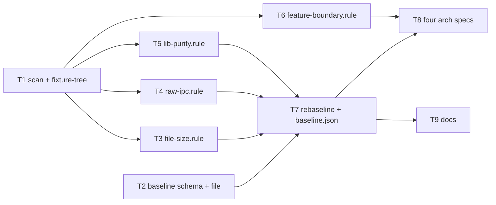

# Wave 0 PR-2: Ratcheted Architecture Specs — Implementation Plan

> **For agentic workers:** REQUIRED SUB-SKILL: Use superpowers:subagent-driven-development (recommended) or superpowers:executing-plans to implement this plan task-by-task. Steps use checkbox (`- [ ]`) syntax for tracking.

**Goal:** Add `app/arch/`, a set of `node --test` specs that fail when code breaks four architecture rules (file size, raw IPC, `lib/` purity, feature privacy), with today's violations frozen in a baseline that may only shrink.

**Architecture:** Bottom-up in four layers. Layer 1 holds the shared file scanner and the baseline schema. Layer 2 holds one rule module per rule; the four rules are independent lanes. Layer 3 holds `rebaseline.ts`, which measures all rules and writes `baseline.json`. Layer 4 holds the four thin arch specs and the docs. Each rule module exports a `collect…` (measure the repo) and a `check…` (compare to baseline → failure messages), so the specs and `rebaseline.ts` share one implementation.

**Tech Stack:** Node 22 (`node --test`, built-in type stripping), TypeScript, Zod 4 (`import { z } from 'zod'`, already in `app/package.json`).

**Spec:** `docs/superpowers/specs/2026-10-30-wave0-guardrails-lld.md` §PR-2; parent HLD `docs/superpowers/specs/2026-10-30-wave-refactor-hld.md` v3.1; ADR `docs/adr/0002-arch-specs-not-eslint.md`

## Global Constraints

- Zero new dependencies. Only `node:*` built-ins and `zod`.
- No runtime code changes. Nothing under `app/src/`, `app/src-tauri/`, `mcp-mindmap/` is edited.
- Budgets: `app/src` `.ts` ≤ 400 lines, `.vue` ≤ 500; `app/src-tauri/src` `.rs` ≤ 600; `mcp-mindmap/src` `.ts` ≤ 400.
- Scanner skips directories `node_modules`, `target`, `dist`, `i18n`, and files ending `.test.ts`.
- Every failure message starts with `[arch:<rule>]` and ends with `See app/arch/CLAUDE.md.`
- Baseline paths are repo-relative, POSIX (`/`), never absolute, never containing `..`.
- `baseline.json` entries may only be removed or lowered. `rebaseline.ts` exits 1 on any increase.
- All arch tests together run in ≤ ~1s.
- Type stripping rules: import types with `import type` / inline `type`; no `enum`, no constructor parameter properties; local imports use the `.ts` extension.
- Commit on `main` (branch creation is blocked here). Do not push. Commit messages end with `Co-Authored-By: Claude Opus 5.5 <noreply@anthropic.com>`.

## Rulings carried into this plan

| # | Decision | Why |
|---|---|---|
| R1 | Rule logic lives in `<rule>.rule.ts` modules, not in the specs | `rebaseline.ts` must recompute the same violations; a spec file cannot be imported without running its tests |
| R2 | `fixture-tree.ts` is a shared test helper file, not local to `scan.test.ts` (LLD said local) | Every rule test needs `withFixtureTree` |
| R3 | `baseline-file.ts` holds baseline I/O; `baseline.schema.ts` stays Zod-only | File-role rule: `.schema.ts` has no I/O |
| R4 | `extractImports(source)` takes text, not a path; `listSourceFiles(repoRoot, roots, exts)` takes a root | Pure functions are testable on fixtures |
| R5 | `rebaseline.ts --init` creates `baseline.json` once; without `--init` it only shrinks | The LLD needs a first generation; `--init` refuses if the file exists |
| R6 | Add role `.rule.ts` to `docs/conventions/file-roles.md` | New role introduced by R1 |
| R7 | `app/arch/` is not typechecked in PR-2 | No `@types/node` in the repo; adding it breaks "zero new deps". Tests are the check |

## Dependency graph



| Layer | Tasks (parallel within layer) | Starts when |
|---|---|---|
| 1 — Foundations | T1 ∥ T2 | now |
| 2 — Rules (one lane per rule) | T3 ∥ T4 ∥ T5 ∥ T6 | T1 committed (does not wait for T2) |
| 3 — Ratchet | T7 | T2, T3, T4, T5 committed |
| 4 — Specs + docs | T8 ∥ T9 | T7 committed (T8 also needs T6) |

## Parallel execution protocol

1. Dispatch every ready task in a layer at once. Each worker writes **only** its listed files.
2. Workers do **not** run `git commit` (parallel commits race on `.git/index.lock`).
3. The orchestrator commits each finished task on its own, staging only that task's paths.
4. A task starts once every task it depends on is committed.

## File map

```
app/arch/
├── CLAUDE.md                     T9  what each spec guards, how to shrink a baseline
├── scan.ts                       T1  REPO_ROOT, listSourceFiles, extractImports, countLines, toRepoPath
├── fixture-tree.ts               T1  withFixtureTree test helper
├── scan.test.ts                  T1
├── baseline.schema.ts            T2  Zod schema + Baseline type
├── baseline-file.ts              T2  BASELINE_PATH, loadBaseline, serializeBaseline
├── baseline.schema.test.ts       T2
├── file-size.rule.ts             T3  SIZE_BUDGETS, collectFileSize, checkFileSize
├── file-size.rule.test.ts        T3
├── raw-ipc.rule.ts               T4  collectRawIpc, checkRawIpc
├── raw-ipc.rule.test.ts          T4
├── lib-purity.rule.ts            T5  collectLibPurity, checkLibPurity
├── lib-purity.rule.test.ts       T5
├── feature-boundary.rule.ts      T6  findBoundaryViolation, checkFeatureBoundary
├── feature-boundary.rule.test.ts T6
├── rebaseline.ts                 T7  measure, rebaseline, CLI (--init)
├── rebaseline.test.ts            T7
├── baseline.json                 T7  generated
├── file-size.arch.test.ts        T8
├── raw-ipc.arch.test.ts          T8
├── lib-purity.arch.test.ts       T8
└── feature-boundary.arch.test.ts T8
```

Run one test file from the repo root: `node --test app/arch/<file>.test.ts`. Run all: `node --test "app/arch/**/*.test.ts"`.

---

### Task 1: Scanner and fixture helper (Layer 1)

**Files:**
- Create: `app/arch/scan.ts`
- Create: `app/arch/fixture-tree.ts`
- Test: `app/arch/scan.test.ts`

**Interfaces:**
- Consumes: nothing.
- Produces:
  - `REPO_ROOT: string` — absolute repo root, with trailing separator stripped by `join` users.
  - `listSourceFiles(repoRoot: string, roots: readonly string[], exts: readonly string[]): string[]` — sorted repo-relative POSIX paths.
  - `extractImports(source: string): string[]` — unique specifiers in order of appearance.
  - `countLines(source: string): number`
  - `toRepoPath(repoRoot: string, absPath: string): string`
  - `readRepoFile(repoRoot: string, repoPath: string): string`
  - `withFixtureTree(files: Record<string, string>, run: (root: string) => void): void` (in `fixture-tree.ts`)

- [ ] **Step 1: Write the fixture helper `app/arch/fixture-tree.ts`**

```typescript
import { mkdirSync, mkdtempSync, rmSync, writeFileSync } from 'node:fs';
import { tmpdir } from 'node:os';
import { dirname, join } from 'node:path';

const FIXTURE_PREFIX = 'arch-fixture-';

export function withFixtureTree(files: Record<string, string>, run: (root: string) => void): void {
  const root = mkdtempSync(join(tmpdir(), FIXTURE_PREFIX));
  try {
    for (const [repoPath, content] of Object.entries(files)) writeFixtureFile(root, repoPath, content);
    run(root);
  } finally {
    rmSync(root, { recursive: true, force: true });
  }
}

function writeFixtureFile(root: string, repoPath: string, content: string): void {
  const abs = join(root, repoPath);
  mkdirSync(dirname(abs), { recursive: true });
  writeFileSync(abs, content);
}
```

- [ ] **Step 2: Write the failing tests `app/arch/scan.test.ts`**

```typescript
import assert from 'node:assert/strict';
import { test } from 'node:test';
import { withFixtureTree } from './fixture-tree.ts';
import { countLines, extractImports, listSourceFiles } from './scan.ts';

test('extractImports finds static, type-only, side-effect, dynamic and re-export specifiers', () => {
  const source = [
    "import a from 'alpha';",
    "import { b,",
    "  c as d } from './beta.ts';",
    "import * as ns from 'gamma';",
    "import type { T } from './types.ts';",
    "import { type U, v } from 'delta';",
    "import 'side-effect.css';",
    "const lazy = () => import('./lazy.vue');",
    "export { e } from './epsilon.ts';",
    "export * from 'zeta';",
    "export type { W } from './omega.ts';",
  ].join('\n');
  assert.deepEqual(extractImports(source), [
    'alpha', './beta.ts', 'gamma', './types.ts', 'delta', 'side-effect.css',
    './lazy.vue', './epsilon.ts', 'zeta', './omega.ts',
  ]);
});

test('extractImports ignores string literals that are not imports and de-duplicates', () => {
  const source = "export const name = 'vue';\nimport x from 'vue';\nimport y from 'vue';";
  assert.deepEqual(extractImports(source), ['vue']);
});

test('listSourceFiles returns sorted repo paths and skips excluded dirs and tests', () => {
  withFixtureTree({
    'app/src/b.ts': '',
    'app/src/a.vue': '',
    'app/src/a.test.ts': '',
    'app/src/i18n/en.ts': '',
    'app/src/node_modules/x/index.ts': '',
    'app/src/dist/out.ts': '',
    'app/src-tauri/target/gen.rs': '',
    'app/src-tauri/src/main.rs': '',
    'app/src/readme.md': '',
  }, (root) => {
    assert.deepEqual(
      listSourceFiles(root, ['app/src', 'app/src-tauri'], ['.ts', '.vue', '.rs']),
      ['app/src-tauri/src/main.rs', 'app/src/a.vue', 'app/src/b.ts'],
    );
  });
});

test('listSourceFiles tolerates a missing root', () => {
  withFixtureTree({ 'app/src/a.ts': '' }, (root) => {
    assert.deepEqual(listSourceFiles(root, ['app/src', 'app/src/features'], ['.ts']), ['app/src/a.ts']);
  });
});

test('countLines matches wc -l for files ending in a newline', () => {
  assert.equal(countLines(''), 0);
  assert.equal(countLines('one\n'), 1);
  assert.equal(countLines('one\ntwo\n'), 2);
  assert.equal(countLines('one\ntwo'), 2);
});
```

- [ ] **Step 3: Run to verify it fails**

Run: `node --test app/arch/scan.test.ts`
Expected: FAIL — `Cannot find module '.../app/arch/scan.ts'`.

- [ ] **Step 4: Write `app/arch/scan.ts`**

```typescript
import { existsSync, readdirSync, readFileSync } from 'node:fs';
import { join, relative, sep } from 'node:path';
import { fileURLToPath } from 'node:url';

export const REPO_ROOT = fileURLToPath(new URL('../../', import.meta.url));

const SKIPPED_DIRS = new Set(['node_modules', 'target', 'dist', 'i18n']);
const TEST_FILE_SUFFIX = '.test.ts';
const IMPORT_PATTERNS: readonly RegExp[] = [
  /\b(?:import|export)\s+(?:type\s+)?(?:[\w*{}\s,$]+?\s+from\s+)?['"]([^'"]+)['"]/g,
  /\bimport\(\s*['"]([^'"]+)['"]\s*\)/g,
];

export function listSourceFiles(repoRoot: string, roots: readonly string[], exts: readonly string[]): string[] {
  const found: string[] = [];
  for (const root of roots) walk(join(repoRoot, root), exts, found);
  return [...new Set(found)].map((abs) => toRepoPath(repoRoot, abs)).sort();
}

export function extractImports(source: string): string[] {
  const hits: Array<{ index: number; specifier: string }> = [];
  for (const pattern of IMPORT_PATTERNS) {
    for (const match of source.matchAll(pattern)) hits.push({ index: match.index ?? 0, specifier: match[1] });
  }
  hits.sort((a, b) => a.index - b.index);
  return [...new Set(hits.map((hit) => hit.specifier))];
}

export function countLines(source: string): number {
  if (source === '') return 0;
  const lines = source.split('\n').length;
  return source.endsWith('\n') ? lines - 1 : lines;
}

export function toRepoPath(repoRoot: string, absPath: string): string {
  return relative(repoRoot, absPath).split(sep).join('/');
}

export function readRepoFile(repoRoot: string, repoPath: string): string {
  return readFileSync(join(repoRoot, repoPath), 'utf8');
}

function walk(dir: string, exts: readonly string[], found: string[]): void {
  if (!existsSync(dir)) return;
  for (const entry of readdirSync(dir, { withFileTypes: true })) {
    const abs = join(dir, entry.name);
    if (entry.isDirectory()) {
      if (!SKIPPED_DIRS.has(entry.name)) walk(abs, exts, found);
      continue;
    }
    if (isSourceFile(entry.name, exts)) found.push(abs);
  }
}

function isSourceFile(name: string, exts: readonly string[]): boolean {
  return !name.endsWith(TEST_FILE_SUFFIX) && exts.some((ext) => name.endsWith(ext));
}
```

- [ ] **Step 5: Run to verify it passes**

Run: `node --test app/arch/scan.test.ts`
Expected: PASS, 5 tests.

If the regex test fails on one case, fix the pattern in `IMPORT_PATTERNS`, not the test.

- [ ] **Step 6: Commit (orchestrator)**

```bash
git add app/arch/scan.ts app/arch/fixture-tree.ts app/arch/scan.test.ts
git commit -m "test(arch): add source scanner and fixture-tree helper

Co-Authored-By: Claude Opus 5.5 <noreply@anthropic.com>"
```

---

### Task 2: Baseline schema and file I/O (Layer 1)

**Files:**
- Create: `app/arch/baseline.schema.ts`
- Create: `app/arch/baseline-file.ts`
- Test: `app/arch/baseline.schema.test.ts`

**Interfaces:**
- Consumes: nothing.
- Produces:
  - `BaselineSchema` (Zod) and `type Baseline = { version: 1; fileSize: Record<string, number>; rawIpc: string[]; libPurity: string[] }`
  - `parseBaseline(raw: unknown): Baseline`
  - `BASELINE_PATH: string` — absolute path of `app/arch/baseline.json`
  - `loadBaseline(path?: string): Baseline` — reads and parses; default `BASELINE_PATH`
  - `serializeBaseline(baseline: Baseline): string` — keys and arrays sorted, 2-space JSON, trailing newline

- [ ] **Step 1: Write the failing tests `app/arch/baseline.schema.test.ts`**

```typescript
import assert from 'node:assert/strict';
import { test } from 'node:test';
import { serializeBaseline } from './baseline-file.ts';
import { parseBaseline } from './baseline.schema.ts';

const VALID = {
  version: 1,
  fileSize: { 'app/src/components/Editor.vue': 5026 },
  rawIpc: ['app/src/App.vue'],
  libPurity: ['app/src/lib/saf-fs.ts'],
};

test('accepts a valid baseline', () => {
  assert.deepEqual(parseBaseline(VALID), VALID);
});

test('rejects negative or zero line counts', () => {
  assert.throws(() => parseBaseline({ ...VALID, fileSize: { 'app/src/a.ts': -1 } }));
  assert.throws(() => parseBaseline({ ...VALID, fileSize: { 'app/src/a.ts': 0 } }));
});

test('rejects absolute and parent-relative paths', () => {
  assert.throws(() => parseBaseline({ ...VALID, rawIpc: ['/Users/x/app/src/a.ts'] }));
  assert.throws(() => parseBaseline({ ...VALID, libPurity: ['C:/repo/a.ts'] }));
  assert.throws(() => parseBaseline({ ...VALID, fileSize: { '/abs/a.ts': 500 } }));
  assert.throws(() => parseBaseline({ ...VALID, rawIpc: ['app/../secrets.ts'] }));
});

test('rejects an unknown version or extra keys', () => {
  assert.throws(() => parseBaseline({ ...VALID, version: 2 }));
  assert.throws(() => parseBaseline({ ...VALID, extra: true }));
});

test('serializeBaseline sorts keys and arrays and ends with a newline', () => {
  const text = serializeBaseline({
    version: 1,
    fileSize: { 'b.ts': 500, 'a.ts': 450 },
    rawIpc: ['z.ts', 'a.ts'],
    libPurity: [],
  });
  assert.equal(text, [
    '{',
    '  "version": 1,',
    '  "fileSize": {',
    '    "a.ts": 450,',
    '    "b.ts": 500',
    '  },',
    '  "rawIpc": [',
    '    "a.ts",',
    '    "z.ts"',
    '  ],',
    '  "libPurity": []',
    '}',
    '',
  ].join('\n'));
});
```

- [ ] **Step 2: Run to verify it fails**

Run: `node --test app/arch/baseline.schema.test.ts`
Expected: FAIL — `Cannot find module '.../app/arch/baseline-file.ts'`.

- [ ] **Step 3: Write `app/arch/baseline.schema.ts`**

```typescript
import { z } from 'zod';

const WINDOWS_DRIVE_RE = /^[A-Za-z]:/;

function isRepoRelative(path: string): boolean {
  return !path.startsWith('/') && !WINDOWS_DRIVE_RE.test(path) && !path.split('/').includes('..');
}

const RepoPath = z.string().min(1).refine(isRepoRelative, 'must be a repo-relative POSIX path');

export const BaselineSchema = z.strictObject({
  version: z.literal(1),
  fileSize: z.record(RepoPath, z.number().int().positive()),
  rawIpc: z.array(RepoPath),
  libPurity: z.array(RepoPath),
});

export type Baseline = z.infer<typeof BaselineSchema>;

export function parseBaseline(raw: unknown): Baseline {
  return BaselineSchema.parse(raw);
}
```

- [ ] **Step 4: Write `app/arch/baseline-file.ts`**

```typescript
import { readFileSync } from 'node:fs';
import { fileURLToPath } from 'node:url';
import { type Baseline, parseBaseline } from './baseline.schema.ts';

export const BASELINE_PATH = fileURLToPath(new URL('./baseline.json', import.meta.url));

const JSON_INDENT = 2;

export function loadBaseline(path: string = BASELINE_PATH): Baseline {
  return parseBaseline(JSON.parse(readFileSync(path, 'utf8')));
}

export function serializeBaseline(baseline: Baseline): string {
  const sorted: Baseline = {
    version: baseline.version,
    fileSize: Object.fromEntries(Object.entries(baseline.fileSize).sort(([a], [b]) => a.localeCompare(b))),
    rawIpc: [...baseline.rawIpc].sort(),
    libPurity: [...baseline.libPurity].sort(),
  };
  return `${JSON.stringify(sorted, null, JSON_INDENT)}\n`;
}
```

- [ ] **Step 5: Run to verify it passes**

Run: `node --test app/arch/baseline.schema.test.ts`
Expected: PASS, 5 tests.

- [ ] **Step 6: Commit (orchestrator)**

```bash
git add app/arch/baseline.schema.ts app/arch/baseline-file.ts app/arch/baseline.schema.test.ts
git commit -m "test(arch): add baseline schema and file I/O

Co-Authored-By: Claude Opus 5.5 <noreply@anthropic.com>"
```

---

### Task 3: File-size rule (Layer 2, lane A)

**Files:**
- Create: `app/arch/file-size.rule.ts`
- Test: `app/arch/file-size.rule.test.ts`

**Interfaces:**
- Consumes (T1): `listSourceFiles`, `countLines`, `readRepoFile`; `withFixtureTree`.
- Produces:
  - `type FileSizeSlice = Record<string, number>`
  - `SIZE_BUDGETS: readonly SizeBudget[]` where `SizeBudget = { root: string; ext: string; maxLines: number }`
  - `collectFileSize(repoRoot: string): FileSizeSlice` — only files over budget
  - `checkFileSize(current: FileSizeSlice, baseline: Readonly<FileSizeSlice>): string[]`

- [ ] **Step 1: Write the failing tests `app/arch/file-size.rule.test.ts`**

```typescript
import assert from 'node:assert/strict';
import { test } from 'node:test';
import { checkFileSize, collectFileSize } from './file-size.rule.ts';
import { withFixtureTree } from './fixture-tree.ts';

const lines = (count: number): string => 'x\n'.repeat(count);

test('collectFileSize reports only files over their budget', () => {
  withFixtureTree({
    'app/src/ok.ts': lines(400),
    'app/src/big.ts': lines(401),
    'app/src/ok.vue': lines(500),
    'app/src/big.vue': lines(501),
    'app/src-tauri/src/big.rs': lines(601),
    'mcp-mindmap/src/big.ts': lines(401),
    'app/src/big.test.ts': lines(900),
  }, (root) => {
    assert.deepEqual(collectFileSize(root), {
      'app/src/big.ts': 401,
      'app/src/big.vue': 501,
      'app/src-tauri/src/big.rs': 601,
      'mcp-mindmap/src/big.ts': 401,
    });
  });
});

test('checkFileSize passes when files are at or under their baseline', () => {
  assert.deepEqual(checkFileSize({ 'app/src/a.vue': 600 }, { 'app/src/a.vue': 600 }), []);
  assert.deepEqual(checkFileSize({ 'app/src/a.vue': 550 }, { 'app/src/a.vue': 600 }), []);
});

test('checkFileSize fails a baselined file that grew', () => {
  assert.deepEqual(checkFileSize({ 'app/src/components/Editor.vue': 5031 }, { 'app/src/components/Editor.vue': 5026 }), [
    '[arch:file-size] app/src/components/Editor.vue has 5031 lines; baseline 5026. Shrink it, or split before adding. See app/arch/CLAUDE.md.',
  ]);
});

test('checkFileSize fails a new file over budget', () => {
  assert.deepEqual(checkFileSize({ 'app/src/new.ts': 401 }, {}), [
    '[arch:file-size] app/src/new.ts has 401 lines; budget 400. Split it into smaller files. See app/arch/CLAUDE.md.',
  ]);
});
```

- [ ] **Step 2: Run to verify it fails**

Run: `node --test app/arch/file-size.rule.test.ts`
Expected: FAIL — `Cannot find module '.../app/arch/file-size.rule.ts'`.

- [ ] **Step 3: Write `app/arch/file-size.rule.ts`**

```typescript
import { countLines, listSourceFiles, readRepoFile } from './scan.ts';

export interface SizeBudget {
  readonly root: string;
  readonly ext: string;
  readonly maxLines: number;
}

export type FileSizeSlice = Record<string, number>;

export const SIZE_BUDGETS: readonly SizeBudget[] = [
  { root: 'app/src', ext: '.ts', maxLines: 400 },
  { root: 'app/src', ext: '.vue', maxLines: 500 },
  { root: 'app/src-tauri/src', ext: '.rs', maxLines: 600 },
  { root: 'mcp-mindmap/src', ext: '.ts', maxLines: 400 },
];

export function collectFileSize(repoRoot: string): FileSizeSlice {
  const over: FileSizeSlice = {};
  for (const budget of SIZE_BUDGETS) {
    for (const path of listSourceFiles(repoRoot, [budget.root], [budget.ext])) {
      const lineCount = countLines(readRepoFile(repoRoot, path));
      if (lineCount > budget.maxLines) over[path] = lineCount;
    }
  }
  return over;
}

export function checkFileSize(current: FileSizeSlice, baseline: Readonly<FileSizeSlice>): string[] {
  return Object.entries(current).flatMap(([path, lineCount]) => {
    const allowed = baseline[path];
    if (allowed === undefined) return [newFileMessage(path, lineCount)];
    return lineCount > allowed ? [grewMessage(path, lineCount, allowed)] : [];
  });
}

function budgetFor(path: string): number {
  const budget = SIZE_BUDGETS.find((b) => path.startsWith(`${b.root}/`) && path.endsWith(b.ext));
  return budget?.maxLines ?? 0;
}

function grewMessage(path: string, lineCount: number, allowed: number): string {
  return `[arch:file-size] ${path} has ${lineCount} lines; baseline ${allowed}. Shrink it, or split before adding. See app/arch/CLAUDE.md.`;
}

function newFileMessage(path: string, lineCount: number): string {
  return `[arch:file-size] ${path} has ${lineCount} lines; budget ${budgetFor(path)}. Split it into smaller files. See app/arch/CLAUDE.md.`;
}
```

- [ ] **Step 4: Run to verify it passes**

Run: `node --test app/arch/file-size.rule.test.ts`
Expected: PASS, 4 tests.

- [ ] **Step 5: Commit (orchestrator)**

```bash
git add app/arch/file-size.rule.ts app/arch/file-size.rule.test.ts
git commit -m "test(arch): add file-size rule

Co-Authored-By: Claude Opus 5.5 <noreply@anthropic.com>"
```

---

### Task 4: Raw-IPC rule (Layer 2, lane B)

**Files:**
- Create: `app/arch/raw-ipc.rule.ts`
- Test: `app/arch/raw-ipc.rule.test.ts`

**Interfaces:**
- Consumes (T1): `listSourceFiles`, `extractImports`, `readRepoFile`; `withFixtureTree`.
- Produces:
  - `RAW_IPC_MODULE = '@tauri-apps/api/core'`
  - `collectRawIpc(repoRoot: string): string[]` — sorted paths under `app/src` (`.ts`, `.vue`) that import `RAW_IPC_MODULE`
  - `checkRawIpc(current: readonly string[], baseline: readonly string[]): string[]`

- [ ] **Step 1: Write the failing tests `app/arch/raw-ipc.rule.test.ts`**

```typescript
import assert from 'node:assert/strict';
import { test } from 'node:test';
import { withFixtureTree } from './fixture-tree.ts';
import { checkRawIpc, collectRawIpc } from './raw-ipc.rule.ts';

test('collectRawIpc finds static and dynamic imports of @tauri-apps/api/core in app/src', () => {
  withFixtureTree({
    'app/src/a.ts': "import { invoke } from '@tauri-apps/api/core';",
    'app/src/b.vue': "<script setup lang=\"ts\">\nconst { invoke } = await import('@tauri-apps/api/core');\n</script>",
    'app/src/c.ts': "import { open } from '@tauri-apps/plugin-dialog';",
    'app/src/d.test.ts': "import { invoke } from '@tauri-apps/api/core';",
    'mcp-mindmap/src/e.ts': "import { invoke } from '@tauri-apps/api/core';",
  }, (root) => {
    assert.deepEqual(collectRawIpc(root), ['app/src/a.ts', 'app/src/b.vue']);
  });
});

test('checkRawIpc passes baselined files and fails new ones', () => {
  assert.deepEqual(checkRawIpc(['app/src/a.ts'], ['app/src/a.ts', 'app/src/gone.ts']), []);
  assert.deepEqual(checkRawIpc(['app/src/a.ts', 'app/src/new.ts'], ['app/src/a.ts']), [
    '[arch:raw-ipc] app/src/new.ts imports @tauri-apps/api/core. New raw IPC is frozen: call it from an already-baselined file, or from app/src/platform/ once it exists (Wave 1). See app/arch/CLAUDE.md.',
  ]);
});
```

- [ ] **Step 2: Run to verify it fails**

Run: `node --test app/arch/raw-ipc.rule.test.ts`
Expected: FAIL — `Cannot find module '.../app/arch/raw-ipc.rule.ts'`.

- [ ] **Step 3: Write `app/arch/raw-ipc.rule.ts`**

```typescript
import { extractImports, listSourceFiles, readRepoFile } from './scan.ts';

export const RAW_IPC_MODULE = '@tauri-apps/api/core';

const RAW_IPC_ROOTS: readonly string[] = ['app/src'];
const RAW_IPC_EXTS: readonly string[] = ['.ts', '.vue'];

export function collectRawIpc(repoRoot: string): string[] {
  return listSourceFiles(repoRoot, RAW_IPC_ROOTS, RAW_IPC_EXTS)
    .filter((path) => extractImports(readRepoFile(repoRoot, path)).includes(RAW_IPC_MODULE));
}

export function checkRawIpc(current: readonly string[], baseline: readonly string[]): string[] {
  const allowed = new Set(baseline);
  return current.filter((path) => !allowed.has(path)).map(rawIpcMessage);
}

function rawIpcMessage(path: string): string {
  return `[arch:raw-ipc] ${path} imports ${RAW_IPC_MODULE}. New raw IPC is frozen: call it from an already-baselined file, or from app/src/platform/ once it exists (Wave 1). See app/arch/CLAUDE.md.`;
}
```

- [ ] **Step 4: Run to verify it passes**

Run: `node --test app/arch/raw-ipc.rule.test.ts`
Expected: PASS, 2 tests.

- [ ] **Step 5: Commit (orchestrator)**

```bash
git add app/arch/raw-ipc.rule.ts app/arch/raw-ipc.rule.test.ts
git commit -m "test(arch): add raw-ipc rule

Co-Authored-By: Claude Opus 5.5 <noreply@anthropic.com>"
```

---

### Task 5: `lib/` purity rule (Layer 2, lane C)

**Files:**
- Create: `app/arch/lib-purity.rule.ts`
- Test: `app/arch/lib-purity.rule.test.ts`

**Interfaces:**
- Consumes (T1): `listSourceFiles`, `extractImports`, `readRepoFile`; `withFixtureTree`.
- Produces:
  - `isFrameworkImport(specifier: string): boolean` — `vue`, `vue/*`, `pinia`, `@tauri-apps/*`
  - `collectLibPurity(repoRoot: string): string[]` — sorted paths under `app/src/lib` (`.ts`, `.vue`) with a framework import
  - `checkLibPurity(current: readonly string[], baseline: readonly string[]): string[]`

- [ ] **Step 1: Write the failing tests `app/arch/lib-purity.rule.test.ts`**

```typescript
import assert from 'node:assert/strict';
import { test } from 'node:test';
import { withFixtureTree } from './fixture-tree.ts';
import { checkLibPurity, collectLibPurity, isFrameworkImport } from './lib-purity.rule.ts';

test('isFrameworkImport matches vue, pinia and any @tauri-apps package only', () => {
  for (const spec of ['vue', 'vue/server-renderer', 'pinia', '@tauri-apps/api/core', '@tauri-apps/plugin-fs']) {
    assert.equal(isFrameworkImport(spec), true, spec);
  }
  for (const spec of ['vue-router-like', './vue.ts', 'pinia-orm', 'zod', '@codemirror/view']) {
    assert.equal(isFrameworkImport(spec), false, spec);
  }
});

test('collectLibPurity scans only app/src/lib and skips tests', () => {
  withFixtureTree({
    'app/src/lib/pure.ts': "import { z } from 'zod';",
    'app/src/lib/uses-vue.ts': "import { ref } from 'vue';",
    'app/src/lib/theme/uses-tauri.ts': "const fs = await import('@tauri-apps/plugin-fs');",
    'app/src/lib/uses-pinia.test.ts': "import { defineStore } from 'pinia';",
    'app/src/stores/store.ts': "import { defineStore } from 'pinia';",
  }, (root) => {
    assert.deepEqual(collectLibPurity(root), ['app/src/lib/theme/uses-tauri.ts', 'app/src/lib/uses-vue.ts']);
  });
});

test('checkLibPurity passes baselined files and fails new ones', () => {
  assert.deepEqual(checkLibPurity(['app/src/lib/a.ts'], ['app/src/lib/a.ts']), []);
  assert.deepEqual(checkLibPurity(['app/src/lib/b.ts'], []), [
    '[arch:lib-purity] app/src/lib/b.ts imports vue, pinia or @tauri-apps/*. lib/ is pure TS: move that call into a store, composable or component. See app/arch/CLAUDE.md.',
  ]);
});
```

- [ ] **Step 2: Run to verify it fails**

Run: `node --test app/arch/lib-purity.rule.test.ts`
Expected: FAIL — `Cannot find module '.../app/arch/lib-purity.rule.ts'`.

- [ ] **Step 3: Write `app/arch/lib-purity.rule.ts`**

```typescript
import { extractImports, listSourceFiles, readRepoFile } from './scan.ts';

const LIB_ROOTS: readonly string[] = ['app/src/lib'];
const LIB_EXTS: readonly string[] = ['.ts', '.vue'];
const FRAMEWORK_EXACT = new Set(['vue', 'pinia']);
const FRAMEWORK_PREFIXES: readonly string[] = ['vue/', '@tauri-apps/'];

export function isFrameworkImport(specifier: string): boolean {
  return FRAMEWORK_EXACT.has(specifier) || FRAMEWORK_PREFIXES.some((prefix) => specifier.startsWith(prefix));
}

export function collectLibPurity(repoRoot: string): string[] {
  return listSourceFiles(repoRoot, LIB_ROOTS, LIB_EXTS)
    .filter((path) => extractImports(readRepoFile(repoRoot, path)).some(isFrameworkImport));
}

export function checkLibPurity(current: readonly string[], baseline: readonly string[]): string[] {
  const allowed = new Set(baseline);
  return current.filter((path) => !allowed.has(path)).map(libPurityMessage);
}

function libPurityMessage(path: string): string {
  return `[arch:lib-purity] ${path} imports vue, pinia or @tauri-apps/*. lib/ is pure TS: move that call into a store, composable or component. See app/arch/CLAUDE.md.`;
}
```

- [ ] **Step 4: Run to verify it passes**

Run: `node --test app/arch/lib-purity.rule.test.ts`
Expected: PASS, 3 tests.

- [ ] **Step 5: Commit (orchestrator)**

```bash
git add app/arch/lib-purity.rule.ts app/arch/lib-purity.rule.test.ts
git commit -m "test(arch): add lib-purity rule

Co-Authored-By: Claude Opus 5.5 <noreply@anthropic.com>"
```

---

### Task 6: Feature-boundary rule (Layer 2, lane D)

**Files:**
- Create: `app/arch/feature-boundary.rule.ts`
- Test: `app/arch/feature-boundary.rule.test.ts`

**Interfaces:**
- Consumes (T1): `listSourceFiles`, `extractImports`, `readRepoFile`; `withFixtureTree`.
- Produces:
  - `findBoundaryViolation(importer: string, specifier: string): string | null` — returns the private target path, or `null`
  - `checkFeatureBoundary(repoRoot: string): string[]` — failure messages; no baseline (the rule must hold from the first feature)

The repo has no import alias, so only relative specifiers (`./`, `../`) can reach a feature's `internal/`.

- [ ] **Step 1: Write the failing tests `app/arch/feature-boundary.rule.test.ts`**

```typescript
import assert from 'node:assert/strict';
import { test } from 'node:test';
import { checkFeatureBoundary, findBoundaryViolation } from './feature-boundary.rule.ts';
import { withFixtureTree } from './fixture-tree.ts';

test('a file outside a feature may not import its internal/', () => {
  assert.equal(
    findBoundaryViolation('app/src/App.vue', './features/git/internal/git.service.ts'),
    'app/src/features/git/internal/git.service.ts',
  );
});

test('another feature may not import internal/, but may import contracts/', () => {
  const importer = 'app/src/features/editor/ui/Editor.vue';
  assert.equal(findBoundaryViolation(importer, '../../git/internal/git.store.ts'), 'app/src/features/git/internal/git.store.ts');
  assert.equal(findBoundaryViolation(importer, '../../git/contracts/git.port.ts'), null);
});

test('a feature may import its own internal/ and bare packages are ignored', () => {
  assert.equal(findBoundaryViolation('app/src/features/git/ui/GitPane.vue', '../internal/git.store.ts'), null);
  assert.equal(findBoundaryViolation('app/src/App.vue', 'vue'), null);
});

test('checkFeatureBoundary passes when no features/ exists yet', () => {
  withFixtureTree({ 'app/src/App.vue': "import x from './lib/x.ts';" }, (root) => {
    assert.deepEqual(checkFeatureBoundary(root), []);
  });
});

test('checkFeatureBoundary reports each crossing import', () => {
  withFixtureTree({
    'app/src/App.vue': "import { s } from './features/git/internal/git.service.ts';",
    'app/src/features/git/internal/git.service.ts': 'export const s = 1;',
  }, (root) => {
    assert.deepEqual(checkFeatureBoundary(root), [
      '[arch:feature-boundary] app/src/App.vue imports app/src/features/git/internal/git.service.ts, which is private to feature "git". Import from app/src/features/git/contracts/ instead. See app/arch/CLAUDE.md.',
    ]);
  });
});
```

- [ ] **Step 2: Run to verify it fails**

Run: `node --test app/arch/feature-boundary.rule.test.ts`
Expected: FAIL — `Cannot find module '.../app/arch/feature-boundary.rule.ts'`.

- [ ] **Step 3: Write `app/arch/feature-boundary.rule.ts`**

```typescript
import { posix } from 'node:path';
import { extractImports, listSourceFiles, readRepoFile } from './scan.ts';

const SOURCE_ROOTS: readonly string[] = ['app/src'];
const SOURCE_EXTS: readonly string[] = ['.ts', '.vue'];
const INTERNAL_PATH_RE = /^app\/src\/features\/([^/]+)\/internal\//;
const FEATURE_PATH_RE = /^app\/src\/features\/([^/]+)\//;
const RELATIVE_PREFIX = '.';

export function findBoundaryViolation(importer: string, specifier: string): string | null {
  if (!specifier.startsWith(RELATIVE_PREFIX)) return null;
  const target = posix.normalize(posix.join(posix.dirname(importer), specifier));
  const targetFeature = INTERNAL_PATH_RE.exec(target)?.[1];
  if (targetFeature === undefined) return null;
  return FEATURE_PATH_RE.exec(importer)?.[1] === targetFeature ? null : target;
}

export function checkFeatureBoundary(repoRoot: string): string[] {
  return listSourceFiles(repoRoot, SOURCE_ROOTS, SOURCE_EXTS).flatMap((importer) =>
    extractImports(readRepoFile(repoRoot, importer)).flatMap((specifier) => {
      const target = findBoundaryViolation(importer, specifier);
      return target === null ? [] : [boundaryMessage(importer, target)];
    }),
  );
}

function boundaryMessage(importer: string, target: string): string {
  const feature = INTERNAL_PATH_RE.exec(target)?.[1] ?? '';
  return `[arch:feature-boundary] ${importer} imports ${target}, which is private to feature "${feature}". Import from app/src/features/${feature}/contracts/ instead. See app/arch/CLAUDE.md.`;
}
```

- [ ] **Step 4: Run to verify it passes**

Run: `node --test app/arch/feature-boundary.rule.test.ts`
Expected: PASS, 5 tests.

- [ ] **Step 5: Commit (orchestrator)**

```bash
git add app/arch/feature-boundary.rule.ts app/arch/feature-boundary.rule.test.ts
git commit -m "test(arch): add feature-boundary rule

Co-Authored-By: Claude Opus 5.5 <noreply@anthropic.com>"
```

---

### Task 7: Rebaseline script and first `baseline.json` (Layer 3)

**Files:**
- Create: `app/arch/rebaseline.ts`
- Test: `app/arch/rebaseline.test.ts`
- Create (generated): `app/arch/baseline.json`

**Interfaces:**
- Consumes: T2 `type Baseline`, `BASELINE_PATH`, `loadBaseline`, `serializeBaseline`; T1 `REPO_ROOT`, `withFixtureTree`; T3 `collectFileSize`, `checkFileSize`; T4 `collectRawIpc`, `checkRawIpc`; T5 `collectLibPurity`, `checkLibPurity`.
- Produces:
  - `measure(repoRoot: string): Baseline`
  - `rebaseline(previous: Baseline, measured: Baseline): { baseline: Baseline; increases: string[] }`
  - CLI: `node app/arch/rebaseline.ts` (shrink only) and `node app/arch/rebaseline.ts --init` (create once)

- [ ] **Step 1: Write the failing tests `app/arch/rebaseline.test.ts`**

```typescript
import assert from 'node:assert/strict';
import { test } from 'node:test';
import type { Baseline } from './baseline.schema.ts';
import { withFixtureTree } from './fixture-tree.ts';
import { measure, rebaseline } from './rebaseline.ts';

const lines = (count: number): string => 'x\n'.repeat(count);

const PREVIOUS: Baseline = {
  version: 1,
  fileSize: { 'app/src/big.vue': 700, 'app/src/fixed.ts': 450 },
  rawIpc: ['app/src/ipc.ts', 'app/src/old-ipc.ts'],
  libPurity: ['app/src/lib/impure.ts'],
};

test('measure collects every baselined rule from the tree', () => {
  withFixtureTree({
    'app/src/big.vue': lines(650),
    'app/src/ipc.ts': "import { invoke } from '@tauri-apps/api/core';",
    'app/src/lib/impure.ts': "import { ref } from 'vue';",
  }, (root) => {
    assert.deepEqual(measure(root), {
      version: 1,
      fileSize: { 'app/src/big.vue': 650 },
      rawIpc: ['app/src/ipc.ts'],
      libPurity: ['app/src/lib/impure.ts'],
    });
  });
});

test('rebaseline lowers shrunk values and drops fixed entries', () => {
  const measured: Baseline = {
    version: 1,
    fileSize: { 'app/src/big.vue': 650 },
    rawIpc: ['app/src/ipc.ts'],
    libPurity: [],
  };
  assert.deepEqual(rebaseline(PREVIOUS, measured), {
    baseline: { version: 1, fileSize: { 'app/src/big.vue': 650 }, rawIpc: ['app/src/ipc.ts'], libPurity: [] },
    increases: [],
  });
});

test('rebaseline refuses an increase (fixture baseline + fixture file)', () => {
  withFixtureTree({
    'app/src/big.vue': lines(701),
    'app/src/new-ipc.ts': "import { invoke } from '@tauri-apps/api/core';",
  }, (root) => {
    const { increases } = rebaseline(PREVIOUS, measure(root));
    assert.equal(increases.length, 2);
    assert.match(increases[0], /^\[arch:file-size\] app\/src\/big\.vue has 701 lines; baseline 700\./);
    assert.match(increases[1], /^\[arch:raw-ipc\] app\/src\/new-ipc\.ts imports/);
  });
});
```

- [ ] **Step 2: Run to verify it fails**

Run: `node --test app/arch/rebaseline.test.ts`
Expected: FAIL — `Cannot find module '.../app/arch/rebaseline.ts'`.

- [ ] **Step 3: Write `app/arch/rebaseline.ts`**

```typescript
import { existsSync, writeFileSync } from 'node:fs';
import { pathToFileURL } from 'node:url';
import { BASELINE_PATH, loadBaseline, serializeBaseline } from './baseline-file.ts';
import type { Baseline } from './baseline.schema.ts';
import { checkFileSize, collectFileSize } from './file-size.rule.ts';
import { checkLibPurity, collectLibPurity } from './lib-purity.rule.ts';
import { checkRawIpc, collectRawIpc } from './raw-ipc.rule.ts';
import { REPO_ROOT } from './scan.ts';

const INIT_FLAG = '--init';
const EXIT_OK = 0;
const EXIT_REFUSED = 1;

export interface RebaselineResult {
  readonly baseline: Baseline;
  readonly increases: string[];
}

export function measure(repoRoot: string): Baseline {
  return {
    version: 1,
    fileSize: collectFileSize(repoRoot),
    rawIpc: collectRawIpc(repoRoot),
    libPurity: collectLibPurity(repoRoot),
  };
}

export function rebaseline(previous: Baseline, measured: Baseline): RebaselineResult {
  const increases = [
    ...checkFileSize(measured.fileSize, previous.fileSize),
    ...checkRawIpc(measured.rawIpc, previous.rawIpc),
    ...checkLibPurity(measured.libPurity, previous.libPurity),
  ];
  return { baseline: shrink(previous, measured), increases };
}

function shrink(previous: Baseline, measured: Baseline): Baseline {
  const kept = Object.keys(previous.fileSize).filter((path) => measured.fileSize[path] !== undefined);
  return {
    version: 1,
    fileSize: Object.fromEntries(kept.map((path) => [path, Math.min(previous.fileSize[path], measured.fileSize[path])])),
    rawIpc: previous.rawIpc.filter((path) => measured.rawIpc.includes(path)),
    libPurity: previous.libPurity.filter((path) => measured.libPurity.includes(path)),
  };
}

function summary(baseline: Baseline): string {
  return `fileSize ${Object.keys(baseline.fileSize).length}, rawIpc ${baseline.rawIpc.length}, libPurity ${baseline.libPurity.length}`;
}

function init(measured: Baseline): number {
  if (existsSync(BASELINE_PATH)) {
    console.error(`${BASELINE_PATH} exists. ${INIT_FLAG} only creates it; run without ${INIT_FLAG} to shrink it.`);
    return EXIT_REFUSED;
  }
  writeFileSync(BASELINE_PATH, serializeBaseline(measured));
  console.log(`baseline created: ${summary(measured)}`);
  return EXIT_OK;
}

function main(args: readonly string[]): number {
  const measured = measure(REPO_ROOT);
  if (args.includes(INIT_FLAG)) return init(measured);
  const { baseline, increases } = rebaseline(loadBaseline(), measured);
  if (increases.length > 0) {
    console.error([...increases, 'rebaseline refused: baseline values may only go down.'].join('\n'));
    return EXIT_REFUSED;
  }
  writeFileSync(BASELINE_PATH, serializeBaseline(baseline));
  console.log(`baseline updated: ${summary(baseline)}`);
  return EXIT_OK;
}

if (process.argv[1] !== undefined && import.meta.url === pathToFileURL(process.argv[1]).href) {
  process.exitCode = main(process.argv.slice(2));
}
```

- [ ] **Step 4: Run to verify it passes**

Run: `node --test app/arch/rebaseline.test.ts`
Expected: PASS, 3 tests.

- [ ] **Step 5: Generate the baseline**

Run: `node app/arch/rebaseline.ts --init`
Expected: `baseline created: fileSize 71, rawIpc 58, libPurity N` — 71 = 22 `.ts` + 26 `.vue` + 23 `.rs`, measured at `9dc0efb3`. `N` is about 21 (it can be slightly higher, since dynamic `import()` is counted too). Record the exact line in the report.

If `fileSize` or `rawIpc` differ from 71 / 58, report the numbers and do not edit anything to force them.

- [ ] **Step 6: Check idempotence and the refusal**

```bash
shasum app/arch/baseline.json
node app/arch/rebaseline.ts
shasum app/arch/baseline.json
node app/arch/rebaseline.ts --init; echo "exit $?"
```

Expected: both `shasum` lines match; the plain run prints `baseline updated: …` with the same counts; the `--init` run prints `… exists …` and `exit 1`.

- [ ] **Step 7: Commit (orchestrator)**

```bash
git add app/arch/rebaseline.ts app/arch/rebaseline.test.ts app/arch/baseline.json
git commit -m "test(arch): add rebaseline script and initial baseline

Co-Authored-By: Claude Opus 5.5 <noreply@anthropic.com>"
```

---

### Task 8: The four arch specs (Layer 4)

**Files:**
- Create: `app/arch/file-size.arch.test.ts`
- Create: `app/arch/raw-ipc.arch.test.ts`
- Create: `app/arch/lib-purity.arch.test.ts`
- Create: `app/arch/feature-boundary.arch.test.ts`

**Interfaces:**
- Consumes: T1 `REPO_ROOT`; T2 `loadBaseline`; T3–T6 `collect…` / `check…`; T7 committed `baseline.json`.
- Produces: the specs PR-3 wires into `guard`.

Each spec passes its failure list as the assertion message, so a failure prints only the `[arch:…]` lines.

- [ ] **Step 1: Write `app/arch/file-size.arch.test.ts`**

```typescript
import assert from 'node:assert/strict';
import { test } from 'node:test';
import { loadBaseline } from './baseline-file.ts';
import { checkFileSize, collectFileSize } from './file-size.rule.ts';
import { REPO_ROOT } from './scan.ts';

test('no file grows past its size budget or baseline', () => {
  const failures = checkFileSize(collectFileSize(REPO_ROOT), loadBaseline().fileSize);
  assert.deepEqual(failures, [], failures.join('\n'));
});
```

- [ ] **Step 2: Write `app/arch/raw-ipc.arch.test.ts`**

```typescript
import assert from 'node:assert/strict';
import { test } from 'node:test';
import { loadBaseline } from './baseline-file.ts';
import { checkRawIpc, collectRawIpc } from './raw-ipc.rule.ts';
import { REPO_ROOT } from './scan.ts';

test('no new file imports @tauri-apps/api/core', () => {
  const failures = checkRawIpc(collectRawIpc(REPO_ROOT), loadBaseline().rawIpc);
  assert.deepEqual(failures, [], failures.join('\n'));
});
```

- [ ] **Step 3: Write `app/arch/lib-purity.arch.test.ts`**

```typescript
import assert from 'node:assert/strict';
import { test } from 'node:test';
import { loadBaseline } from './baseline-file.ts';
import { checkLibPurity, collectLibPurity } from './lib-purity.rule.ts';
import { REPO_ROOT } from './scan.ts';

test('no new lib/ file imports vue, pinia or @tauri-apps/*', () => {
  const failures = checkLibPurity(collectLibPurity(REPO_ROOT), loadBaseline().libPurity);
  assert.deepEqual(failures, [], failures.join('\n'));
});
```

- [ ] **Step 4: Write `app/arch/feature-boundary.arch.test.ts`**

```typescript
import assert from 'node:assert/strict';
import { test } from 'node:test';
import { checkFeatureBoundary } from './feature-boundary.rule.ts';
import { REPO_ROOT } from './scan.ts';

test("no file imports another feature's internal/", () => {
  const failures = checkFeatureBoundary(REPO_ROOT);
  assert.deepEqual(failures, [], failures.join('\n'));
});
```

- [ ] **Step 5: Run all arch tests**

Run: `node --test "app/arch/**/*.test.ts"`
Expected: PASS, 31 tests (5 + 5 + 4 + 2 + 3 + 5 + 3 + 4), `# fail 0`, duration under ~1s.

- [ ] **Step 6: Prove a spec fails with the right message (do not keep the change)**

```bash
printf '\n' >> app/src/components/Editor.vue
node --test app/arch/file-size.arch.test.ts; echo "exit $?"
git restore app/src/components/Editor.vue
git diff --exit-code -- app/src/components/Editor.vue && echo restored
```

Expected: the test fails with `[arch:file-size] app/src/components/Editor.vue has <baseline+1> lines; baseline <baseline>. …`, `exit 1`, then `restored`.

- [ ] **Step 7: Commit (orchestrator)**

```bash
git add app/arch/file-size.arch.test.ts app/arch/raw-ipc.arch.test.ts app/arch/lib-purity.arch.test.ts app/arch/feature-boundary.arch.test.ts
git commit -m "test(arch): add file-size, raw-ipc, lib-purity and feature-boundary specs

Co-Authored-By: Claude Opus 5.5 <noreply@anthropic.com>"
```

---

### Task 9: Docs — `app/arch/CLAUDE.md` and doc sync (Layer 4)

**Files:**
- Create: `app/arch/CLAUDE.md`
- Modify: `docs/conventions/file-roles.md` (add one row after the `.arch.test.ts` row)
- Modify: `app/CLAUDE.md` (lines 21, 30, 40)
- Modify: `CLAUDE.md` (invariants 2 and 4)

**Interfaces:**
- Consumes: T7 CLI (`rebaseline.ts`, `--init`), the file map above.
- Produces: the doc that every `[arch:…]` message points to.

- [ ] **Step 1: Write `app/arch/CLAUDE.md`**

````markdown
# app/arch/

Architecture specs. They run with `node --test` and fail with `[arch:<rule>]` messages. Decision: [ADR 0002](../../docs/adr/0002-arch-specs-not-eslint.md).

## Rules

| Rule | Guards | Fails when | Baseline key |
|---|---|---|---|
| `file-size` | `app/src` `.ts` ≤ 400, `.vue` ≤ 500; `app/src-tauri/src` `.rs` ≤ 600; `mcp-mindmap/src` `.ts` ≤ 400 | A file not in the baseline is over budget, or a baselined file grows past its recorded size | `fileSize` |
| `raw-ipc` | `app/src` | A file not in the baseline imports `@tauri-apps/api/core` | `rawIpc` |
| `lib-purity` | `app/src/lib` | A file not in the baseline imports `vue`, `pinia` or `@tauri-apps/*` | `libPurity` |
| `feature-boundary` | `app/src` | A file imports another feature's `features/<f>/internal/` | none — no exceptions |

Tests (`*.test.ts`) and `i18n/` are never scanned.

## When a spec fails

1. Read the `[arch:…]` line. It names the file and the fix.
2. Fix the code: split the file, or move the import. Never edit `baseline.json` by hand to make it pass.
3. Baseline entries never grow. A new violation is not an option.

## Shrinking the baseline

After you make a baselined file smaller or remove its violation:

```bash
node app/arch/rebaseline.ts
```

It lowers or drops entries and commits nothing. It exits 1 and changes nothing if any value would go up. `--init` only creates a missing `baseline.json`.

## Files

| File | Role |
|---|---|
| `scan.ts` | File walker, import extractor, line counter |
| `<rule>.rule.ts` | `collect…` measures the repo; `check…` compares to the baseline |
| `<rule>.arch.test.ts` | The spec: collect, check, assert no failures |
| `baseline.schema.ts`, `baseline-file.ts` | Baseline shape (Zod) and I/O |
| `rebaseline.ts` | Shrink-only baseline update |
| `fixture-tree.ts` | `withFixtureTree` helper for rule tests |

## Run

```bash
node --test "app/arch/**/*.test.ts"
```

Adding a rule: write `<rule>.rule.ts` + its unit test with `withFixtureTree`, then a thin `<rule>.arch.test.ts`. If the rule needs a baseline, add its key to `baseline.schema.ts` and to `measure` / `rebaseline` in `rebaseline.ts`.
````

- [ ] **Step 2: Add the `.rule.ts` role to `docs/conventions/file-roles.md`**

Insert after the row starting `| \`.arch.test.ts\` |`:

```markdown
| `.rule.ts` | One architecture rule under `app/arch/`: `collect…` and `check…` | Assertions, writes |
```

- [ ] **Step 3: Update `app/CLAUDE.md`**

- Line 21: delete the text `, \`arch/\` (Wave 0 PR-2)` so the line ends with `\`src/ai/\` (Wave 4).`
- Line 30: replace the row with
  `| Arch | \`arch/*.test.ts\` | \`node --test "arch/**/*.test.ts"\` (from \`app/\`); \`pnpm --dir app arch\` from PR-3 |`
- Line 40: replace the row with
  `| \`arch/\` | [arch/CLAUDE.md](arch/CLAUDE.md) |`

- [ ] **Step 4: Update root `CLAUDE.md` invariants 2 and 4**

- Invariant 2: replace `(\`app/arch/baseline.json\`, from Wave 0 PR-2)` with `([app/arch/baseline.json](app/arch/baseline.json))`.
- Invariant 4: replace `they get baselined in Wave 0 PR-2 and may only shrink` with `they are listed in \`app/arch/baseline.json\` and may only shrink`.

- [ ] **Step 5: Check links and size**

Run: `bash <scratchpad>/check-links.sh CLAUDE.md app/CLAUDE.md app/arch/CLAUDE.md docs/conventions/file-roles.md && wc -w app/arch/CLAUDE.md`

The checker (save to the scratchpad, not the repo):

```bash
#!/usr/bin/env bash
status=0
for f in "$@"; do
  dir=$(dirname "$f")
  grep -oE '\]\([^)#[:space:]]+' "$f" | sed 's/^](//' | grep -vE '^https?:' | while read -r p; do
    [ -e "$dir/$p" ] || { echo "BROKEN $f -> $p"; exit 1; }
  done || status=1
done
exit $status
```

Expected: no `BROKEN` lines; `app/arch/CLAUDE.md` ≤ 1000 words. If T7 is not yet committed when this runs, the `baseline.json` link reports BROKEN; rerun after T7.

- [ ] **Step 6: Commit (orchestrator)**

```bash
git add app/arch/CLAUDE.md docs/conventions/file-roles.md app/CLAUDE.md CLAUDE.md
git commit -m "docs(arch): add app/arch/CLAUDE.md and sync conventions and routers

Co-Authored-By: Claude Opus 5.5 <noreply@anthropic.com>"
```

---

### Final verification (orchestrator, after T8 and T9)

- [ ] `node --test "app/arch/**/*.test.ts"` → `# fail 0`, 31 tests.
- [ ] `pnpm --dir app test` → 1153 pass (arch tests sit outside `src/`, so this count is unchanged).
- [ ] `pnpm --dir app exec vue-tsc --noEmit` → exit 0 (`arch/` is outside `include`, so unaffected).
- [ ] `git diff --name-only <PR-2 base> -- app/src app/src-tauri mcp-mindmap` → empty.
- [ ] `git status --porcelain` → empty.

## Spec coverage

| LLD §PR-2 item | Task |
|---|---|
| `scan.ts` — `listSourceFiles`, `extractImports`, `countLines`; skip list | T1 (signature changes: R4) |
| `baseline.schema.ts` — `{version:1, fileSize, rawIpc, libPurity}` | T2 |
| `baseline.json` generated once | T7 (`--init`, R5) |
| `rebaseline.ts` — write only lowered/removed entries; exit 1 on increase | T7 |
| `file-size`, `raw-ipc`, `lib-purity`, `feature-boundary` rules and scopes | T3–T6 logic, T8 specs |
| Message format `[arch:file-size] … has N lines; baseline M. Shrink it, or split before adding. See app/arch/CLAUDE.md.` | T3 (exact string tested) |
| `feature-boundary` passes vacuously until `features/` exists | T6 test + T8 |
| Unit coverage: static, dynamic, type-only, side-effect imports | T1 |
| Unit coverage: excludes node_modules, dist, target, tests, i18n | T1 |
| Unit coverage: schema rejects negative counts and absolute paths | T2 |
| Unit coverage: rebaseline refuses an increase (fixture baseline + file) | T7 |
| `withFixtureTree(files, run)` helper | T1 (`fixture-tree.ts`, R2) |
| `app/arch/CLAUDE.md` | T9 |
| Seam 2 (helpers + tests, no consumer) / Seam 3 (specs, baseline, rebaseline, CLAUDE.md) | Layers 1–2 / Layers 3–4 |
