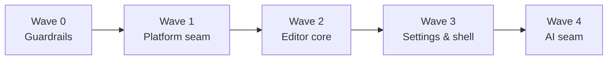

## HLD: Wave Refactor — therapy-os principles for solomd-rtl

**Status**: Stable | **Version**: v3.0 | **Date**: 30-10-26

---

### 1. Overview

**Problem**: solomd-rtl grew feature-first. God files (`Editor.vue` 5026, `FileTree.vue` 2943, `ai_proxy.rs` 2933, `SettingsPanel.vue` 2614, `App.vue` 2511, `stores/settings.ts` 1793), ~100 raw `invoke()` calls in 58 files, AI calls scattered in components. Each new AI capability costs more than the last.

**Solution**: Restructure in waves. Each wave runs two tracks at once — **Define** (contracts, bottom-up) and **Decompose** (split god files, top-down) — and closes with an **Integrate** gate where decomposed code adopts the new contracts. Every wave ships a release.

**Version history**
- **v1.0** (30-10-26): initial draft
- **v1.1** (30-10-26): Q1 resolved — fork independent; full move to `features/`
- **v2.0** (30-10-26): Q2 resolved — Editor wave moved before AI wave
- **v3.0** (30-10-26): AI wave moved last (AI features not in use yet); Q3 resolved — desktop + web only

**Scope**
- In: `app/src`, `app/src-tauri/src`, `mcp-mindmap/`, agent docs (`CLAUDE.md` layering), quality gates.
- Out: new features, visual redesign, upstream SoloMD feature parity, demos/.

### 2. Principles ported from therapy-os

| # | therapy-os principle | solomd-rtl form |
|---|---|---|
| P1 | Feature = `contracts/` + `internal/`; boundary lint | `app/src/features/<f>/{contracts,internal,ui}`; lint bans imports into another feature's `internal/` |
| P2 | Zod at every boundary | IPC, persisted settings, AI responses, `.mmap` files (model: `lib/theme/schema.ts`) |
| P3 | Provider-agnostic `LlmClient` port + drivers + canned stub + rule-based fallback | Same, in TS; Rust keeps transport/keychain only |
| P4 | File-role taxonomy `<name>.<role>.ts` | Roles: `port`, `adapter`, `schema`, `service`, `feature`, `store`, `prompt` |
| P5 | Greenness ladder, exit code is the signal | `guard` (≤15s) → `verify` → `full` |
| P6 | Layered agent docs, doc-sync rule | Root `CLAUDE.md` = invariants only; one `CLAUDE.md` per feature; code change ⇒ nearest `CLAUDE.md` updated |
| P7 | Spec wins; decisions settled in ADRs | `docs/adr/`; HLD per wave |
| P8 | Silent-failure guards as architecture tests | Arch specs: no raw `invoke`, no cross-`internal` import, file-size ratchet |

Not ported: NestJS DI (Vue uses a feature registry + `provide/inject`), server modular monolith.

**Why this survives AI evolution**: models change, providers change, agents get more autonomy. The defense is the same each time — small files an agent can hold whole, contracts it cannot silently break, a 15-second guard it runs after every edit, and docs that sit next to the code they describe.

### 3. Target architecture

```
app/src/
  platform/          ports + adapters (tauri | web); only place that imports @tauri-apps
  ai/                LlmClient port, drivers, prompt registry, tool contracts
  features/<f>/      contracts/ internal/ ui/ CLAUDE.md   — editor features, git, mindmap, rag…
  shell/             App host, layout, registry wiring (thin)
  lib/               pure utilities (unchanged rule: no Vue, no IPC)
```

| Component | Responsibility | Source of truth for |
|---|---|---|
| `platform/` | Typed, Zod-validated IPC; web/desktop parity | Rust command surface (TS side) |
| `ai/` | Model access, streaming, tool calling, fallback | Provider choice, prompts |
| `features/*` | One capability: CM extensions, commands, settings slice, i18n keys, UI | Its own state + settings slice |
| `shell/` | Compose registered features; window lifecycle | Feature registration order |
| Rust `src-tauri/` | Commands grouped by domain mirroring `platform/` ports | OS access, keychain, git, SQLite |

### 4. Wave map



| Wave | Define (contracts) | Decompose (god files) | Integrate gate | Est. |
|---|---|---|---|---|
| **0 Guardrails** | File-role taxonomy, `docs/adr/`, `CLAUDE.md` layering skeleton | — | `guard`/`verify` scripts; boundary lint; file-size ratchet at today's baseline (files may shrink, never grow) | 1 day |
| **1 Platform** | `platform/` ports + Zod per command domain (fs, git, ai, rag, settings, window); tauri + web adapters | `App.vue` → window, file-open, shortcuts, session, updates services | All ~100 `invoke` sites via ports; lint bans `@tauri-apps/api/core` outside `platform/` | 3–5 days |
| **2 Editor** | `EditorFeature` contract: CM extensions + commands + settings slice + i18n keys | `Editor.vue` → features (find, spellcheck, vim, export, image-upload, folds, ai-rewrite, session); `cm-live-blocks.ts` | `Editor.vue` is a host < 400 lines composing registered features; `ai-rewrite` keeps today's AI path behind a thin shim until Wave 4 | 5–8 days |
| **3 Settings & shell** | Per-feature settings slice schema + migration (theme pattern) | `stores/settings.ts`, `SettingsPanel.vue`, `FileTree.vue`, `Toolbar.vue`; Rust `commands.rs`, `git_pane/cli/actions.rs` | Settings UI rendered from feature registry; ratchet tightened to final budget (except AI files) | 5–7 days |
| **4 AI** | `LlmClient`, `ToolContract`, `PromptTemplate` registry, canned driver, fallback rule | `ai_proxy.rs` → per-provider drivers, wire, stream, cancel; `AISettings.vue`, `AgentPanel.vue` | `ai-rewrite` feature, agent panel, RAG go through `ai/`; temporary AI shim from Wave 2 deleted; AI settings slice joins the registry; MCP tool schemas shared with `mcp-mindmap` | 4–6 days |

Estimates assume Claude executes with the user reviewing each PR.

**Inside a wave**
1. Write the wave's contracts first (small PR, no callers yet).
2. Decompose in parallel PRs: extract-in-place, behavior unchanged, tests stay green.
3. Integrate gate: switch callers to contracts, delete old paths, turn the new lint rule from warn → error.
4. Release, tighten the ratchet, update `CLAUDE.md` files.

### 5. Data model

No persisted-data change except Wave 4: today's single settings blob splits into per-feature slices behind a versioned migration (same approach as `lib/theme/migrate.ts`). Old settings files must load unchanged.

### 6. Key decisions

| Decision | Options | Choice | Rationale | Reversibility |
|---|---|---|---|---|
| Wave order | AI earlier / AI last | Platform → Editor → Settings & shell → AI | AI features are not in use yet, so the AI wave has no user value until then; the editor, settings and shell are used daily. Cost: `ai-rewrite` sits behind a shim for two waves | High |
| Wave shape | Big-bang branch / wave per release | Wave per release | Always shippable; regressions stay small | High |
| Where `LlmClient` lives | Rust / TS | TS port, Rust transport | Prompts and tool contracts change fastest; TS is faster to iterate and shares types with `mcp-mindmap` | Medium |
| Feature folders | Keep `components/` flat / `features/` | Move everything into `features/` as each wave touches it; `components/` empties by Wave 4 | Fork is independent of upstream (Q1), so moves cost nothing at merge time | High |
| DI | Container / registry + `provide/inject` | Registry | Vue-native, no runtime dep | High |
| File-size rule | Hard cap now / ratchet | Ratchet | Hard cap fails ~20 files on day one | High |

### 7. Non-functional requirements

| Concern | Requirement | Design implication |
|---|---|---|
| No regressions | Test count never drops; e2e theme baselines pass | Integrate gate blocked on `verify` |
| Agent-sized code | Target ≤ 400 lines `.ts`, ≤ 500 `.vue`, ≤ 600 `.rs` by Wave 4 | Ratchet in `guard` |
| Feedback speed | `guard` ≤ 15s | Lint + typecheck of changed files + unit tests only |
| Reviewability | PR diff ≤ ~500 lines excluding moves | Extract-in-place, then move |
| Web/desktop parity | Every port has a tauri-desktop and a web adapter, or an explicit `unsupported`; no mobile adapters | Adapter contract test per port |

### 8. Open questions

| # | Question | Why it matters | Owner | Status |
|---|---|---|---|---|
| 1 | Do you still merge from upstream SoloMD? | Decides how freely files move | Ofek | Resolved 30-10-26: no — fork is independent; move freely |
| 2 | AI wave before Editor wave, or swap? | Order of value vs. size reduction | Ofek | Resolved 30-10-26: Editor first |
| 3 | Mobile (iOS/Android) in scope for adapters? | Adds a third adapter per port | Ofek | Resolved 30-10-26: no — desktop + web only |

---

### AI Context YAML

```yaml
hld_version: v3.0
feature: "Wave Refactor — therapy-os principles"
status: stable
waves:
  - {id: 0, name: guardrails, define: [file-role taxonomy, adr dir, claude-md layering], integrate: [guard script, boundary lint, size ratchet]}
  - {id: 1, name: platform, define: [platform ports + zod, tauri/web adapters], decompose: [App.vue], integrate: [ban raw invoke]}
  - {id: 2, name: editor, define: [EditorFeature], decompose: [Editor.vue, cm-live-blocks.ts], integrate: [Editor host < 400 lines]}
  - {id: 3, name: settings-shell, define: [settings slice schema], decompose: [stores/settings.ts, SettingsPanel.vue, FileTree.vue, Toolbar.vue, commands.rs, git_pane actions], integrate: [registry-rendered settings]}
  - {id: 4, name: ai, define: [LlmClient, ToolContract, PromptTemplate, canned driver], decompose: [ai_proxy.rs, AISettings.vue, AgentPanel.vue], integrate: [ai callers via ai/]}
key_components: [platform/, ai/, features/<f>/{contracts,internal,ui}, shell/, lib/]
key_decisions: [platform-first, wave-per-release, llmclient-in-ts, features-dir-full-migration, registry-not-container, size-ratchet]
open_questions: []
resolved: [{upstream-merge: "no upstream merges; move freely"}, {wave-order: "platform -> editor -> settings-shell -> ai"}, {platforms: "desktop + web only"}]
lld_ready: true
```
